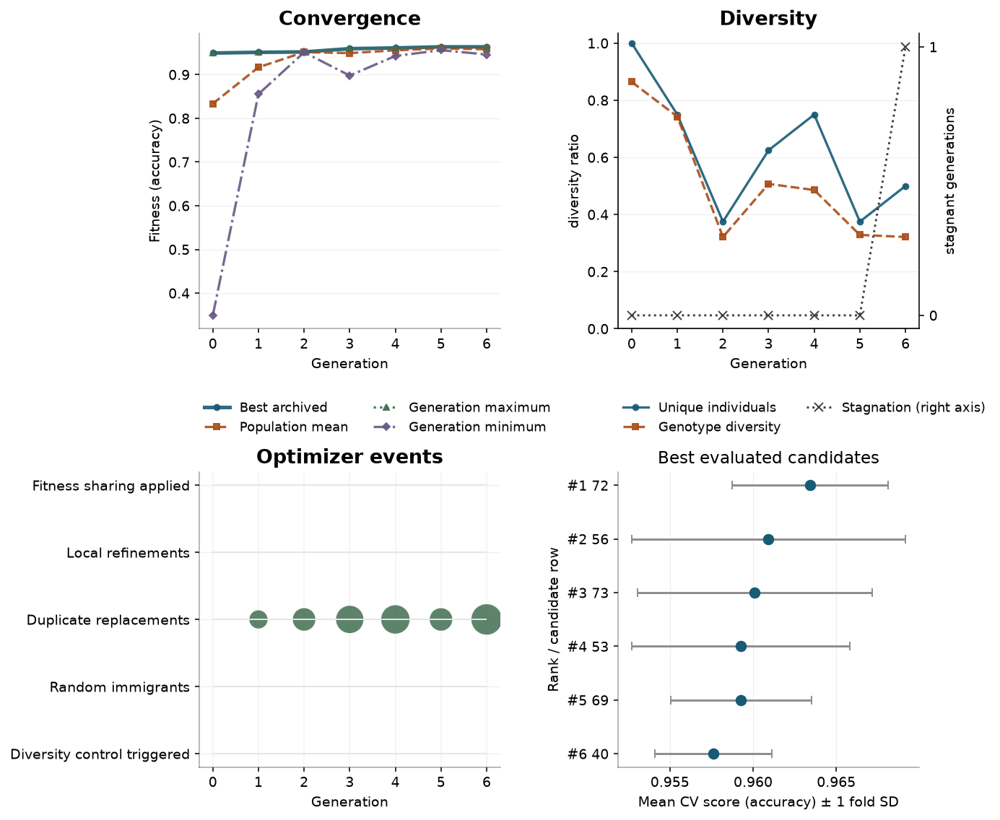

sklearn-genetic-opt
===================

|release| |tests| |license|

**Hyperparameter tuning and feature selection for scikit-learn.**
Give ``GASearchCV`` or ``GAFeatureSelectionCV`` a model, a scorer and a budget.
The search evaluates candidates with cross-validation, refits the winner and
lets you call ``predict`` on new data.
Use it when the combinations of parameters or columns would make an exhaustive
search too expensive.

`Stable documentation`_ · `Backend tutorial`_ · `Benchmarks`_ · `Plot gallery`_

Run your first search
---------------------

Install the published package on Python 3.12 or newer:

.. code-block:: bash

   python -m pip install sklearn-genetic-opt

How deep should a decision tree grow? Search integer depths and two split
criteria on the training set. Compare the winning cross-validation score with
balanced accuracy on data the search never saw.

.. code-block:: python

   from sklearn.datasets import load_breast_cancer
   from sklearn.metrics import balanced_accuracy_score
   from sklearn.model_selection import train_test_split
   from sklearn.tree import DecisionTreeClassifier
   from sklearn_genetic import GASearchCV
   from sklearn_genetic.space import Categorical, Integer

   X, y = load_breast_cancer(return_X_y=True)
   X_train, X_test, y_train, y_test = train_test_split(
       X, y, stratify=y, test_size=0.25, random_state=7
   )
   tree = DecisionTreeClassifier(random_state=7)
   settings = dict(cv=3, scoring="balanced_accuracy", population_size=8,
                   generations=3, random_state=7, n_jobs=1, verbose=False)

   search = GASearchCV(
       tree,
       param_grid={"max_depth": Integer(2, 12), "criterion": Categorical(["gini", "entropy"])},
       **settings,
   ).fit(X_train, y_train)

   print(search.best_params_, search.best_score_)
   print(balanced_accuracy_score(y_test, search.predict(X_test)))

Which columns does the tree need?
---------------------------------

Reuse the model, folds and budget with ``GAFeatureSelectionCV``. Set an upper
limit of eight columns. The fitted selector applies its mask during prediction.

.. code-block:: python

   from sklearn_genetic import GAFeatureSelectionCV

   selector = GAFeatureSelectionCV(tree, max_features=8, **settings).fit(X_train, y_train)
   print(selector.get_support(indices=True))
   print(balanced_accuracy_score(y_test, selector.predict(X_test)))

Choose an optimizer
-------------------

DEAP is included by default. Four additional engines are available as extras.
Install the extra for the engine you want. For example, to use pymoo:

.. code-block:: bash

   python -m pip install "sklearn-genetic-opt[pymoo]>=0.16.0"

Change one parameter on either estimator to run the same experiment with a
different engine. Cloning keeps the earlier result available for comparison.

.. code-block:: python

   from sklearn.base import clone

   alternative = clone(selector).set_params(optimizer_backend="pymoo")
   alternative.fit(X_train, y_train)
   print(alternative.get_support(indices=True), alternative.fit_stats_["cross_validate_calls"])

.. list-table::
   :header-rows: 1
   :widths: 20 80

   * - Backend
     - What it brings to the search
   * - ``deap``
     - Included by default. Choose genetic operators, adaptive schedules and local search.
   * - ``scipy``
     - Differential evolution for bounded spaces. It can stop early when the population converges.
   * - ``nevergrad``
     - OnePlusOne adjusts its mutations as candidates succeed or fail. TwoPointsDE is also available.
   * - ``cmaes``
     - CatCMA with Margin learns how numeric variables vary together and adapts category probabilities.
   * - ``pymoo``
     - Uses type-specific operators for mixed parameters and a binary genetic algorithm for feature masks.

Each optional engine has a pip extra with the same name. All five support
live plotting, early stopping and resuming from a completed generation.
The `engine reference`_ lists supported domains, controls and checkpoint
requirements. To integrate another optimizer, see the `plugin protocol`_.

How do they compare? The `benchmarks`_ compare the bundled optimizers at
matched counts of fresh CV calls, using separate held-out scores. No single
engine wins on every workload; choose the search space, metric and budget
before comparing engines on your own data.

Inspect a fitted search
-----------------------

Use ``cv_results_`` for individual candidates and ``history`` for progress by
generation. This example from the `digits walkthrough`_ shows how a neural
network search progressed and which candidates finished near the top.

What changed in 0.17.0
----------------------

* Cap new cross-validation calls with ``CVBudgetStopping`` and see fresh,
  reused and refit work separately in ``fit_counts_``. The `budget and resume tutorial`_
  shows how to save work across sessions.
* Keep pandas column names and dtypes in feature selection with
  ``preserve_dataframe=True``, or seed the search using
  ``PopulationConfig(warm_start_masks=...)``.
* Diagnose a run with per-fold and finalist score plots, phase timings and
  clearer errors for invalid folds, failed fits and unreadable checkpoints.

Go further
----------

* **Build a search** with the `GASearchCV`_, `GAFeatureSelectionCV`_ and `search space`_ references.
* **Track a long run** with the `checkpoint recipe`_, `plot gallery`_ and `backend tutorial`_.
* **Work on the project** with the `contributor guide`_ and `release notes`_.

Cite sklearn-genetic-opt
------------------------

If you use the library in research, cite the version used in your experiment.
For version 0.17.0, cite Rodrigo Arenas (2026), *sklearn-genetic-opt*
(version 0.17.0) [Computer software]. The `software citation`_ contains the
machine-readable metadata. For BibTeX, use:

.. code-block:: bibtex

   @software{arenas2026sklearn_genetic_opt,
     author  = {Arenas, Rodrigo},
     title   = {{sklearn-genetic-opt}},
     year    = {2026},
     version = {0.17.0},
     url     = {https://pypi.org/project/sklearn-genetic-opt/0.17.0/}
   }

.. |release| image:: https://img.shields.io/pypi/v/sklearn-genetic-opt
   :alt: Latest release on PyPI
   :target: https://pypi.org/project/sklearn-genetic-opt/
.. |tests| image:: https://github.com/rodrigo-arenas/Sklearn-genetic-opt/actions/workflows/ci-tests.yml/badge.svg?branch=master
   :alt: Continuous integration on master
   :target: https://github.com/rodrigo-arenas/Sklearn-genetic-opt/actions/workflows/ci-tests.yml
.. |license| image:: https://img.shields.io/badge/license-MIT-blue
   :alt: MIT license
   :target: https://github.com/rodrigo-arenas/Sklearn-genetic-opt/blob/master/LICENSE

.. _stable documentation: https://sklearngeneticopt.rodrigo-arenas.com/stable/
.. _backend tutorial: https://sklearngeneticopt.rodrigo-arenas.com/versions/0.16/tutorials/optimizer-backends
.. _benchmarks: https://sklearngeneticopt.rodrigo-arenas.com/versions/0.16/benchmarks/optimizer-catalog
.. _engine reference: https://sklearngeneticopt.rodrigo-arenas.com/versions/0.16/api/optimizer-backends
.. _plugin protocol: https://sklearngeneticopt.rodrigo-arenas.com/versions/0.16/api/algorithms#optimizer-plugins
.. _digits walkthrough: https://sklearngeneticopt.rodrigo-arenas.com/versions/0.16/guide/basic-usage
.. _GASearchCV: https://sklearngeneticopt.rodrigo-arenas.com/versions/0.16/api/gasearchcv
.. _GAFeatureSelectionCV: https://sklearngeneticopt.rodrigo-arenas.com/versions/0.16/api/gafeatureselectioncv
.. _search space: https://sklearngeneticopt.rodrigo-arenas.com/versions/0.16/api/space
.. _checkpoint recipe: https://sklearngeneticopt.rodrigo-arenas.com/versions/0.16/recipes/advanced/checkpointing
.. _plot gallery: https://sklearngeneticopt.rodrigo-arenas.com/versions/0.16/examples/plotting-gallery
.. _contributor guide: https://github.com/rodrigo-arenas/Sklearn-genetic-opt/blob/master/CONTRIBUTING.md
.. _release notes: https://sklearngeneticopt.rodrigo-arenas.com/versions/0.16/release-notes
.. _budget and resume tutorial: https://sklearngeneticopt.rodrigo-arenas.com/versions/latest/tutorials/budgeted-optimizer-search
.. _software citation: https://github.com/rodrigo-arenas/Sklearn-genetic-opt/blob/master/CITATION.cff
