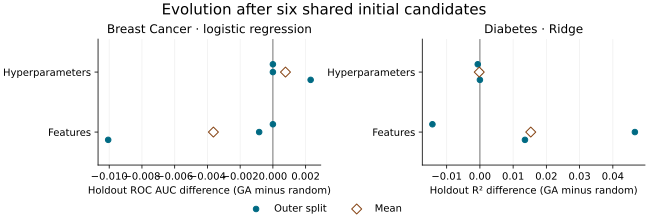
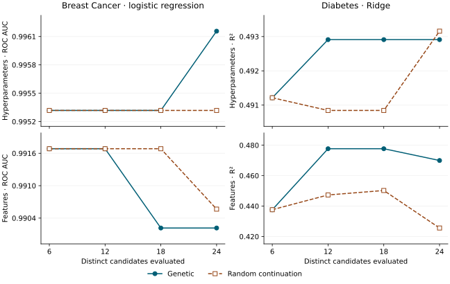

# Continued performance work

Baseline: `d6b2f3aab9cee50322934ec8c00c585e2fcbac2f`. This is an ongoing investigation of both `GASearchCV` and `GAFeatureSelectionCV`.

Timing note: HPO comparisons below through the four-family random-search transfer matrix were measured before the `return_train_score=False` fix. The constructor advertised `False` but scikit-learn's base initializer reset it to `True`, adding training-fold scoring. Their solution-quality observations remain useful; their elapsed-time ratios do not directly describe the corrected 0.14.0 code. The final paired overhead section measures the correction across model families.

## Executive evidence summary

- **Measured speed gains are conditional.** Cached finite spaces finish 7.82–9.01× faster for small HPO and 5.82–5.94× faster for small feature-mask spaces, with identical solutions. One-fold SVC evolution plus eight five-fold finalists is 4.09–4.81× faster for HPO and 3.48–3.92× faster for feature selection across six held-out splits, but synthetic HPO and all three feature-selection means lose held-out accuracy. These shortcuts are opt-in; full-fold search remains the default.
- **Short-deadline feature searches have a genuine quality repair.** Starting smart-initialized timed searches with the largest legal mask lowers mean classification error 5.45× on Dry Bean SVM at a one-second request, while total fitting time falls 3.40×. On Digits LightGBM, error falls 11.56× but total time rises 12.4%. The gain comes from evaluating a viable dense baseline before the deadline; it does not imply more compact selections or universal improvement.
- **Evolution is useful for some feature tasks, but not every task.** Against equal-budget random masks, default feature search improves mean held-out accuracy on Breast Cancer, Digits and synthetic SVC classification. A separate tree/KNN/forest control also favors it on three classifier tasks, whereas Diabetes/Ridge regression loses 59.31 negative-MSE points on average. A further imbalanced/sparse/linear/nonlinear transfer matrix has two task means in each direction.
- **Do not prefer smaller masks merely because their CV scores are close.** A separate 20-fit transfer pilot selected the smallest mask within one standard error of the CV winner. It lost held-out score on all five Diabetes/Ridge splits and two Wine splits, so this rule was rejected rather than tuned into the default.
- **A more local feature mutation is not a general default improvement either.** In 60 new searches across the same four model families, flipping exactly one bit at either a 0.1 or 0.8 individual mutation rate produced mixed classification results and worse mean Ridge regression holdout than the current method. It was not promoted.
- **HPO quality remains an open gap.** Default `GASearchCV` improves its best CV score after initialization in 23 of 24 runs, yet a same-budget random SVC search matches or exceeds its mean held-out accuracy on all three datasets and completes the sequentially timed cohorts faster. CV progress alone is not evidence of improved generalization.
- **HPO does transfer to other model families, but efficiency varies.** A new four-task control against `RandomizedSearchCV` has higher GA mean held-out score for Digits/KNN, Diabetes/ElasticNet and synthetic/random forest, but lower for Wine/tree. After removing redundant train-fold scoring, the GA/random time ratio is .81× on KNN, .93× on forest, 1.05× on ElasticNet and 1.44× on tree. The gains are small or split-dependent; no HPO search policy was retuned to this matrix.
- **A corrected-default Optuna TPE control is similarly mixed.** On three new splits of each of the same four model families, GA and Optuna tie all Wine/tree and Digits/KNN holdouts; GA loses mean Diabetes/ElasticNet negative MSE by 3.05 points and wins synthetic-forest accuracy by .00667. GA/Optuna mean time ratios range from .68× to 1.13×. This small matrix supports task-dependent parity, not a general SOTA claim.
- **Penalizing HPO fold variance is not a general repair.** A post-hoc one-standard-error lower-confidence-bound rule left Wine/tree and Digits/KNN winners unchanged but reduced mean held-out scores on Diabetes/ElasticNet and synthetic/random forest. The rule was rejected without changing the API.
- **Native AutoML parity is workload-specific.** On three Dry Bean splits, reduced-training SVM HPO averages .930649 accuracy in 12.096 seconds versus AutoGluon .928886 in 13.168 seconds and FLAML .926437 in 15.524 seconds under the recorded CPU configuration. On other tasks, AutoGluon or Optuna remains faster or more accurate. TPOT and H2O have not been measured here.

The linked sections below preserve dataset definitions, limits, per-seed measurements, source hashes and reproduction scripts. Solution-quality comparisons use held-out partitions, but the small, overlapping split cohorts do not establish statistical superiority or performance on arbitrary datasets.

For changes to the default search policy, the transfer check here uses new outer-split seeds, equal candidate/CV budgets and multiple estimator families, including regression. A gain confined to the motivating SVC tasks is treated as an experiment, not a default improvement. The library keeps workload-dependent acceleration and alternative evolutionary strategies opt-in where held-out quality is mixed. This protocol reduces benchmark-specific tuning; it cannot guarantee the best optimizer for every dataset.

## Profile

A cProfile run of the existing paired benchmark (four HPO tasks and one feature task, one seed) attributed 9.27 of 9.36 seconds in the evolutionary loop to candidate evaluation, including 8.75 seconds in scikit-learn cross-validation. Profile overhead affects absolute times. Most end-to-end gains therefore need fewer expensive evaluations at comparable quality, rather than only faster Python evolution operators.

## Fitness-sharing execution

The optional sharing operation now vectorizes distances one population row at a time and uses O(population × dimensions) auxiliary memory rather than constructing a three-dimensional pairwise tensor. Its O(population² × dimensions) arithmetic is unchanged. Ordered contribution accumulation preserves selection ties. Numeric subtraction retains Python integer precision, including integer-valued continuous dimensions; categorical equality retains its original semantics.

Median of three isolated calls, with the original pairwise implementation as reference:

| Population | Binary features (100 dimensions) | Mixed HPO (3 dimensions) |
|---:|---:|---:|
| 50 | 9.24× | 7.90× |
| 150 | 14.44× | 10.04× |
| 300 | 13.51× | 14.76× |

Four complete seeded searches with sharing enabled produced the same best CV scores and evaluation counts. Complete-fit speed ratios ranged from **1.04× to 1.26×** in the final timing pass: these results do not demonstrate a general 4× training speedup. Timings use fixed before/after order on a shared Windows machine; they are descriptive, not significance estimates. Sharing is disabled by default, so this change does not accelerate the default evaluation path.

Reproduce in PowerShell:

```powershell
.venv\Scripts\python.exe benchmarks\benchmark_sharing.py
```

The benchmark includes reference equality checks, feature/HPO complete fits, two fit seeds, one native thread, and the raw per-case timings. It does not measure holdout quality because the operation is intended to preserve the existing search behavior, not introduce a new selection policy.

Verification: 102 focused algorithm/helper tests pass; `test_guard` is clean. New equality regressions were observed failing before their repairs; an unordered-accumulation mutant fails the selection regression. Independent review closed all material findings. Full suite not run. [Raw results](results/performance-v2/sharing.json), [verification evidence](results/performance-v2/sharing-verification.txt).

## Sequential local refinement

Previously, all `local_search_steps` neighbors were generated from the same initial elite. Each step now uses the updated elite archive: an improvement can lead to another improvement. The maximum candidate count is unchanged, and separate elite neighbors are still evaluated as a batch within each step. This applies to both searches and all three existing algorithms. Local search remains opt-in; one-step behavior is unchanged. Steps are dependent, so they are sequential rather than parallelized together; independent elites within a step retain parallel evaluation.

Twenty-four controlled algorithm cases (numeric/features, minimization/maximization, one/two elites, three algorithms) distinguish chained progress from one-shot sampling; all fail with the previous function. The focused algorithm/helper suite passes 126 tests. Real fits on Wine confirm identical serial/two-worker scores and chosen solutions, valid feature bounds, candidate limits, and final best-score telemetry. These are behavior checks, not claims of general holdout improvement or a 4× speedup. [Verification](results/performance-v2/refinement-verification.txt).

## Optional differential evolution

Both searches now accept `algorithm="eaDifferentialEvolution"`: deferred rand/1/bin, scale 0.8, one trial per parent, and greedy weighted replacement. Numeric differences use the declared linear/logarithmic domain; integers, categories and binary feature masks retain their domain constraints. Population size must be at least four. The standard mutation operator, cache, parallel evaluator, callbacks and optional local refinement are reused. Selection-specific tournament/sharing controls do not apply. The default algorithm is unchanged.

The new option is **not a general quality or speed improvement**. It is retained as an alternative evolutionary strategy; measured regressions below rule out replacing the default based on this experiment.

HPO validation used 240 searches: Iris, Wine, Breast Cancer and Diabetes × tree/SVM/KNN × five seeds (301–305) × default GA, differential evolution, Optuna TPE and FLAML CFO. Each run has a maximum of 40 candidate CV evaluations, identical folds, spaces and train/test split, and includes final refit in elapsed time. Logit-labelled Bayesmark dimensions use the same natural-range uniform distribution for all methods. Seeds 301–305 were declared after exploratory runs on 0–2 and before this validation. These are fixed-model HPO comparisons, not comparisons of full AutoML pipelines.

| Dataset/model | GA CV | DE CV | GA test | DE test | GA/DE time |
|---|---:|---:|---:|---:|---:|
| iris/dt | 0.9180 | 0.9319 | 0.9368 | 0.8947 | 1.03× |
| iris/svm | 0.9696 | 0.9697 | 0.9684 | 0.9579 | 1.07× |
| iris/knn | 0.9661 | 0.9643 | 0.9421 | 0.9368 | 1.18× |
| wine/dt | 0.8121 | 0.8180 | 0.7822 | 0.8133 | 1.01× |
| wine/svm | 0.9851 | 0.9851 | 0.9778 | 0.9778 | 1.05× |
| wine/knn | 0.9745 | 0.9760 | 0.9422 | 0.9333 | 1.36× |
| breast/dt | 0.9085 | 0.9075 | 0.9063 | 0.9035 | 1.03× |
| breast/svm | 0.9746 | 0.9742 | 0.9748 | 0.9734 | 1.06× |
| breast/knn | 0.9653 | 0.9667 | 0.9650 | 0.9650 | 1.15× |
| diabetes/dt | -4047.6632 | -4051.8790 | -4065.6570 | -4041.7889 | 1.00× |
| diabetes/svm | -3099.1697 | -3101.1773 | -3077.7374 | -3070.4122 | 0.99× |
| diabetes/knn | -3365.9392 | -3339.7368 | -3294.2080 | -3338.2356 | 1.12× |

Classification values are accuracy; Diabetes values are negative MSE (higher is better). Each cell averages five seeds. A ratio above 1 means DE was faster. Methods run in fixed order on a shared Windows machine; small timing differences should not be treated as robust speedups.

| Method | Mean classification CV | Mean classification test | Mean seconds/run |
|---|---:|---:|---:|
| differential | 0.9437 | 0.9284 | 0.925 |
| flaml | 0.9274 | 0.9216 | 0.639 |
| gasearch | 0.9415 | 0.9329 | 1.041 |
| optuna | 0.9510 | 0.9402 | 0.654 |

The classification aggregate contains 45 runs per method. It does not imply statistical significance or superiority on unseen tasks; the full per-seed data also records regression results. Optuna/FLAML remain stronger on several scenarios. TPOT, H2O and AutoGluon have not been run in this comparison.

Feature selection used 60 additional searches: 20/60/120 synthetic variables × tree/logistic regression × five new dataset/split seeds × two algorithms. Both methods propose 72 candidates (GA: 8 initial + 4 × 16; DE: 8 initial + 8 × 8), use three CV folds, and select between one and half the available features.

| Variables/model | GA CV | DE CV | GA test | DE test | GA/DE time |
|---|---:|---:|---:|---:|---:|
| 20/dt | 0.8400 | 0.8320 | 0.8220 | 0.8220 | 1.04× |
| 20/logistic | 0.8500 | 0.8493 | 0.8340 | 0.8420 | 1.03× |
| 60/dt | 0.8220 | 0.8187 | 0.7780 | 0.7620 | 1.00× |
| 60/logistic | 0.8573 | 0.8460 | 0.8160 | 0.7740 | 0.96× |
| 120/dt | 0.7927 | 0.7813 | 0.7780 | 0.7760 | 0.99× |
| 120/logistic | 0.7960 | 0.7960 | 0.8140 | 0.8440 | 0.95× |

The high-dimensional exploratory gains did not consistently repeat. For example, 120-variable logistic test accuracy improved by 3 percentage points, while 60-variable logistic test accuracy fell by 4.2 points. Overall these measurements do not meet the requested general 4× objective. No holdout-based choice of winner is made by the library.

Reproduce in PowerShell:

```powershell
.venv\Scripts\python.exe benchmarks\benchmark_evolution.py --output hpo.json --datasets iris wine breast diabetes --models dt svm knn --seeds 5 --seed-start 301 --budget 40 --methods gasearch differential optuna flaml
.venv\Scripts\python.exe benchmarks\benchmark_features.py --output features.json
```

Verification: 136 focused algorithm/helper tests and eight public search/validation tests pass. Separate real fits verify identical serial/two-worker solutions, six local refinement candidates, checkpoint cache reuse, and fitted save/load for both search classes. Missing algorithm behavior was recorded red before implementation; NaN callback recovery was recorded red before repair. Independent review rejected tie/category/NaN mutants and closed all material findings. `test_guard` and Black on tracked Python plus the new benchmark pass. Repository-root Black also scans ignored experiment scripts and reports formatting there; no tracked source failed. Full suite not run.

[HPO data](results/performance-v2/differential-hpo.json), [feature data](results/performance-v2/differential-features.json), [verification](results/performance-v2/differential-verification.txt).

## Complete finite-space coverage

Baseline: `f49c19ad1118bc415aade86dc6ff9eccb5128f03`. Cached search now stops after all possible configurations have been observed in the current run and preserved through the best-solution archive. This applies to both search classes and every evolutionary algorithm. Unknown/custom or non-fixed continuous dimensions, uncached runs, and runs without an archive keep the generation budget. Old cache contents alone never prove current coverage. Feature counts include every nonempty mask up to `max_features`.

Paired benchmark: 18 baseline/current pairs, three seeds per workload, 20 individuals, at most 40 generations, identical three-fold splits, one worker/native thread, final refit included. All pairs have exactly equal CV score, held-out score, predictions, selected configuration/mask, and CV evaluation counts.

| Workload | Baseline seconds (mean) | Current seconds (mean) | Paired speedup range | Current history records |
|---|---:|---:|---:|---|
| hpo-small | 0.636 | 0.076 | 7.82–9.01× | 1, 1, 1 |
| hpo-medium | 1.057 | 0.456 | 2.17–2.40× | 5, 4, 6 |
| hpo-continuous | 13.954 | 13.303 | 1.03–1.06× | 41, 41, 41 |
| features-small | 0.375 | 0.064 | 5.82–5.94× | 1, 1, 1 |
| features-medium | 0.870 | 0.652 | 1.23–1.43× | 11, 21, 11 |
| features-wide | 10.491 | 10.109 | 1.01–1.08× | 41, 41, 41 |

Baseline history has 41 records for every run (generation zero included). Small HPO and feature spaces exceed 4× with identical solutions; medium spaces improve less. Continuous and large-feature controls do not exhaust, so their small timing changes should be treated as noise. Runs use a fixed baseline-then-current order on a shared machine; these are workload-specific measurements, not a general 4× or SOTA claim.

Reproduce with `benchmarks/benchmark_exhaustion.py --output current.json`; export the baseline package with `git archive` and add `--source-root <export-directory>` for the baseline run.

[Baseline data](results/performance-v2/exhaustion-baseline.json), [current data](results/performance-v2/exhaustion-current.json), [verification](results/performance-v2/exhaustion-verification.txt).

## Feature masks compared with TPE and CFO

This comparison uses Optuna TPE and FLAML CFO as optimizers of a binary feature mask, not their complete AutoML workflows. All four methods use the same model, training/holdout split, three CV folds, 72 proposed candidates, one native thread, duplicate-score caching and timed final refit. Empty masks are infeasible; the GA repairs them and external optimizers receive negative infinity without a fit. No empty proposals occurred in the recorded runs. There is no feature-count cap, unlike the previous half-feature benchmark.

Data: synthetic classification with 400 samples, eight informative and four redundant variables, widths 20/60/120, seeds 501–503, depth-five decision tree and scaled logistic regression. All 72 runs completed. The holdout is used only for reporting.

| Method | Mean CV accuracy | Mean holdout accuracy | Mean seconds | Mean selected features |
|---|---:|---:|---:|---:|
| genetic | 0.7469 | 0.7178 | 1.1659 | 31.7222 |
| differential | 0.7496 | 0.7283 | 1.0845 | 31.7222 |
| optuna | 0.7648 | 0.7267 | 1.9438 | 35.1111 |
| flaml | 0.7448 | 0.7122 | 1.2497 | 32.4444 |

Means above cover 18 runs per method. Per-workload mean held-out accuracy follows; all timing and CV details remain in the raw results.

| Width/model | GA | Differential | TPE | CFO |
|---|---:|---:|---:|---:|
| 20/dt | 0.7033 | 0.7533 | 0.7367 | 0.7133 |
| 20/logistic | 0.7633 | 0.7767 | 0.7767 | 0.7700 |
| 60/dt | 0.7300 | 0.7067 | 0.7267 | 0.7200 |
| 60/logistic | 0.7367 | 0.7333 | 0.7000 | 0.7167 |
| 120/dt | 0.6667 | 0.7133 | 0.7033 | 0.6633 |
| 120/logistic | 0.7067 | 0.6867 | 0.7167 | 0.6900 |

Differential evolution takes about 1.79× less time than TPE on the aggregate mean, with similar average held-out accuracy; TPE has the better average CV score. This small synthetic suite does not establish statistical superiority or equivalence to native TPOT/H2O/AutoGluon feature handling. Method order is fixed and machine load is shared, so timing is descriptive.

The original bounded benchmark remains reproducible: all twelve seed-301 rows match the prior committed data exactly for CV/holdout scores, masks counts and evaluation counts. Regression tests exercise empty masks, duplicates, selection of an earlier CV winner, final refit, and CLI domain restrictions.

```powershell
.venv\Scripts\python.exe benchmarks\benchmark_features.py --output feature-optimizers.json --seed-start 501 --seeds 3 --methods genetic differential optuna flaml --unconstrained
```

[Raw data](results/performance-v2/feature-optimizers.json), [verification](results/performance-v2/feature-optimizers-verification.txt).

Additional exploratory ideas were rejected: partial default seeding and boundary seeding worsened several HPO tasks; heavy-tailed feature mutation did not retain its exploratory gains on five new seeds. These experiments did not change library behavior.

## Independent categorical population coverage

Baseline: `8171f981dfa233df67f2d6577919c7bc8a5bc310`. Smart HPO initialization now independently shuffles each categorical dimension. Uniform dimensions sample the entire choice domain when the population is smaller than the domain; larger batches retain balanced category counts. Weighted dimensions retain prior-based strata, including exclusion of zero-prior choices. Warm starts and valid estimator defaults keep their existing priority. Numeric-only and feature-mask initialization are unchanged.

Previously, categorical columns shared one repeating index, so unrelated genes started in correlated combinations; small populations only visited the category prefix. Public regression cases now find a deliberately crossed category optimum and demonstrate coverage of all 20 choices across fixed seeds. These are coverage guarantees, not a claim that every task improves.

The paired baseline/current GA comparison covers Iris, Wine, Breast Cancer and Digits, decision trees/SVC/KNN, seeds 601–603 and a budget of 40 candidate evaluations. The new categorical profile uses identical domains, folds, splits and budgets for GA, Optuna TPE and FLAML CFO. Every method refits the CV winner before held-out reporting. All 144 fits completed (36 baseline plus 108 current/comparator fits).

| Method | Mean CV accuracy | Mean holdout accuracy | Mean seconds |
|---|---:|---:|---:|
| GA baseline | 0.95003 | 0.95821 | 1.92407 |
| GA current | 0.95287 | 0.95466 | 1.85349 |
| Optuna TPE | 0.95450 | 0.95595 | 1.14361 |
| FLAML CFO | 0.95135 | 0.95554 | 0.93759 |

GA improves mean CV accuracy by 0.00284, while held-out accuracy decreases by 0.00355. Wine/tree contributes the largest change: CV +0.01751 and holdout −0.03704. This prevents interpreting improved training-fold exploration as a generalization win. Current GA remains slower than TPE/CFO on this suite; its approximately 1.04× baseline timing ratio is small and potentially noise. Fixed execution order and shared machine load limit timing conclusions. No general 4× or SOTA claim follows.

The comparison harness converts FLAML NumPy scalar parameters into native Python values both during evaluation and final refit: Digits/KNN otherwise raises a real Cython type error for a NumPy string metric. A targeted regression demonstrates that failure and protects both conversion points.

```powershell
.venv\Scripts\python.exe benchmarks\benchmark_evolution.py --output categories-current.json --datasets iris wine breast digits --models dt svm knn --seeds 3 --seed-start 601 --budget 40 --methods gasearch optuna flaml --categorical
```

For the baseline, export the commit above, pass its directory with `--source-root`, and select only `--methods gasearch`. Four public initializer cases and 20 benchmark tests pass; independent review killed biased-subset, weighted-correlation, ignored-profile and missing-refit-normalization mutants. Scoped Black, test guard and diff checks pass. Full suite not run.

[Baseline data](results/performance-v2/categories-baseline.json), [current/comparator data](results/performance-v2/categories-current.json), [verification](results/performance-v2/categories-verification.txt).

## Stop impossible uniqueness retries during initialization

Baseline: `7c072d2331f54246e4cdd8e1dd3d52b44c42cf88`. Both smart initializers now reuse the bounded finite-domain count to stop retrying uniqueness after observing every possible configuration. They still fill the requested population size. Incomplete, unknown, continuous and uncached spaces retain the existing attempt bound. No new library option is introduced.

Twelve paired fits isolate initialization (zero generations, three seeds per workload/population size). All pairs have exactly identical CV/holdout scores, predictions, selected configuration/mask and CV evaluation counts. Three-fold CV and final refit are timed.

| Workload | Population | Baseline mean seconds | Current mean seconds | Paired speedup range |
|---|---:|---:|---:|---:|
| HPO, 6 configurations | 20 | 0.0848 | 0.0591 | 1.38–1.53× |
| HPO, 6 configurations | 100 | 0.1897 | 0.0930 | 1.95–2.13× |
| Features, 10 masks | 20 | 0.0679 | 0.0680 | 0.93–1.07× |
| Features, 10 masks | 100 | 0.0822 | 0.0790 | 0.99–1.08× |

HPO benefits because the discarded draws repeatedly call parameter distributions. Feature draws are cheap: their removal reduces work but shows no convincing total-fit timing gain here. These small, fixed-order runs are descriptive and do not support a general speedup. Six additional paired controls (continuous HPO and 20-feature selection, two generations) preserve scores, predictions, configurations, generation counts and CV counts exactly. Mean control time rises from 0.8665 to 0.9035 seconds for HPO and from 0.6606 to 0.7725 seconds for features. These controls show no speed gain; the small shared-machine sample cannot distinguish timing noise from overhead.

```powershell
.venv\Scripts\python.exe benchmarks\benchmark_exhaustion.py --output saturation.json --population-size 100 --generations 0 --cases hpo-small features-small
```

Repeat with population 20; export the baseline package and use `--source-root` for paired runs. Controls use `--population-size 20 --generations 2 --cases hpo-continuous features-wide`. Four public fit regressions fail without the optimization and pass with it. Two further cases detect premature stopping before all six configurations/masks are sampled. The focused initializer/finite-space consumer set passes 48 tests; four additional public-fit cases preserve retries for uncached HPO/features and unknown custom/continuous dimensions, and reject the premature-stop mutant. Full suite not run.

[20-individual baseline](results/performance-v2/saturation-baseline-20.json), [current](results/performance-v2/saturation-current-20.json); [100-individual baseline](results/performance-v2/saturation-baseline-100.json), [current](results/performance-v2/saturation-current-100.json); [control baseline](results/performance-v2/saturation-baseline-controls.json), [current](results/performance-v2/saturation-current-controls.json); [verification](results/performance-v2/saturation-verification.txt).

## Isolate final refit and preserve cloned-search reproducibility

Both searches now fit a cloned winner, preserving the supplied estimator's parameters and fitted state. The `estimator` attribute is the constructor template; callers that previously used it for prediction must use `best_estimator_`, `estimator_`, or the search's prediction methods. This compatibility change follows the existing documented fitted-winner interface and is recorded in the changelog. Estimator-valued hyperparameters are cloned too, preventing a winning pipeline component from being fitted in place.

A public-fit regression also exposed numeric sampling drift after `clone(search)`: copying a dimension copied its bound SciPy distribution's internal random state. Unseeded numeric draws now explicitly use the global RNG, so the search's seed controls the cloned search as intended. Explicit dimension generators keep their independent streams. The test compares candidate parameters and scores after cloning a fitted search; checking only the final winner would miss this drift.

Evidence includes original red ownership cases, red Integer/Continuous sampling mutants, a red nested-estimator mutation case, and negative prediction-method cases. The fitted paths exercise prediction, probabilities, decision function, score, feature transform, history and save/load. This is an API/reproducibility improvement, with no claimed training speedup. Verification includes 77 focused space/seed cases, 14 final ownership/prediction-guard cases and six checkpoint-resume cases. One pre-existing checkpoint test exhausted its three-value space before advancing any schedules; its space now exceeds the per-run proposal budget, preserving every adapter assertion. Full suite not run.

[Verification](results/performance-v2/refit-isolation-verification.txt).

A further exploratory current-to-pbest differential variant was rejected after 108 paired development fits: gains on some narrow feature tasks did not extend to wider masks or HPO regression, and there was no general timing gain. It is not part of the library.

## Native CPU AutoML comparison

The native comparison uses a shared 25% outer holdout, seeds 901–903, Breast Cancer, Digits, Diabetes and a fixed synthetic classification dataset (2,000 samples, 80 columns). Each method receives a requested 15-second budget and one CPU thread. Reported time is actual fitting time including final refitting, so generation-level stopping and native soft-limit overruns remain visible. Prediction time and optional-package imports are excluded. Classification uses holdout accuracy; regression uses negative mean squared error and is reported separately.

GASearchCV tunes five LightGBM hyperparameters with a population of eight and three-fold CV. GAFeatureSelectionCV selects a nonempty feature mask for fixed-parameter LightGBM with the same population and CV. Both use their default evolutionary algorithm. FLAML AutoML searches LightGBM, random forest and extra trees with native three-fold CV. AutoGluon trains those three CPU families, three bag folds and its weighted ensemble, with stacking disabled and sequential fitting. Native workflows receive a 1 GB memory setting; the genetic searches do not expose an equivalent cap. AutoGluon model persistence is included in its fitting time.

This is a comparison of complete configured workflows: the native validation procedures, model choices and ensembles differ from the genetic searches. It does not isolate optimizer quality, and this restricted CPU configuration does not represent every AutoGluon preset or establish overall SOTA. No TPOT or H2O measurement is included. Fixed method order, three splits and shared-machine load limit timing and generalization conclusions. The isolated environment records AutoGluon 1.6.3, FLAML 2.7.0, LightGBM 4.7.0 and the numerical dependency versions in the JSON artifact. See the [AutoGluon fit API](https://auto.gluon.ai/stable/api/autogluon.tabular.TabularPredictor.fit.html) for the native configuration semantics.

An earlier ExtraTrees surrogate-screening experiment was rejected after 108 development fits: fitting the surrogate and replacing cached proposals increased cost, while held-out gains were inconsistent across HPO and feature tasks. No surrogate is added to the library.

All 48 runs completed. Cells below show mean holdout score / mean actual seconds across three seeds. Higher scores are better, including negative MSE.

| Dataset / metric | GASearchCV | GAFeatureSelectionCV | FLAML AutoML | AutoGluon |
|---|---:|---:|---:|---:|
| breast / accuracy | 0.96737 / 15.77 | 0.95804 / 15.59 | 0.96037 / 15.00 | 0.96737 / 2.27 |
| digits / accuracy | 0.97185 / 23.45 | 0.96741 / 28.92 | 0.97852 / 15.26 | 0.97556 / 6.74 |
| diabetes / negative MSE | -2820.31296 / 15.34 | -3708.33279 / 15.30 | -2969.95390 / 15.01 | -2796.32627 / 1.58 |
| synthetic / accuracy | 0.89667 / 27.52 | 0.89467 / 17.64 | 0.87667 / 15.26 | 0.89000 / 8.78 |

GASearchCV matches AutoGluon's mean accuracy on Breast Cancer but takes about 6.94 times as long. On Digits it trails both native workflows; its generation boundary overshoots the requested budget. On the synthetic problem it exceeds FLAML's accuracy by 0.02000, but takes about 1.80 times as long. AutoGluon remains faster across all four tasks with broadly competitive quality in this configuration. These results do not establish parity with native AutoML.

Feature selection retains 11/21/16 of 30 columns on Breast Cancer, 58/49/64 of 64 on Digits, 6/7/2 of 10 on Diabetes, and 80/68/72 of 80 on the synthetic problem. Diabetes is a clear weakness: its mean MSE is 3708.33 versus 2820.31 for HPO, despite selecting fewer features. Because the two workflows also use different model parameters, that difference cannot be attributed solely to the evolutionary operators. No empty masks occurred. The longest measured fit was 31.53 seconds against a requested 15 seconds; reducing generation-level overshoot and model-evaluation cost remains necessary.

Reproduce with an isolated Python environment containing the recorded package versions and this repository:

```powershell
.agent-runs\performance-v2\automl-env\Scripts\python.exe benchmarks\benchmark_native_automl.py --output native-automl.json --model-dir native-models --label replication --seeds 3 --seed-start 901 --seconds 15
```

The harness writes results atomically after each completed run. Verification includes four smoke runs, 16 pilot runs, the 48-run matrix, 25 original benchmark tests and six final CLI boundary tests. The additional legal-boundary test rejects an over-restrictive seed-count mutant. Independent review found no remaining material issue; scoped Black, test guard and diff checks pass. Full suite not run.

[Raw results](results/performance-v2/native-automl.json), [verification](results/performance-v2/native-automl-verification.txt).

## Reduced-training evolution with full-training finalist selection

`subsample_cv` builds explicit CV splits with fewer training rows and unchanged validation rows. Both public searches can then re-evaluate distinct finalists on the original, full-training folds before choosing and refitting the winner. `GAFeatureSelectionCV` now shares the existing HPO final-selection engine, including grouped configuration, cloning, sample metadata and checkpoint support. Equal final feature scores prefer fewer columns. Search history and `cv_results_` remain proxy results; full-fold scores are recorded separately. This workflow is opt-in and adds no dependency.

The paired benchmark compares ordinary full-training search with training fractions 0.25 and 0.125. It uses population eight, four generations, three CV folds and four unique promoted finalists, with one CPU thread. Every fit has the same seeded 25% outer holdout, which never participates in search or finalist selection. Timing includes split preparation, search construction, evolutionary CV, full-training finalist CV and the final refit; imports and holdout prediction are excluded. Training subsampling uses independent seeded state and preserves all validation indices. Classification uses accuracy; Diabetes uses negative MSE, where higher is better.

SVM uses a fitted-within-fold `StandardScaler` pipeline: HPO searches logarithmic C/gamma, while feature selection uses fixed C=1 for classification and C=100 for regression. Random forest uses 80 trees: HPO searches depth, minimum leaf size and maximum feature fraction; feature selection uses fixed model parameters. The synthetic problem has 2,000 rows and 40 columns, including ten informative and eight redundant columns, with fixed dataset seed 113. SVM covers this problem plus Breast Cancer, Digits and Diabetes with seeds 1201–1205; random forest covers synthetic classification and Diabetes with seeds 1201–1203. These are configured workflow comparisons, not native AutoML comparisons or evidence of a universal optimizer improvement.

The fixed method order and shared Windows machine limit timing precision. Small focused checks occasionally ran alongside the measurements; no second heavy training workload ran concurrently. Lower-fidelity rankings can discard candidates that would have performed well with full training, and finalist promotion cannot recover them. The library therefore does not enable subsampling automatically or select its fraction using the outer holdout.

The RF process used the repaired one-sided sampler and started before a final lifecycle correction that clears three conditional result attributes on feature-fit entry. Every benchmark search is a new instance, so those attributes were absent and the cleanup would do nothing. Independent review confirmed this distinction does not require repeating RF. The final SVM replay uses the lifecycle correction too; [source hashes](results/performance-v2/fidelity-source-sha256.json) preserve both measured implementations.

Random-forest results: mean held-out score / total fitting seconds across three seeds.

| Dataset / search | Full training | 25% training + finalists | 12.5% training + finalists |
|---|---:|---:|---:|
| synthetic / hpo | 0.89800 / 102.04 | 0.90933 / 33.55 | 0.90667 / 28.27 |
| synthetic / features | 0.91400 / 44.12 | 0.90200 / 25.34 | 0.90067 / 22.79 |
| diabetes / hpo | -3008.37951 / 16.48 | -3051.39933 / 15.44 | -3186.97729 / 15.46 |
| diabetes / features | -3204.83070 / 18.09 | -3343.80777 / 14.91 | -3311.78857 / 14.22 |

On synthetic classification, RF HPO is 3.04x faster with a quarter of training rows and 3.61x faster with an eighth; held-out accuracy improves by 0.01133 and 0.00867 respectively. Feature selection is only 1.74x/1.94x faster and loses 0.01200/0.01333 accuracy. On Diabetes, HPO gains only about 1.07x and feature selection 1.21x/1.27x, while every reduced-training mean has worse held-out MSE. These RF results do not establish a 4x improvement and do not justify automatically subsampling every search.

[RF raw results](results/performance-v2/fidelity-rf.json).

SVM results: mean held-out score / total fitting seconds across five seeds.

| Dataset / search | Full training | 25% training + finalists | 12.5% training + finalists |
|---|---:|---:|---:|
| synthetic / hpo | 0.92520 / 26.15 | 0.92360 / 4.69 | 0.92480 / 2.86 |
| synthetic / features | 0.92040 / 9.93 | 0.92200 / 3.22 | 0.91920 / 2.22 |
| breast / hpo | 0.97063 / 2.29 | 0.96923 / 1.21 | 0.96923 / 1.09 |
| breast / features | 0.96783 / 1.09 | 0.97483 / 0.86 | 0.96084 / 0.82 |
| digits / hpo | 0.98133 / 26.23 | 0.98044 / 4.76 | 0.98044 / 2.81 |
| digits / features | 0.97867 / 10.23 | 0.98311 / 3.84 | 0.98267 / 2.61 |
| diabetes / hpo | -2809.24243 / 2.17 | -2783.42300 / 0.94 | -2834.50426 / 0.85 |
| diabetes / features | -3369.60862 / 1.33 | -3409.49632 / 0.73 | -3324.93156 / 0.65 |

SVM HPO reaches 9.16x speedup on synthetic classification and 9.35x on Digits at one-eighth training size, with held-out accuracy differences of -0.00040 and -0.00089. At a quarter, the speedups are 5.57x and 5.51x. Feature selection reaches 4.47x on synthetic classification with a -0.00120 accuracy difference and 3.92x on Digits with a +0.00400 difference. These are measured, workload-specific gains; they do not prove quality equivalence or a universal 4x improvement.

On Breast Cancer, quarter-training feature selection improves mean held-out accuracy by 0.00699 but is only 1.26x faster; using an eighth loses 0.00699 instead. Diabetes is mixed: quarter-training HPO lowers held-out MSE from 2809.24 to 2783.42 at 2.31x speed, while quarter-training feature selection increases MSE from 3369.61 to 3409.50. All 156 final fits completed; every feature-selection result retained at least one column. The raw rows include every seed, selected configuration/mask, number of search and finalist CV calls, fold sizes and dependency versions. No fraction is chosen automatically from these holdout scores.

Reproduce the final matrices with the public API:

```powershell
.venv\Scripts\python.exe benchmarks\benchmark_fidelity.py --output fidelity-svm.json --models svm --seeds 5 --seed-start 1201 --label final-sampler
.venv\Scripts\python.exe benchmarks\benchmark_fidelity.py --output fidelity-rf.json --models rf --datasets synthetic diabetes --seeds 3 --seed-start 1201
```

Verification includes recorded red finalist/NaN/budget, grouped-clone, checkpoint, sampling-boundary and repeated-fit regressions; 34 final focused cases; 57 adjacent HPO/feature/configuration/metadata/checkpoint cases; four initial smoke fits; both documented example fits; and result-integrity validation of all 156 final fits. Removing sampling uniqueness, class preservation or conditional-result cleanup is caught by the corresponding tests. Independent implementation review closed all material findings. Full suite not run.

[Final SVM data](results/performance-v2/fidelity-svm.json), [RF data](results/performance-v2/fidelity-rf.json), [verification](results/performance-v2/fidelity-verification.txt).

## Accelerated workflows versus native CPU AutoML on fresh splits

The follow-up uses the native benchmark dataset loader: Breast Cancer, Digits, Diabetes and a synthetic classification problem with 2,000 rows, 80 columns, 12 informative and eight redundant columns. The synthetic problem therefore differs from the 40-column fidelity experiment above. Five fresh seeds (1301-1305) define the same 25% outer holdout for every workflow. No holdout row enters evolutionary CV, finalist selection or refit.

This matrix contains 160 fits: full-, quarter- and eighth-training SVM workflows for both public searches, plus native FLAML and AutoGluon. Evolution uses population eight, at most four generations and a requested 15-second soft limit, then up to four distinct full-training finalists when subsampling is enabled. The full-training workflow can hit the timer before completing four generations, while a faster workflow can evaluate more candidates. These speedups consequently compare configured workflows under the same upper bounds, not identical candidate sequences. The native methods keep their preceding three-family, three-fold CPU settings; their validation and ensembles differ from the evolutionary pipelines.

Actual fitting time includes model construction, subsampling, evolutionary evaluations, full-training promotion and refit. The timer applies to evolution and is checked after generations; it does not cap finalist promotion or refit. Imports and outer prediction are excluded. The four profiles ran in fixed order: full, quarter, eighth, native. One heavy process ran at a time on the shared Windows machine; small diagnostic probes also ran, so subsecond timing differences should not be overinterpreted. Neither fraction nor model family is selected automatically using these holdout outcomes.

Mean held-out score / total fitting seconds across five seeds (higher score is better, including negative MSE):

| Dataset / search | Full training | 25% training + finalists | 12.5% training + finalists |
|---|---:|---:|---:|
| breast / gasearch | 0.97343 / 2.29 | 0.97483 / 1.15 | 0.97203 / 1.11 |
| breast / features | 0.97063 / 1.06 | 0.97203 / 0.83 | 0.97203 / 0.85 |
| digits / gasearch | 0.98311 / 16.35 | 0.98178 / 4.78 | 0.98400 / 2.79 |
| digits / features | 0.98044 / 10.14 | 0.98089 / 3.75 | 0.97867 / 2.57 |
| diabetes / gasearch | -3145.06237 / 2.08 | -3152.26357 / 0.95 | -3158.19614 / 0.86 |
| diabetes / features | -4236.90037 / 1.34 | -4000.68342 / 0.75 | -3815.68739 / 0.66 |
| synthetic / gasearch | 0.85280 / 17.92 | 0.85480 / 5.23 | 0.84920 / 3.27 |
| synthetic / features | 0.86360 / 12.70 | 0.85640 / 3.77 | 0.86240 / 2.65 |

| Dataset | FLAML native | AutoGluon native |
|---|---:|---:|
| breast | 0.96224 / 15.00 | 0.95245 / 2.03 |
| digits | 0.97333 / 15.30 | 0.97733 / 6.55 |
| diabetes | -3462.58553 / 15.01 | -3356.23817 / 1.55 |
| synthetic | 0.88240 / 15.26 | 0.88480 / 8.44 |

On Digits, eighth-training HPO is 5.87x faster than this full-training workflow, with accuracy 0.98400 versus 0.98311. Feature selection is 3.94x faster with accuracy 0.97867 versus 0.98044. Against native AutoGluon, these eighth-training HPO/feature workflows take 2.79/2.57 seconds versus 6.55, with mean accuracies 0.98400/0.97867 versus 0.97733. They also have higher mean accuracy and lower time than the configured FLAML workflow. This establishes competitive measured workflows on this dataset, not statistical superiority or an optimizer-only comparison.

Breast Cancer also favors the accelerated SVM workflows on mean accuracy and elapsed time against both configured native methods. Diabetes HPO at one-eighth training takes 0.86 seconds with MSE 3158.20, versus AutoGluon's 1.55 seconds and MSE 3356.24. Feature selection remains weaker on Diabetes: even though eighth-training improves MSE from 4236.90 to 3815.69 and halves its own fitting time, it is worse than both native AutoML means. It retains 7.4 of ten columns on average, compared with 5.8 for full-training selection; faster fitting here is not a larger dimensionality reduction.

The 80-column synthetic task does not reach native AutoML quality. Eighth-training HPO/feature searches take 3.27/2.65 seconds and score 0.84920/0.86240, versus AutoGluon's 8.44 seconds and 0.88480. Relative to their own full-training baselines, the speedups are 5.49x/4.79x, with accuracy changes -0.00360/-0.00120. The quarter-training feature workflow loses 0.00720. A single faster SVM workflow therefore cannot replace model-family selection, and these results do not justify enabling subsampling by default.

All 160 fits completed in 894.85 seconds of measured fitting time, with no empty selected mask. Each promoted workflow scored four distinct finalists on full training folds. Large-task full-training HPO evaluated 42.8 (Digits) and 39.8 (synthetic) candidates on average before the timer, versus about 71 under reduced training. Every raw seed, candidate count, mask/configuration, fold size, dependency version and source hash is retained. Sample standard deviations are in the verification summary; five overlapping dataset splits are not five independent datasets, and no quality-equivalence claim is made.

Reproduce with the recorded isolated environment; use a fresh native model label/directory:

```powershell
$benchmarkPython = '.agent-runs\performance-v2\automl-env\Scripts\python.exe'
foreach ($fraction in @(1, 0.25, 0.125)) {
    & $benchmarkPython benchmarks\benchmark_native_automl.py --output "svm-$fraction.json" --model-dir native-models-replication --label "svm-$fraction" --methods gasearch features --evolutionary-model svm --train-fraction $fraction --generations 4 --finalists 4 --seeds 5 --seed-start 1301 --seconds 15
}
& $benchmarkPython benchmarks\benchmark_native_automl.py --output native-fresh.json --model-dir native-models-replication --label native-fresh --methods flaml autogluon --evolutionary-model svm --generations 4 --seeds 5 --seed-start 1301 --seconds 15
```

Verification: seven new boundary/runtime cases failed before implementation; 14 final native benchmark cases pass, including real classification/regression fits, full-training and reduced-training paths, and exact outer-training inputs. Tests reject mutants that ignore positive generation counts or fit on the outer holdout. Scoped Black, test guard and diff checks pass. The complete 160-row matrix was checked for missing/duplicate combinations, finite metrics, fold sizes, promotion counts, valid masks, parameter domains and unchanged measured sources. Full suite not run.

[Raw matrix and source hashes](results/performance-v2/accelerated-native.json), [verification and per-workflow score dispersion](results/performance-v2/accelerated-native-verification.txt).


## Estimator-valued categorical inheritance

A public `GASearchCV.fit` reproduction exposed an evolutionary correctness issue: four warm-start parents all used a depth-one tree, yet crossover evaluated a depth-three tree with mutation and diversity replacement disabled. DEAP copies estimator objects; identity-based categorical membership rejected the copies and randomly sampled a replacement. Applying nested model parameters also modified the caller's categorical options before CV cloned the candidate.

Categorical membership now compares estimator constructor configurations and resolves valid copies to the original choice. Candidate and finalist evaluation clone parameter dictionaries before applying nested settings. The hall of fame compares canonical configurations, and its public winner-first ordering preserves distinct entries. This applies to all four HPO evolutionary algorithms, including cloned searches and notebook-local estimator classes; it introduces no new search option. Binary feature masks do not contain estimator categories and are unaffected by this correction.

Sixteen regression cases fail on the preceding implementation and pass after the change. In the crossover-only fixture, each of the three crossover GAs performs exactly four real CV evaluations for the four known configurations; repeated offspring use the cache. Differential evolution can create new numeric values and is checked for faithful model inheritance without imposing that four-call limit. Nested estimator, array and RNG configuration validation is covered through public warm-start sampling. Fifty-nine focused/adjacent tests pass, covering categorical spaces, cache, warm starts, refit and final selection. These are correctness and evaluation-count observations, not a general wall-time or held-out quality benchmark. Evidence: `results/performance-v2/categorical-inheritance-verification.txt`.


## Candidate-level time budgets in both searches

`TimerStopping` now stops scheduling candidate batches inside a generation, including local refinement. Serial evaluation and the CV backend check between candidates; population parallelism checks between batches of at most the effective worker count. At least one initial batch completes even when setup consumes the deadline, so a model remains available. In-flight cross-validation and final selection/refit finish: this is a soft search budget, not a hard bound on `fit`.

Partial generations retain the best completed candidate in the hall of fame. Unevaluated candidates receive no score, cache entry or evaluation count. Reusing a callback starts a new deadline; subsequent fits without it evaluate normally. The public API and full-generation behavior without a timer remain unchanged.

The paired benchmark uses the existing native-workflow harness with full-training SVM pipelines, four datasets and three fresh outer-split seeds (1701-1703). Each of both searches has population eight, up to 1,000 generations, three CV folds and a requested five-second evolutionary budget. Final refit is included; finalist promotion is disabled because training is full-size. The 48 runs alternate baseline/current order by seed and use immutable package snapshots. The baseline is `d821a1edbd367b22850ef513c0a8e7e5cacd55bb`. One heavy process ran at a time; small review probes ran concurrently on the shared Windows machine.

Mean held-out score / total fitting seconds across three seeds (higher score is better):

| Dataset / search | Generation boundary | Candidate boundary | Speedup |
|---|---:|---:|---:|
| breast / GASearchCV | 0.97436 / 5.35 | 0.97436 / 5.07 | 1.06x |
| breast / features | 0.96970 / 5.22 | 0.96737 / 5.06 | 1.03x |
| digits / GASearchCV | 0.98593 / 9.74 | 0.98667 / 5.37 | 1.81x |
| digits / features | 0.98222 / 5.71 | 0.98222 / 5.15 | 1.11x |
| diabetes / GASearchCV | -2724.17 / 5.07 | -2724.17 / 5.05 | 1.00x |
| diabetes / features | -3144.04 / 5.21 | -3144.04 / 5.07 | 1.03x |
| synthetic / GASearchCV | 0.89000 / 11.23 | 0.88467 / 5.44 | 2.07x |
| synthetic / features | 0.89600 / 7.31 | 0.89400 / 5.12 | 1.43x |

The maximum measured fit falls from 11.54 to 5.57 seconds; across all rows the mean falls from 6.85 to 5.16 seconds. This is reduced deadline overshoot, not increased evaluation throughput or a universal quality improvement. Synthetic HPO evaluates 11.7 candidates on average instead of 24 and loses 0.00533 held-out accuracy; synthetic feature selection evaluates 28 instead of 40 and loses 0.00200. Digits HPO is 1.81x faster with a +0.00074 accuracy difference; feature accuracy is unchanged. The three splits overlap and do not establish statistical equivalence. No 4x or SOTA claim follows from this timer experiment.

Reproduce either source snapshot with the existing harness and recorded dependency versions:

```powershell
.venv\Scripts\python.exe benchmarks\benchmark_native_automl.py --output timer-replication.json --model-dir timer-models --label timer-replication --methods gasearch features --evolutionary-model svm --train-fraction 1 --generations 1000 --finalists 4 --seeds 3 --seed-start 1701 --seconds 5
```

The raw artifact retains every seed, full mask/configuration, actual CV count, score, elapsed time, dependency version and source hash. [Raw paired matrix](results/performance-v2/timer-benchmark.json).

Verification: all 52 timer regression cases fail on the baseline. Final focused HPO/feature checks pass 109 cases; algorithm, internal-helper and callback files pass 200, with four pre-existing TensorFlow-unavailable skips. Coverage includes all four algorithms, serial/population/CV parallelism, cached and uncached evaluations, initial/later/refinement/setup deadlines, winners, counters and callback reuse. A counter-overcount mutant is rejected. Independent review closed its one material test gap. Black, test guard and diff checks pass; full suite not run. [Verification](results/performance-v2/timer-verification.txt).


## Compatibility of numeric smart initialization

The default numeric initializer failed before fitting under a supported older dependency combination: Python 3.12, NumPy 1.26.4, SciPy 1.11.4 and scikit-learn 1.5.0. SciPy renamed the QMC `seed` keyword to `rng` in 1.15 ([official migration note](https://docs.scipy.org/doc/scipy-1.15.0/reference/generated/scipy.stats.qmc.LatinHypercube.html)). The initializer now selects the keyword exposed by the constructor; it does not catch and mask constructor errors or add a dependency. Newer releases retain the existing `rng` path because changing the keyword can change seeded samples.

The existing public reproducibility test fails with the original code in that real older environment. Twenty-nine focused cases pass on each dependency stack after the fix. Additional public fits of both searches preserve exactly the current-stack candidate sequence, CV scores, predictions and counters, and both APIs fit successfully in the older environment. No new test duplicates the existing regression. This restores compatibility and makes no speed or quality claim. [Verification](results/performance-v2/qmc-compatibility-verification.txt).


## LightGBM fidelity and native AutoML comparison

A separate 96-fit matrix tests whether the earlier SVM acceleration transfers to tree boosting. It uses four datasets, three fresh outer-split seeds (1801-1803), a 25% holdout, one CPU, and 15-second soft search budgets. Both evolutionary searches use population eight, at most four generations, three CV folds and either full, quarter or eighth training folds. Reduced workflows reevaluate four distinct finalists on full training folds. Profile order rotates by seed; all measured sources remain at `f0105308780853f9c026fe6c4f17cfece888cf64`. FLAML and AutoGluon use their native CPU LightGBM/random-forest/extra-trees workflows, so model families and validation differ; this compares complete workflows, not identical optimizers. Every reported total includes final selection and refit.

Mean held-out score / fitting seconds over three seeds; classification uses accuracy and diabetes uses negative MSE (higher is better):

| Dataset / search | Full training | Quarter training | Eighth training |
|---|---:|---:|---:|
| breast / GASearchCV | .96037 / 6.12 | .96270 / 2.73 | .95571 / 2.46 |
| breast / features | .95338 / 5.85 | .95804 / 2.24 | .85781 / 1.15 |
| digits / GASearchCV | .97778 / 16.07 | .97778 / 19.40 | .97778 / 19.05 |
| digits / features | .98370 / 16.16 | .98222 / 21.31 | .97630 / 20.97 |
| diabetes / GASearchCV | -3325.75 / 3.64 | -3306.57 / 1.91 | -3535.46 / 1.63 |
| diabetes / features | -3532.41 / 2.34 | -3964.21 / 1.46 | -5593.70 / .82 |
| synthetic / GASearchCV | .89000 / 17.31 | .90467 / 24.68 | .89467 / 16.65 |
| synthetic / features | .90200 / 15.84 | .90600 / 14.86 | .90200 / 9.28 |

| Dataset | FLAML score / seconds | AutoGluon score / seconds |
|---|---:|---:|
| breast | .97436 / 15.00 | .94872 / 2.31 |
| digits | .97481 / 15.01 | .98370 / 6.59 |
| diabetes | -3278.48 / 15.00 | -3130.26 / 1.64 |
| synthetic | .89800 / 15.46 | .89800 / 8.76 |

The quarter workflow is 2.25x faster for breast HPO and 2.62x for breast features with small positive accuracy differences. Eighth-training synthetic features preserve mean accuracy at 1.71x speed and approach AutoGluon's elapsed time. However, eighth-training breast features lose 0.09557 accuracy despite a 5.07x time reduction, and diabetes feature error rises substantially. This is not a useful quality-preserving 4x result. Reduced workflows are slower on digits because they search more candidates before the deadline and still pay for full-training finalist reevaluation. Promotion/refit remain outside the soft evolutionary budget. Training fraction therefore stays explicit; these results do not justify automatically reducing it or selecting a fraction from holdout performance.

The small-training feature regressions motivate a separate investigation: a flat preliminary score can fill all finalist slots with small masks before full-training evaluation. That hypothesis is not a fix or a demonstrated improvement in this baseline matrix. Three overlapping splits do not establish statistical equivalence or general SOTA performance. TPOT and H2O were not measured.

Reproduce each evolutionary profile with the existing harness (replace the fraction with 1, .25 or .125):

```powershell
.agent-runs\performance-v2\automl-env\Scripts\python.exe benchmarks\benchmark_native_automl.py --output lightgbm-replication.json --model-dir lightgbm-models --label lightgbm-replication --methods gasearch features --evolutionary-model lightgbm --train-fraction .125 --generations 4 --finalists 4 --seeds 3 --seed-start 1801 --seconds 15
```

For native controls, use `--methods flaml autogluon --train-fraction 1`. Dependency versions, exact settings, all scores, masks, configurations, counters, timings and source hashes are retained in the [raw matrix](results/performance-v2/lightgbm-native.json). [Validation and dispersion](results/performance-v2/lightgbm-native-verification.txt) cover all 96 combinations. Total measured fit time is 971.16 seconds. This evidence-only slice changes no production code or tests; the full suite was not run.


## Feature finalist diversity when preliminary scores are flat

Reduced-training CV can leave no useful ranking between feature masks. In the LightGBM discovery matrix, eighth-training folds contain 35 rows for breast cancer and 27 for diabetes; the model uses `min_child_samples=20`. LightGBM documents this as an approximate minimum leaf size ([parameter reference](https://lightgbm.readthedocs.io/en/stable/Parameters.html#min_data_in_leaf)). The paired reproduction records the actual number of distinct preliminary scores rather than assuming that small folds must always produce a flat score.

Previously, final selection sorted tied masks by increasing feature count and spent every finalist slot on small masks. A public reproduction evaluates masks with 1, 2, 4 and 5 features, all with the same preliminary score, then promotes only the 1- and 2-feature masks despite the 5-feature mask winning under full-training evaluation.

When at least two finalist slots share the cutoff score, selection now keeps the sparse representative and replaces the last slot with a denser unselected mask at that same score when available. Higher-ranked candidates retain priority, masks remain distinct, and `final_selection_top_k` still bounds the number of extra CV calls. One-finalist searches remain unchanged; final-score ties still prefer fewer features. Masks respect `max_features` because selection draws only from evaluated candidates. This changes neither `GASearchCV` finalist ranking nor the evolutionary candidate sequence.


The paired validation uses five new seeds (1901-1905), four datasets and quarter/eighth training fractions: 80 feature-search fits before/after, plus eight HPO control fits at seed 1906. Both snapshots use exactly four generations, population eight, three CV folds, four full-training finalists and one CPU. A nonbinding 3,600-second timer preserves the harness path without truncating searches. Baseline/current and fraction order alternate by seed. Every one of the 44 pairs has identical evolutionary candidate/score hashes and actual CV counts; only 12 finalist lists change. Finalist score-rank multisets and the first finalist remain identical. The baseline production source is `f0105308780853f9c026fe6c4f17cfece888cf64`; the intervening benchmark-only commit adds no implementation change.

Mean held-out score / total fitting seconds across five seeds:

| Dataset / fraction | Previous finalist selection | Diverse tied finalists |
|---|---:|---:|
| breast / .25 | .967832 / 2.353 | .967832 / 2.278 |
| breast / .125 | .897902 / 1.183 | .969231 / 1.296 |
| digits / .25 | .973778 / 41.646 | .973778 / 41.505 |
| digits / .125 | .976889 / 24.715 | .976889 / 24.599 |
| diabetes / .25 | -3732.95 / 1.455 | -3732.95 / 1.376 |
| diabetes / .125 | -4581.02 / .830 | -3544.74 / .814 |
| synthetic / .25 | .892800 / 14.384 | .892800 / 14.068 |
| synthetic / .125 | .886800 / 8.870 | .886800 / 8.756 |

Eighth-training breast cancer has **3.32x lower mean classification error**, with accuracy improving by 0.07133 and elapsed time increasing by 9.5%. Diabetes mean squared error falls **22.6%**. All five seeds improve in each of these two cases; each records exactly one distinct preliminary score. The other six feature scenarios have unchanged held-out scores. The HPO controls retain the same candidates, finalists, selected parameters and scores. Timing differences in unchanged scenarios are not attributed to this code change.

The improvement preserves predictive quality by retaining more features: breast averages 30 instead of two, and diabetes ten instead of 1.8. It is not evidence of better dimensionality reduction, a universal 4x improvement or SOTA performance. Replacing one tied finalist can affect which configurations receive full evaluation; these five overlapping splits do not establish universal non-regression. Total measured fitting time is 1,055.99 seconds.

Reproduce each source with the native harness using `--methods features --evolutionary-model lightgbm --train-fraction .125 --generations 4 --finalists 4 --seeds 5 --seed-start 1901 --seconds 3600`; repeat at fraction `.25`. HPO controls use `--methods gasearch --train-fraction .25 --seeds 1 --seed-start 1906`. Supply the usual `--output`, `--model-dir` and `--label` arguments. The [paired raw artifact](results/performance-v2/feature-plateau.json) preserves per-seed masks, finalists, preliminary-score counts, exact candidate/score hashes, timing, settings and source hashes.

Verification: ten public regression cases fail without the change; 49 focused feature/HPO/final-selection/subsample checks pass. Coverage includes score direction, full-training refit and sample weights, score priority, fixed finalist counts, one finalist, bounded masks, final-score parsimony and uncached duplicate masks with differing observed scores. A mutant that removes duplicate protection fails both dedicated cases; independent review also rejects a mutant that ignores score rank and closes without material findings. Black, test guard and diff checks pass. No test file was added or renamed; the full suite was not run. [Verification and dispersion](results/performance-v2/feature-plateau-verification.txt).


## Rejected mutation-only change for fixed dimensions

An experiment changed `GASearchCV.mutate` to skip singleton categories and equal numeric bounds. The current operator can spend a mutation on an unchanged value; default diversity control can then replace that duplicate with a random candidate. The proposal reduced these replacements and preserved custom sampling, weighted priors and ordinary all-mutable seeded trajectories. However, it showed no consistent measured speed or held-out quality benefit, so **the production change was not adopted**.

The matrix contains 104 fits: two source snapshots x SVM/LightGBM x four datasets x three fresh seeds (2101-2103) x two budget regimes, plus eight ordinary SVM controls without fixed dimensions at seed 2104. One regime uses exactly four generations with a nonbinding 3,600-second timer; the other uses a five-second soft evolutionary budget and at most 1,000 generations. Population eight, full-training three-fold CV, a 25% held-out split, one CPU and no finalist promotion are shared within every pair. Execution order rotates across seeds. Final refit is included in elapsed time and can exceed the soft budget.

SVM adds fixed kernel=rbf, shrinking=True, max_iter=-1, tol=.001 and cache_size=200 to its C/gamma search. LightGBM adds n_jobs=1, verbosity=-1, random_state=seed, boosting_type=gbdt, objective=None, subsample=1 and colsample_bytree=1 to its five-variable search. These match estimator settings and introduce no new degrees of freedom. Each before/after pair has identical initialization and model domain.

Mean held-out score / fitting seconds over three seeds; classification uses accuracy and diabetes negative MSE (higher is better):

| Model / budget | Dataset | Existing mutation | Skip fixed dimensions |
|---|---|---:|---:|
| svm / 4 generations | breast | 0.972028 / 2.289 | 0.969697 / 2.259 |
| svm / 4 generations | digits | 0.982222 / 25.138 | 0.977778 / 25.791 |
| svm / 4 generations | diabetes | -3169.560603 / 2.135 | -3169.221639 / 2.129 |
| svm / 4 generations | synthetic | 0.881333 / 32.004 | 0.880667 / 31.526 |
| svm / 5 seconds | breast | 0.969697 / 5.057 | 0.969697 / 5.049 |
| svm / 5 seconds | digits | 0.979259 / 5.297 | 0.979259 / 5.211 |
| svm / 5 seconds | diabetes | -3155.955765 / 5.052 | -3156.900599 / 5.058 |
| svm / 5 seconds | synthetic | 0.880000 / 5.408 | 0.880000 / 5.482 |
| lightgbm / 4 generations | breast | 0.951049 / 5.581 | 0.941725 / 5.395 |
| lightgbm / 4 generations | digits | 0.972593 / 67.280 | 0.973333 / 69.129 |
| lightgbm / 4 generations | diabetes | -3496.545699 / 3.233 | -3532.346414 / 3.320 |
| lightgbm / 4 generations | synthetic | 0.904667 / 90.244 | 0.904667 / 101.569 |
| lightgbm / 5 seconds | breast | 0.951049 / 5.100 | 0.944056 / 5.082 |
| lightgbm / 5 seconds | digits | 0.973333 / 5.901 | 0.973333 / 5.930 |
| lightgbm / 5 seconds | diabetes | -3524.866826 / 5.048 | -3554.999184 / 5.051 |
| lightgbm / 5 seconds | synthetic | 0.899333 / 6.241 | 0.899333 / 6.352 |

At four generations, duplicate replacements fall from 520 to 443 for SVM and 302 to 262 for LightGBM across all datasets/seeds. Yet total SVM fitting time remains 184.69 versus 185.11 seconds; LightGBM rises from 499.01 to 538.24 seconds. Mean classification accuracy falls by 0.00248 and 0.00286 respectively. Under five seconds, SVM classification accuracy is unchanged; LightGBM loses 0.00233 on average. On expensive LightGBM tasks the deadline can end during initial population evaluation, before mutation runs, so identical scores there are not evidence that the mutation strategy is effective. Changes in sampled model complexity also affect fixed-generation timings.

These three overlapping train/test splits do not establish universal superiority of either strategy. They provide no basis for shipping this proposal as a performance improvement. The earlier native benchmark spaces contain no fixed dimensions and would not benefit from it. Total measured fitting time is 1,789.82 seconds. The eight ordinary controls preserve exact candidate/score hashes, selected parameters, scores, CV counts, cache hits and duplicate-replacement counters. All source snapshots remain unchanged.

The [raw experiment](results/performance-v2/fixed-mutation-experiment.json) preserves the rejected mutation method, execution/aggregation scripts, dependency versions, settings, per-seed scores, counters, histories and source hashes; baseline is `aa61cd20b9aa4914bace5ab0f4b023a5b745b3f4`. Scripts reuse `benchmark_native_automl.py` and add the constants listed above. The prototype had five discriminating public regressions fail against the original operator and 28 focused checks pass with the proposal. Independent mutation checks covered interleaved fixed coordinates, custom and weighted sampling, and exact Python/NumPy RNG preservation on mutable spaces. Prototype tests and implementation are retained with the local experiment, not shipped as a library change. [Validation and dispersion](results/performance-v2/fixed-mutation-verification.txt).


## A dense initial feature candidate under a short deadline

Smart feature initialization constructs masks in increasing feature-count order. Candidate-level stopping can therefore spend an entire short budget evaluating only the sparsest masks, even though the initial population already contains a dense candidate. Fresh `GAFeatureSelectionCV` searches with smart initialization and `TimerStopping` now move the densest existing initial mask first. The candidate set, `max_features` bound and soft deadline semantics are retained. Searches without a timer, random initialization, checkpoint resumes and HPO keep their ordering. This is a change in the timed feature-search trajectory, not a new evolutionary algorithm or a preprocessing filter.

The paired experiment has 136 fits: 120 feature searches across two sources, SVM/LightGBM, five datasets, three fresh seeds (2201-2203) and one-/five-second budgets, plus 16 no-timer initial-generation controls for features/HPO on the four earlier datasets at seed 2204. Each fit uses population eight, full-training three-fold CV, one CPU, a 25% held-out split and no finalist promotion. Timed runs allow at most 1,000 generations; execution order rotates by seed. In-flight CV and final refit finish beyond the soft deadline, and actual fitting times include this work.

This adds [UCI Dry Bean](https://archive.ics.uci.edu/dataset/602/dry%2Bbean%2Bdataset): 13,611 samples, 16 measured features and seven classes, licensed CC BY 4.0, DOI [10.24432/C50S4B](https://doi.org/10.24432/C50S4B). The source ZIP/ARFF and prepared-array hashes are recorded with its provenance. Each split contains 10,208 training and 3,403 held-out rows. No external test labels enter the search.

Mean held-out score / total fitting seconds across three seeds; classification uses accuracy and diabetes negative MSE:

| Model / requested seconds | Dataset | Ascending initial masks | Dense candidate first |
|---|---|---:|---:|
| svm / 1 | breast | 0.969697 / 1.022 | 0.965035 / 1.026 |
| svm / 1 | digits | 0.979259 / 1.115 | 0.977037 / 1.163 |
| svm / 1 | diabetes | -3272.372678 / 1.033 | -3214.995440 / 1.029 |
| svm / 1 | synthetic | 0.838000 / 1.150 | 0.864667 / 1.150 |
| svm / 1 | drybean | 0.595945 / 7.486 | 0.925850 / 2.203 |
| svm / 5 | breast | 0.958042 / 5.063 | 0.962704 / 5.062 |
| svm / 5 | digits | 0.979259 / 5.135 | 0.978519 / 5.099 |
| svm / 5 | diabetes | -3303.909203 / 5.067 | -3303.909203 / 5.066 |
| svm / 5 | synthetic | 0.873333 / 5.129 | 0.867333 / 5.193 |
| svm / 5 | drybean | 0.698012 / 7.922 | 0.925850 / 8.044 |
| lightgbm / 1 | breast | 0.972028 / 1.063 | 0.967366 / 1.082 |
| lightgbm / 1 | digits | 0.691852 / 1.800 | 0.973333 / 2.023 |
| lightgbm / 1 | diabetes | -3350.847136 / 1.032 | -3339.863577 / 1.048 |
| lightgbm / 1 | synthetic | 0.810000 / 1.722 | 0.898667 / 2.039 |
| lightgbm / 1 | drybean | 0.588794 / 1.852 | 0.922421 / 4.332 |
| lightgbm / 5 | breast | 0.962704 / 5.089 | 0.974359 / 5.090 |
| lightgbm / 5 | digits | 0.966667 / 6.627 | 0.973333 / 5.615 |
| lightgbm / 5 | diabetes | -3660.065813 / 5.061 | -3727.289848 / 5.056 |
| lightgbm / 5 | synthetic | 0.904000 / 6.768 | 0.903333 / 6.485 |
| lightgbm / 5 | drybean | 0.899500 / 6.337 | 0.922421 / 7.483 |

With a one-second request, Dry Bean SVM improves from .59595 to .92585 accuracy: **5.45x lower mean classification error**, while elapsed time falls from 7.486 to 2.203 seconds (**3.40x faster**). All three seeds improve. The original one-feature SVM fits are slower than fitting all features on this data. At five seconds the mean error is 4.07x lower, but elapsed time is slightly higher (8.044 versus 7.922 seconds). These results retain all 16 features rather than one to two; they improve prediction under a short budget, not dimensionality reduction.

Digits LightGBM at one second improves from .69185 to .97333 accuracy (**11.56x lower mean error**), at a 12.4% time increase. Dry Bean LightGBM at one second has 5.30x lower mean error but takes 4.332 instead of 1.852 seconds (2.34x as long). Synthetic accuracy also improves at one second with either model. Large gains occur where the old budget omitted the dense candidate; they do not demonstrate faster individual CV evaluations or universal SOTA performance.

Other scenarios are mixed: SVM accuracy decreases by .00466 on breast and .00222 on digits at one second, and by .006 on synthetic at five seconds. LightGBM breast accuracy decreases by .00466 at one second, while five-second diabetes MSE rises about 1.84%. Full per-seed scores, masks, evaluation counts and dispersion are retained. Three overlapping splits are descriptive evidence, not statistical equivalence or universal non-regression. The strongest quality gains often retain every feature. Total measured fitting time is 478.99 seconds.

Every timed current run starts with the dense mask, every baseline with one feature, and every returned mask is nonempty and within the feature bounds. The no-timer controls preserve exact candidate/score hashes, full histories, scores, chosen masks/parameters and counters in both APIs. Frozen source hashes remain unchanged. The [raw artifact](results/performance-v2/feature-timer.json) includes settings, dependencies, dataset provenance and driver/runner/reducer scripts that reuse `benchmark_native_automl.py`; baseline is `dac3879d15a26764f2107a133a2f11065c2a0192`. [Validation and dispersion](results/performance-v2/feature-timer-verification.txt).

Verification: 66 focused checks pass across both search APIs, including timed candidate batching, smart initialization, unchanged complete initial candidate sets and real checkpoint resume. The new behavior failed eight cases against the baseline; random-initialization controls already passed. An independent mutant probe exposed a population-backfill coverage gap; extending the existing parameterization now rejects taking the last mask instead of the densest. Black and the test guard pass. The full suite was not run.

## Larger real-data comparison on Dry Bean

A further 42 fits compare both evolutionary search APIs against native FLAML and AutoGluon on the 13,611-row, 16-feature, seven-class Dry Bean dataset above. Three new stratified 75/25 train/test splits use seeds 2401-2403. Every workflow receives one CPU. Evolutionary search uses SVM or LightGBM, population eight, up to 1,000 generations and three-fold CV. Full-training search requests 15 seconds; reduced workflows request 3.75 seconds using a quarter or an eighth of each training fold, then re-evaluate up to four finalists using full training folds. Validation rows are retained, and holdout labels are excluded from fitting. Actual times include final validation and refit.

FLAML and AutoGluon each request 15 seconds using their native validation/search and LightGBM, random-forest and extra-trees families. AutoGluon uses three bagging folds, no stacking and sequential fitting. Their model families, folds, ensembling and resource allocation differ from the fixed-model evolutionary workflows: this compares complete CPU workflows, not isolated optimizer quality or every configuration of those libraries.

Mean held-out accuracy / elapsed fitting seconds / selected features over three splits:

| Model / method | Full training | Quarter training + promotion | Eighth training + promotion |
|---|---:|---:|---:|
| svm / gasearch | 0.930845 / 17.683 / 16.00 | 0.931433 / 16.137 / 16.00 | 0.930649 / 12.096 / 16.00 |
| svm / features | 0.929376 / 16.885 / 13.00 | 0.929376 / 11.600 / 13.00 | 0.928984 / 11.355 / 12.33 |
| lightgbm / gasearch | 0.928299 / 17.906 / 16.00 | 0.927025 / 16.303 / 16.00 | 0.927025 / 16.651 / 16.00 |
| lightgbm / features | 0.925850 / 16.590 / 16.00 | 0.925850 / 12.230 / 16.00 | 0.925850 / 11.900 / 16.00 |

| Native workflow | Accuracy | Fitting seconds | Features |
|---|---:|---:|---:|
| flaml | 0.926437 | 15.524 | 16 |
| autogluon | 0.928886 | 13.168 | 16 |

SVM HPO with one-eighth training is **1.46x faster** than full search (12.096 versus 17.683 seconds), with a mean accuracy change of -0.000196. Quarter training improves accuracy by 0.000588 but provides only a 1.10x speedup. Feature selection with SVM is 1.46x faster at quarter training with unchanged mean accuracy, or 1.49x faster at eighth training with a -0.000392 change and 12.33 versus 13 selected features on average. LightGBM feature search keeps identical accuracy and all 16 features, at 1.36-1.39x speedups; LightGBM HPO gains only 1.08-1.10x and loses 0.001273 accuracy.

The reduced SVM HPO workflow averages .930649 accuracy in 12.096 seconds, versus .928886 in 13.168 seconds for AutoGluon and .926437 in 15.524 seconds for FLAML. This supports comparable measured time and quality on this dataset and CPU setting. It does not establish statistical superiority from three overlapping splits or general SOTA performance. AutoGluon finishes one split in 9.230 seconds, faster than that split's reduced SVM workflow. All per-seed values and standard deviations are preserved.

A fourfold smaller requested evolutionary budget does **not** produce fourfold lower total time here. Full-training finalist validation is a substantial remaining cost. The matrix totals 618.08 measured fitting seconds. Raw records verify finite scores, nonempty/bounded feature masks, explicit training-fold sizes and promotion counts; frozen sources remain unchanged.

[Raw results and reproduction scripts](results/performance-v2/drybean-native.json), [validation and dispersion](results/performance-v2/drybean-native-verification.txt). Source commit: `78a9f2d46cf20c11f47194fd1bc13ce0fcfb7329`. The embedded data-preparation script rebuilds the exact compressed NumPy dataset from the official UCI ZIP, checking ZIP, ARFF and array-file hashes. The drivers reuse `benchmark_native_automl.py`; no library behavior changes in this slice.

## Forest preset prerequisite: a deprecated alias breaks CV cloning

Real `GASearchCV.fit` checks of the regression forest presets found a current compatibility failure before the planned fast-profile performance experiment could run. In scikit-learn 1.9, assigning `criterion="friedman_mse"` with `set_params` leaves that value on the estimator, while its constructor normalizes it to `"squared_error"`. The subsequent CV clone rejects the changed constructor parameter with `RuntimeError`. Both Random Forest and Extra Trees are affected, including pipelines and every preset profile.

The two regression presets now offer `squared_error` and `absolute_error`, removing the redundant alias. The [scikit-learn documentation](https://scikit-learn.org/stable/modules/generated/sklearn.ensemble.RandomForestRegressor.html) marks `friedman_mse` as deprecated; its installed constructor states it maps to `squared_error`. No model family, numeric range, profile name or prefix behavior changes. This prerequisite repairs usable searches; it is not a claimed training-speed improvement. Caller-supplied search spaces containing the upstream problematic alias are outside this preset-only change.

Twelve public preset/CV cases failed before the fix. All 76 focused preset checks pass on scikit-learn 1.9.1 and again on 1.5.0. Two duplicated factory-only criterion tests were replaced by one parametrized real-fit test covering both forests, all three profiles and direct/pipeline estimators; the absence-of-class-weight assertion is retained. The test guard reports a textual net reduction of two assertions for this consolidation, with both former contracts exercised by the replacement. Black and diff checks pass; no full suite was run. [Verification](results/performance-v2/forest-alias-verification.txt).

## Faster regression-forest presets, with an explicit robust-loss tradeoff

The `fast` profiles of `random_forest_regressor_space` and `extra_trees_regressor_space` now search only `squared_error`. The default `balanced` profile and `wide` retain both supported criteria. Names, prefixes, dimension keys and numeric ranges are unchanged. This reduces expensive candidate fits and frees a fixed time budget for more evaluations; it changes the search space and trajectory, not the implementation of scikit-learn trees. It applies to preset-driven `GASearchCV`, with no claimed feature-selection speedup from this particular change.

The baseline is the functional alias-repair commit `5ba9fe30dba5b5ce4ce3d9e6c0d2bce6b4d88094`. The matrix contains 96 searches: two versions × two forests × four datasets × three seeds (2501–2503) × two regimes. Each uses one CPU, a 25% held-out split, full-training three-fold CV and population six. Fixed searches run one generation and complete 18 CV evaluations each; timed searches use a five-second soft limit, at most 1,000 generations, and finish in-flight CV and final refit. Timings include that refit. Before/after execution order alternates by seed. Eight additional initial-generation fits test unchanged `balanced`/`wide` profiles with two-tree estimators.

Datasets are the real diabetes regression dataset, Friedman1 with 800 or 2,400 rows and 15 features (noise 1), and an 800-row Friedman1 case where independently sampled 10% target entries receive symmetric ±30 offsets before the outer split. The contaminated case optimizes MAE; others optimize MSE. Both held-out metrics are recorded for every run. A minus sign below means less held-out error. Ratios compare mean total fit times over three seeds.

| Forest | Budget | Dataset | Before → after seconds | Speedup | Held-out error change | CV calls before → after |
|---|---|---|---:|---:|---:|---:|
| rf | fixed | diabetes | 10.002 → 6.802 | 1.47× | -0.63% | 18.0 → 18.0 |
| rf | fixed | friedman800 | 18.816 → 9.617 | 1.96× | -1.02% | 18.0 → 18.0 |
| rf | fixed | friedman2400 | 56.034 → 21.050 | 2.66× | -1.49% | 18.0 → 18.0 |
| rf | fixed | outliers | 21.699 → 9.950 | 2.18× | +5.73% | 18.0 → 18.0 |
| rf | timer | diabetes | 5.432 → 5.419 | 1.00× | -0.78% | 9.0 → 14.0 |
| rf | timer | friedman800 | 7.179 → 5.698 | 1.26× | -4.27% | 5.7 → 9.0 |
| rf | timer | friedman2400 | 14.270 → 7.769 | 1.84× | -2.70% | 2.3 → 5.0 |
| rf | timer | outliers | 7.093 → 5.672 | 1.25× | +5.17% | 5.0 → 9.3 |
| et | fixed | diabetes | 13.855 → 4.727 | 2.93× | +1.10% | 18.0 → 18.0 |
| et | fixed | friedman800 | 32.937 → 9.536 | 3.45× | -1.05% | 18.0 → 18.0 |
| et | fixed | friedman2400 | 67.933 → 13.009 | 5.22× | -2.94% | 18.0 → 18.0 |
| et | fixed | outliers | 21.723 → 6.349 | 3.42× | +12.96% | 18.0 → 18.0 |
| et | timer | diabetes | 5.770 → 5.304 | 1.09× | +1.10% | 9.3 → 20.3 |
| et | timer | friedman800 | 8.191 → 5.434 | 1.51× | -3.87% | 5.7 → 16.3 |
| et | timer | friedman2400 | 18.128 → 5.811 | 3.12× | -6.08% | 2.3 → 9.3 |
| et | timer | outliers | 7.950 → 5.459 | 1.46× | +12.43% | 5.7 → 16.7 |

The strongest fixed-budget result is Extra Trees on 2,400-row Friedman1: 5.22× faster with 2.94% lower MSE. The same workload under the soft deadline completes four times as many CV evaluations on average, finishes 3.12× faster and lowers MSE by 6.08%. This is a workload-specific result, not a universal speedup. On diabetes, Extra Trees increases MSE by 1.10% in both regimes.

The contaminated-target experiment exposes the cost of removing the robust criterion: fixed-budget MAE rises 5.73% for Random Forest and 12.96% for Extra Trees; timed MAE rises 5.17% and 12.43%. [Scikit-learn describes the absolute-error criterion as using terminal-node medians](https://scikit-learn.org/stable/modules/generated/sklearn.ensemble.RandomForestRegressor.html), unlike squared error's means. The change is accepted only for the explicitly fast profile; the ordinary default remains `balanced`. Three seeds, one small real dataset and synthetic workloads do not establish broad statistical superiority, and these numbers do not compare against native AutoML.

All four nonfast before/after control pairs preserve exact candidate/score hashes, predictions, best parameters, held-out/CV scores and evaluation counters. All 104 successful fits use matching before/after data and splits, finite scores, and valid full CV partitions; frozen sources are unchanged. Total measured fitting time is 1,334.48 seconds. The [raw artifact](results/performance-v2/fast-forest.json) contains per-seed results, dispersion, split hashes and sizes, raw-record hashes, dependency versions, all source hashes, the two changed source files and the execution/aggregation scripts. To reconstruct the experiment, populate `fast-forest-before` from the recorded baseline, copy it to `fast-forest-after` and replace the files in `changed_source_files`; extract the scripts and source manifests into `.agent-runs/performance-v2` and run the runner from the repository root using the recorded environment.

Four public fast-profile cases fail on the baseline while eight nonfast cases pass; the same 76 focused preset checks pass after the change on scikit-learn 1.9.1 and on 1.5.0. The cases exercise actual CV for both forests, every profile and direct/pipeline prefixes. Independent review exposed a rare-choice mutant that retained `absolute_error` with a 0.001 prior; all four fast cases now additionally reject that criterion through a fresh public warm-start request and kill the mutant. The artifact separates this later verification-test source from the original benchmark snapshots, and includes additional dependency versions captured at aggregation without an environment change. Black and test guard pass. No full suite or documentation build was run. [Verification](results/performance-v2/fast-forest-verification.txt).

## Rejected fast Random Forest classifier search-space reduction

After the regression-forest result, a paired classification experiment tested removing `max_features=None` from only the `fast` Random Forest classifier preset. The alternative kept `sqrt` and `log2`; the library preset was **not changed**. Pilot fits showed that all-feature tree splits can be expensive, but the full search exposed a material quality risk.

The matrix contains 48 real `GASearchCV` fits: baseline versus proposed space, breast cancer, digits, and 800/2,400-row synthetic classification, three seeds (2601–2603), one CPU, three-fold CV, 25% stratified holdout and population six. Fixed searches run one generation and 18 CV candidate evaluations each. Timed searches use a five-second soft limit, at most 1,000 generations, and include in-flight CV and final refit. Before/after order alternates by seed. Results below are means over three paired splits; the speed ratio divides baseline by proposed mean fitting time.

| Budget | Dataset | Baseline → proposed seconds | Speed ratio | Held-out accuracy baseline → proposed | CV calls baseline → proposed |
|---|---|---:|---:|---:|---:|
| fixed | breast | 12.088 → 9.716 | 1.24× | .94639 → .95105 | 18 → 18 |
| fixed | digits | 22.163 → 13.991 | 1.58× | .96963 → .97333 | 18 → 18 |
| fixed | synthetic 800 | 14.149 → 11.627 | 1.22× | .86833 → .86833 | 18 → 18 |
| fixed | synthetic 2,400 | 31.440 → 20.227 | 1.55× | .90444 → .89278 | 18 → 18 |
| timer | breast | 5.474 → 5.408 | 1.01× | .94406 → .94406 | 8.7 → 10.0 |
| timer | digits | 5.941 → 5.916 | 1.00× | .96889 → .96963 | 4.3 → 7.3 |
| timer | synthetic 800 | 6.471 → 5.718 | 1.13× | .86333 → .87000 | 7.0 → 9.0 |
| timer | synthetic 2,400 | 7.358 → 5.977 | 1.23× | .90000 → .89500 | 3.7 → 5.0 |

Across the 12 fixed pairs, total fit time falls from 239.52 to 166.68 seconds (1.44×), but the 2,400-row case at seed 2603 drops from .91833 to .88333 held-out accuracy with the proposed space. The baseline's winning candidate uses `max_features=None`, which the alternative excludes. Under the timer, the proposed space evaluates 94 instead of 71 candidates overall, but the same seed drops from .905 to .890 accuracy. This is enough to reject the preset change despite its useful speed gain. There is no claimed broad statistical equivalence from three overlapping splits, and the unchanged `balanced` and `wide` profiles were not re-benchmarked in this rejected experiment.

The [raw artifact](results/performance-v2/rf-fast-classifier-rejected.json) preserves all 48 candidate histories, split hashes, source hashes, dispersion, environment versions and reproduction scripts. Every pair used the same split, all scores are finite, each fixed run made 18 CV calls, and the frozen library source remained unchanged. Total measured fitting time was 550.99 seconds. This negative result guides further work toward cheaper evaluations that retain the useful candidate.

## Rejected smaller fast classification forests

A second classifier-preset experiment kept the full candidate space, including `max_features=None`, but reduced `n_estimators` from 50–180 to 25–90 in the `fast` Random Forest and Extra Trees spaces. The library preset was **not changed**. On breast cancer, digits and 800/2,400-row synthetic classification, six stratified train/test seeds (2701–2706) produced 96 fixed-budget fits: both spaces received 18 candidate CV calls, three folds, one CPU and one evolutionary generation. The first three seeds were a pilot; the other three were held apart for validation. A further 48 fits on validation seeds used a five-second soft timer and at most 1,000 generations. All fits include final refit in their elapsed time.

Means over six fixed-budget seeds (baseline → fewer trees):

| Dataset | Forest | Seconds | Held-out accuracy |
|---|---|---:|---:|
| breast | RF | 11.046 → 5.464 | .95921 → .95571 |
| breast | ET | 6.550 → 3.304 | .96970 → .96853 |
| digits | RF | 21.085 → 10.567 | .97593 → .97259 |
| digits | ET | 13.167 → 6.674 | .98370 → .98222 |
| synthetic 800 | RF | 13.980 → 7.139 | .88167 → .87750 |
| synthetic 800 | ET | 7.371 → 3.692 | .91000 → .90417 |
| synthetic 2,400 | RF | 30.297 → 14.803 | .89528 → .89389 |
| synthetic 2,400 | ET | 10.678 → 5.313 | .90917 → .91000 |

Across fixed runs, mean time fell from 19.102 to 9.493 seconds for RF (**2.01×**) and 9.442 to 4.746 seconds for ET (**1.99×**). Held-out accuracy fell by .00310 for RF and .00191 for ET. The proposed range lost on 25 of 48 pairs, won on 15 and tied on eight. The independent validation included a 2.8-point RF loss on breast and a 2.5-point RF loss on synthetic 800.

Under the five-second timer, RF evaluated 5.83 → 11.92 candidates on average, but mean accuracy fell .92620 → .92408 and elapsed time improved only 6.215 → 5.619 seconds. ET evaluated 11.08 → 22.33 candidates, while accuracy fell .94759 → .94282 and elapsed time improved 5.665 → 5.301 seconds. The fixed-budget speed gain therefore does not translate into a reliable short-deadline quality gain. Reducing the tree range is rejected as a default `fast` preset change; users who explicitly value speed over this measured quality loss can still define an `Integer(25, 90)` dimension themselves.

The [raw artifact](results/performance-v2/fast-classifier-tree-range-rejected.json) preserves all 144 fits, per-seed scores, times, winning parameters, CV counts, source hashes, dependency versions and scripts. The experiment used source commit `065300e`; the source files were unchanged throughout these runs. The data are descriptive: six overlapping splits per fixed workload and three timed splits do not establish statistical equivalence or broad superiority.

## One-fold evolution with full-CV finalist promotion

Both `GASearchCV` and `GAFeatureSelectionCV` already allow different search and finalist CV folds. To measure the workflow, 108 fits on breast cancer, digits and 800-row synthetic classification used a 25% stratified holdout, three original CV folds, one CPU, RBF SVC models, population eight and four generations (at most 72 proposed candidates). Full searches scored candidates on all three folds. Reduced searches used the first fold for evolution and re-evaluated either four or eight finalists on all three folds; a two-fold/four-finalist variant was also tested. Timings include finalist CV and final refit. Pilot seeds 901–903 tested one fold with four finalists; independent validation seeds 904–906 compared all four methods. This keeps the evolutionary search and its candidate budget, changing only the fidelity of candidate evaluation.

Validation means across three new seeds, shown as held-out accuracy / total fitting seconds:

| Dataset | API | Full three-fold search | One fold + eight finalists | Two folds + four finalists |
|---|---|---:|---:|---:|
| breast | `GASearchCV` | .96970 / 2.353 | .96970 / .975 | .96970 / 1.608 |
| breast | `GAFeatureSelectionCV` | .96737 / 1.009 | .96503 / .481 | .96970 / .742 |
| digits | `GASearchCV` | .98444 / 27.236 | .98370 / 9.932 | .98444 / 18.351 |
| digits | `GAFeatureSelectionCV` | .96889 / 9.199 | .96741 / 4.192 | .97037 / 6.722 |
| synthetic | `GASearchCV` | .88833 / 4.600 | .87000 / 1.856 | .87167 / 3.304 |
| synthetic | `GAFeatureSelectionCV` | .90667 / 2.130 | .89667 / .957 | .88667 / 1.546 |

One fold plus eight finalists is **2.10–2.74× faster** across these six validation groups, with mean accuracy changes from zero to −.01833. The four-finalist pilot yielded 2.35–2.97× speedups, but its mean feature-selection accuracy fell on digits and synthetic data. Adding finalists helped some validation groups, yet the synthetic SVC search still lost 1.83 percentage points. Two preliminary folds cut the speedup to 1.36–1.48× and did not eliminate synthetic losses. Selected feature counts stay near baseline on average; this workflow is a speed/quality tradeoff, not a dimensionality-reduction improvement.

The [raw artifact](results/performance-v2/fold-promotion-svm.json) contains all per-seed scores, times, candidate CV counts, finalist counts, selected feature counts, source hashes, dependency versions and reproduction scripts. At most 72 candidate CV calls were made in every fit (some cached duplicates made fewer); finalist calls are recorded separately. The groups share data and outer splits within each seed. Three overlapping validation seeds are descriptive rather than proof of equivalent accuracy. The [guide](../docs-vitepress/versions/latest/guide/advanced-optimizer-control.md) shows the opt-in API pattern; full three-fold search remains the default.

## Five-fold, larger-budget promotion versus Optuna TPE

A further 72 fits on the same three datasets test whether the earlier speed gain persists with five original folds and ten evolutionary generations. Seeds 907–909 were not used in the three-fold experiment. Every run has a stratified 25% outer holdout, the same training folds within each seed, one CPU and a StandardScaler/RBF-SVC pipeline. The GA runs use population eight and ten generations; all methods have up to 168 proposed candidates. `GASearchCV` and Optuna TPE search the same log-uniform C/gamma space; feature selection fixes C=10 and selects at most half the columns. The reduced workflow searches on the first fold, then scores its eight best distinct finalists on all five folds before full-training refit. Full workflows search on all five folds and refit the winner. All reported times include promotion and refit. Variant execution order alternates by seed.

Mean held-out accuracy / total fitting seconds over three seeds:

| Dataset | GA HPO, five folds | GA HPO, one fold + eight | Optuna, five folds | Optuna, one fold + eight |
|---|---:|---:|---:|---:|
| breast | .97902 / 9.878 | .97669 / 2.391 | .98135 / 4.593 | .97436 / 1.492 |
| digits | .97704 / 124.401 | .98000 / 26.585 | .97778 / 40.746 | .98222 / 9.793 |
| synthetic | .88833 / 21.433 | .87333 / 4.832 | .89333 / 11.166 | .87833 / 2.888 |

| Dataset | Feature selection, five folds | Feature selection, one fold + eight | Speed ratio | Mean accuracy change |
|---|---:|---:|---:|---:|
| breast | .97203 / 3.813 | .96037 / 1.052 | 3.63× | −.01166 |
| digits | .97556 / 34.544 | .97259 / 8.737 | 3.95× | −.00296 |
| synthetic | .92833 / 8.530 | .90833 / 2.190 | 3.90× | −.02000 |

For HPO, one fold plus eight finalists is **4.13–4.68× faster** than the full GA workflow; a four-finalist variant reaches 4.33–4.80×. The reduced GA gains .00296 accuracy on digits but loses .00233 on breast and .01500 on synthetic. Feature selection remains slightly below 4× with eight finalists and loses held-out accuracy on all three datasets; the worst individual loss is .035 on synthetic. The 4× time objective is thus met for this HPO configuration, not for a general speed-and-quality improvement.

Optuna is **1.60–3.05× faster** than GA under the matching HPO fold policy in these measurements and has higher mean held-out accuracy in five of the six dataset/policy comparisons. Both methods' reduced workflow loses .01500 accuracy on synthetic. This is evidence that lowering CV fidelity cannot simply be made the new default, and that GA candidate generation remains an important speed target. Optuna made 168 CV candidate calls per fit; `GASearchCV` made 158–167 after cache reuse. The three outer splits overlap, so small accuracy differences are descriptive. These fixed-model results do not compare full AutoML pipelines.

The [raw 72-fit artifact](results/performance-v2/five-fold-promotion-svm.json) retains each paired score, time, candidate/finalist count, selected feature count, source hash, dependency version and exact reproduction scripts. The one-fold pattern is documented in the [advanced optimizer guide](../docs-vitepress/versions/latest/guide/advanced-optimizer-control.md); evaluating candidates on all configured CV folds remains the default.

## Further evolutionary proposal screening

Ten additional paired experiments (99 pairs) tested whether changing how individuals are generated improves the quality/time tradeoff. Most HPO runs used one-fold evolution followed by eight finalists on the original five folds, with population eight and at most 168 proposals. Post-search local refinement adds three neighbors (at most 171 proposals). The feature-mask mutation experiment used 20/60/120-variable synthetic classification, a tree and logistic regression, three folds and 72 proposals. The feature-ranking experiment used full five-fold search; its supervised ranking sees all outer-training labels, so its inner search CV is not a nested performance estimate. All runs used one CPU and untouched outer holdouts. These experiments are exploratory; their seeds and exact scripts differ by proposal.

| Proposal | Pairs | Holdout wins/ties/losses | Median paired speed ratio | Worst accuracy change |
|---|---:|---:|---:|---:|
| Mixed local/global HPO mutation | 9 | 1/4/4 | 1.01× | −.0150 |
| Differential HPO, new validation seeds | 9 | 1/7/1 | 1.22× | −.0200 |
| Differential feature selection | 9 | 2/0/7 | 1.04× | −.0222 |
| Ranked feature-mask initialization | 9 | 5/1/3 | 1.03× | −.0210 |
| One-bit mask mutation with higher mutation probability | 18 | 7/1/10 | 1.03× | −.0900 |
| Tournament-selected parents | 9 | 2/4/3 | 1.00× | −.0100 |
| Bounded numeric blend crossover | 9 | 4/2/3 | 1.10× | −.0250 |
| Post-search local refinement | 9 | 0/9/0 | .99× | .0000 |
| Elite-neighborhood offspring | 9 | 3/5/1 | 1.09× | −.0210 |

The tenth experiment was a nine-pair differential-HPO pilot: 3 wins, 4 ties, 2 losses, median speed ratio 1.30× and worst accuracy change −.0050. Its baseline and proposed runs used separate processes, so the alternating validation above is the more reliable timing check. Differential evolution improves mean candidate scores on the SVC tasks, but cannot be recommended as the new default after its holdout loss and the feature-selection regressions. The other proposals likewise fail to show a repeatable improvement in both outcomes. None changed library behavior. The [raw proposal artifact](results/performance-v2/evolution-proposal-pilots.json) includes all per-fit records, versions, source hashes, paired summaries and exact reproduction scripts. A slow baseline outlier inflates the numeric-blend aggregate timing ratio; the table uses the median paired ratio.

## Does promoting more finalists recover accuracy?

A further 63 fits on fresh seeds 943–945 kept the same datasets, outer split, five original folds, one CPU, RBF-SVC models and maximum of 168 search proposals. They compared full five-fold GA, one-fold GA with eight or 24 five-fold finalists, and full five-fold Optuna TPE. Timings include finalist validation and final refit. For `GAFeatureSelectionCV`, C=10 and at most half the columns were selected. Task order reversed on odd seeds. Mean held-out accuracy / total fitting seconds:

| Dataset | GA HPO full | GA HPO top 8 | GA HPO top 24 | Optuna full | Features full | Features top 8 | Features top 24 |
|---|---:|---:|---:|---:|---:|---:|---:|
| breast | .96037 / 11.537 | .96737 / 2.845 | .96737 / 3.793 | .96270 / 6.541 | .95338 / 4.909 | .95804 / 1.456 | .95338 / 2.363 |
| digits | .98222 / 136.647 | .98519 / 27.646 | .98370 / 31.618 | .98148 / 40.878 | .98074 / 37.597 | .97778 / 9.683 | .97852 / 13.212 |
| synthetic | .86333 / 21.207 | .86667 / 4.815 | .86833 / 5.722 | .87000 / 10.693 | .92000 / 8.513 | .90667 / 2.178 | .90167 / 2.891 |

Twenty-four finalists did not consistently recover external accuracy. Against eight, they tied on breast, lost .00148 on digits and gained .00167 on synthetic for HPO, while taking longer in every group. For feature selection they helped digits by only .00074, tied or lost on the other datasets, and cost about 33–62% more. A larger finalist pool can increase selection bias even with five-fold finalist scores; more validation candidates are not a monotonic quality guarantee.

The source hashes and settings match the earlier [72-fit five-fold cohort](results/performance-v2/five-fold-promotion-svm.json), so its seeds 907–909 can be pooled descriptively with these new seeds. Across all six splits, the eight-finalist HPO workflow is **4.09–4.81× faster** than full five-fold GA search. Its mean held-out accuracy changes by +.00233 on breast, +.00296 on digits and −.00583 on synthetic; the worst single loss is .025. Against full five-fold Optuna, it is faster in these workloads, but this comparison uses fewer preliminary folds for GA. Under matching fold policies, the earlier cohort found Optuna faster. The feature-selection workflow is **3.48–3.92× faster**, with mean accuracy losses of .00350, .00296 and .01667 respectively; its worst single loss is .040. These six overlapping outer splits do not establish a general speed/quality guarantee or SOTA equivalence.

The [raw 63-fit artifact](results/performance-v2/top24-fivefold-validation.json) contains every score and timing, actual CV calls, finalist counts, split and source hashes, dependency versions, the exact script, per-cohort summaries and the six-seed synthesis. Each split hash is SHA-256 of the concatenated little-endian int64 training indices, test indices, then the training and validation indices for each of the five CV folds. No finalist count or fold policy was changed in the library; users can make this tradeoff through the existing opt-in API.

To reproduce those 63 fits from the repository root in PowerShell, install the benchmark dependencies in `.venv`, create the output directory, extract the recorded script, then run it. It writes the raw JSON and JSONL files under `.agent-runs/performance-v2`:

```powershell
New-Item -ItemType Directory -Force -Path .agent-runs/performance-v2 | Out-Null
.\.venv\Scripts\python.exe -c "import json,pathlib; a=json.loads(pathlib.Path('benchmarks/results/performance-v2/top24-fivefold-validation.json').read_text(encoding='utf-8')); pathlib.Path('.agent-runs/performance-v2/top24-fivefold-validation.py').write_text(a['reproduction_script'], encoding='utf-8')"
.\.venv\Scripts\python.exe .agent-runs/performance-v2/top24-fivefold-validation.py
```

## Evolutionary feature masks versus random search

A separate 48-fit control tests whether the default feature-search evolution adds value beyond random masks at the same proposal budget. Breast Cancer, Digits and the 800-row synthetic classification problem above each use eight fresh stratified 75/25 outer splits (seeds 951–958), three fixed CV folds, a scaled RBF SVC with C=10, one CPU and at most half the columns. `GAFeatureSelectionCV` uses its default `eaMuPlusLambda` algorithm, smart initialization, population eight and four generations: 72 mask proposals. The random control also proposes 72 masks, drawing the number of selected columns uniformly from one to the cap and then choosing that many columns uniformly; it caches duplicate CV scores and breaks equal scores toward fewer columns. Both refit the CV winner on the full outer-training partition. Timings include search and refit; execution order alternates by seed. The first three seeds were exploratory and the next five were reserved for validation.

| Dataset | GA accuracy / CV / seconds | Random accuracy / CV / seconds | GA − random accuracy | Validation-only GA − random |
|---|---:|---:|---:|---:|
| Breast Cancer | .97378 / .97653 / 1.052 | .96853 / .97477 / 1.062 | +.00524 | +.00420 |
| Digits | .97278 / .97197 / 9.243 | .96833 / .96446 / 9.618 | +.00444 | +.00044 |
| Synthetic | .90625 / .89833 / 2.243 | .88000 / .87854 / 2.377 | +.02625 | +.01600 |

The GA wins four, five and six of eight paired outer splits respectively, with two, one and zero ties. After duplicate caching, it makes 71–72 actual candidate CV calls per fit; the random control makes 70–72. Mean selected counts are 13.25 versus 12.63 on Breast Cancer, 30.00 versus 30.88 on Digits and 9.13 versus 8.88 on synthetic data. The held-out gains are therefore not accompanied by a consistent reduction in selected columns; two losses occur on each dataset. Validation-only Digits accuracy is nearly tied. This fixed-model control shows useful evolutionary search pressure on these workloads, not a general quality guarantee, statistical significance, a fourfold quality gain or superiority over stronger optimizers.

The [48-fit artifact](results/performance-v2/random-mask-control.json) includes all raw rows, pilot/validation summaries, source and split hashes, dependency versions, and the search and summary scripts. From the repository root, extract and run them with PowerShell after installing the benchmark dependencies in `.venv`:

```powershell
New-Item -ItemType Directory -Force -Path .agent-runs/performance-v2 | Out-Null
.\.venv\Scripts\python.exe -c "import json,pathlib; a=json.loads(pathlib.Path('benchmarks/results/performance-v2/random-mask-control.json').read_text(encoding='utf-8')); w=pathlib.Path('.agent-runs/performance-v2'); (w/'random-mask-ablation.py').write_text(a['reproduction_script'], encoding='utf-8'); (w/'summarize-random-mask.py').write_text(a['summary_script'], encoding='utf-8')"
.\.venv\Scripts\python.exe .agent-runs/performance-v2/random-mask-ablation.py
.\.venv\Scripts\python.exe .agent-runs/performance-v2/random-mask-ablation.py --seed-start 954 --seeds 5 --output .agent-runs/performance-v2/random-mask-ablation-validation.jsonl
.\.venv\Scripts\python.exe .agent-runs/performance-v2/summarize-random-mask.py
```

## Diverse feature finalists: exploratory tradeoff

The eight-finalist, one-fold search can spend its full-validation budget on similar masks. To test a diversity adjustment without changing the library, each paired run used one `GAFeatureSelectionCV` trajectory (population eight, ten generations, at most 168 one-fold candidate CV calls), then evaluated the union of two eight-mask finalist sets on the original five folds. The baseline uses the existing top-eight ranking. The exploratory selector starts with the top mask and greedily combines preliminary rank with minimum normalized Hamming distance from masks already chosen. Both choose a winner solely by five-fold accuracy, breaking ties toward fewer features, then fit on the complete outer-training data. No outer holdout information selects finalists or winners. The datasets, SVC model, half-column cap and 25% holdout match the five-fold experiments above.

A moderate setting (top-24 pool, distance weight 0.5) selected almost the same masks as the baseline across three pilot seeds 971–973. A stronger setting (top-64 pool, weight 2.0) was tried on seeds 974–976 and then held fixed for five new validation seeds 977–981. Its validation results are:

| Dataset | Top-eight holdout accuracy | Diverse-eight holdout accuracy | Mean change | Diverse wins/ties/losses |
|---|---:|---:|---:|---:|
| Breast Cancer | .95385 | .95804 | +.00420 | 2/2/1 |
| Digits | .97644 | .97511 | −.00133 | 1/2/2 |
| Synthetic | .89600 | .90600 | +.01000 | 2/3/0 |

The stronger selector changes most finalist masks, but loses accuracy on two Digits splits and one Breast Cancer split; its worst Digits change is −.01111. The default finalist ranking is therefore unchanged. These exploratory timings include an extra preliminary-model refit before the manual final-selection simulation and are not presented as production workflow speedups. The [paired artifact](results/performance-v2/diverse-finalists-pilot.json) records all 33 trajectories, finalist indices, held-out results, pilot/validation summaries, source hashes and reproduction scripts. As with the other comparisons, the overlapping splits do not establish a general quality guarantee.

The recorded scripts can be extracted and rerun from the repository root in PowerShell after installing the benchmark dependencies in `.venv`:

```powershell
New-Item -ItemType Directory -Force -Path .agent-runs/performance-v2 | Out-Null
.\.venv\Scripts\python.exe -c "import json,pathlib; a=json.loads(pathlib.Path('benchmarks/results/performance-v2/diverse-finalists-pilot.json').read_text(encoding='utf-8')); w=pathlib.Path('.agent-runs/performance-v2'); (w/'diverse-finalists-pilot.py').write_text(a['reproduction_script'], encoding='utf-8'); (w/'summarize-diverse-finalists.py').write_text(a['summary_script'], encoding='utf-8')"
.\.venv\Scripts\python.exe .agent-runs/performance-v2/diverse-finalists-pilot.py
.\.venv\Scripts\python.exe .agent-runs/performance-v2/diverse-finalists-pilot.py --seed-start 974 --seeds 3 --pool 64 --diversity-weight 2 --output .agent-runs/performance-v2/diverse-finalists-strong.jsonl
.\.venv\Scripts\python.exe .agent-runs/performance-v2/diverse-finalists-pilot.py --seed-start 977 --seeds 5 --pool 64 --diversity-weight 2 --output .agent-runs/performance-v2/diverse-finalists-validation.jsonl
.\.venv\Scripts\python.exe .agent-runs/performance-v2/summarize-diverse-finalists.py
```

## Does feature evolution improve after initialization?

The [random-mask control above](#evolutionary-feature-masks-versus-random-search) compares final solutions. A separate 24-fit experiment measures progress *within* the default evolutionary search: Breast Cancer, Digits and the same 800-row synthetic problem use eight fresh seeds 991–998, a stratified 25% outer holdout, three CV folds, one CPU, the same scaled RBF SVC with C=10, and a cap of half the columns. Every `GAFeatureSelectionCV` fit proposes 72 masks through population eight and four generations. The initial comparator is the best of the eight generation-zero masks by CV score (fewer columns break ties); it is separately refit on all outer-training rows. The final winner comes from the ordinary fitted search. The holdout is scored only after those choices.

| Dataset | Initial → final mean CV accuracy | Initial → final mean held-out accuracy | Held-out wins/ties/losses |
|---|---:|---:|---:|
| Breast Cancer | .97154 → .97975 | .96678 → .96503 | 1/4/3 |
| Digits | .95147 → .97253 | .95917 → .97444 | 7/0/1 |
| Synthetic | .82646 → .89958 | .83000 → .90500 | 8/0/0 |

The best-so-far CV score improves in 23 of 24 runs. On synthetic data, mean best CV accuracy progresses `.82646 → .85479 → .86875 → .88125 → .89958` from generation zero through four, and held-out accuracy gains .07500 on average. Digits gains .01528 held-out accuracy; Breast Cancer instead loses .00175 on average despite its CV gain. The evolutionary process is measurably improving its training objective on these workloads, and often improves external quality, but additional search can also overfit CV. This is not a fourfold quality gain or a guarantee on unseen datasets. The initial-model refit used for this comparison is outside the reported search fitting time.

The [24-fit artifact](results/performance-v2/feature-progress.json) contains every per-generation best score, initial and final external score, fit count and time, split and source hashes, dependency versions, and reproduction scripts. To rerun it from the repository root in PowerShell after installing benchmark dependencies in `.venv`:

```powershell
New-Item -ItemType Directory -Force -Path .agent-runs/performance-v2 | Out-Null
.\.venv\Scripts\python.exe -c "import json,pathlib; a=json.loads(pathlib.Path('benchmarks/results/performance-v2/feature-progress.json').read_text(encoding='utf-8')); w=pathlib.Path('.agent-runs/performance-v2'); (w/'feature-progress.py').write_text(a['reproduction_script'], encoding='utf-8'); (w/'summarize-feature-progress.py').write_text(a['summary_script'], encoding='utf-8')"
.\.venv\Scripts\python.exe .agent-runs/performance-v2/feature-progress.py
.\.venv\Scripts\python.exe .agent-runs/performance-v2/summarize-feature-progress.py
```

## Does hyperparameter evolution improve after initialization?

A matching 24-fit trajectory check measures the default `GASearchCV` algorithm on eight fresh seeds 1001–1008 for each dataset. The scaled RBF SVC searches log-uniform `C` in `[.01, 100]` and `gamma` in `[.0001, 1]`; the outer 25% holdout, three CV folds, one CPU, population eight, four generations and 72 proposed candidates match the feature-progress budget. The initial comparator is the highest-CV candidate among the eight generation-zero proposals, separately refit on all outer-training rows. The final comparator is the search's refitted winner. Holdout labels are used only after selection.

| Dataset | Initial → final mean CV accuracy | Initial → final mean held-out accuracy | Held-out wins/ties/losses |
|---|---:|---:|---:|
| Breast Cancer | .96948 → .97741 | .97290 → .97465 | 3/3/2 |
| Digits | .97764 → .98033 | .98167 → .98361 | 5/2/1 |
| Synthetic | .86583 → .87375 | .85813 → .85687 | 2/2/4 |

Best-so-far CV accuracy improves in 23 of 24 runs. On synthetic data, its mean progression is `.86583 → .86896 → .87104 → .87333 → .87375` over the five recorded generations, yet the mean held-out accuracy falls .00125, with one split losing .030. Mean held-out gains on Breast Cancer and Digits are .00175 and .00194. Thus the default HPO evolutionary process improves the selection objective on these tasks, but may overfit CV and does not show a general external-quality gain. The separate initial-model refit is excluded from the reported search fitting time. The three datasets and overlapping outer splits are a limited check, not statistical proof of superiority over random search or AutoML.

The [24-fit HPO artifact](results/performance-v2/hpo-progress.json) contains the initial and final candidate scores and parameters, per-generation best scores, holdout accuracies, fit counts and times, split and source hashes, dependency versions, and exact reproduction scripts. To rerun from the repository root in PowerShell after installing benchmark dependencies in `.venv`:

```powershell
New-Item -ItemType Directory -Force -Path .agent-runs/performance-v2 | Out-Null
.\.venv\Scripts\python.exe -c "import json,pathlib; a=json.loads(pathlib.Path('benchmarks/results/performance-v2/hpo-progress.json').read_text(encoding='utf-8')); w=pathlib.Path('.agent-runs/performance-v2'); (w/'hpo-progress.py').write_text(a['reproduction_script'], encoding='utf-8'); (w/'summarize-hpo-progress.py').write_text(a['summary_script'], encoding='utf-8')"
.\.venv\Scripts\python.exe .agent-runs/performance-v2/hpo-progress.py
.\.venv\Scripts\python.exe .agent-runs/performance-v2/summarize-hpo-progress.py
```

## Default HPO evolution versus equal-budget random search

The [HPO trajectory cohort above](#does-hyperparameter-evolution-improve-after-initialization) also permits an external optimizer control. On the identical 24 dataset/split/fold combinations, `RandomizedSearchCV` sampled 72 configurations from the same log-uniform `C` and `gamma` intervals and refit its CV winner. It used the same scaled RBF SVC, one CPU thread and accuracy metric. The GA proposed 72 candidates per run and made 69–72 actual CV calls after duplicate caching; random search made 72. The train/test split and CV folds match by seed, but the two cohorts were timed sequentially with every GA run first, so elapsed-time ratios are descriptive rather than clean paired timing evidence.

| Dataset | GA / random mean CV accuracy | GA / random mean held-out accuracy | GA wins/ties/losses on holdout | GA / random mean seconds |
|---|---:|---:|---:|---:|
| Breast Cancer | .97741 / .97770 | .97465 / .97640 | 1/5/2 | 2.385 / 1.519 |
| Digits | .98033 / .98033 | .98361 / .98417 | 3/2/3 | 28.083 / 16.725 |
| Synthetic | .87375 / .87146 | .85687 / .86438 | 1/3/4 | 4.681 / 2.800 |

On these fixed SVC tasks, default GA evolution does **not** beat independent log-uniform random sampling in mean held-out accuracy. Its mean score is lower by .00175, .00056 and .00750, respectively, despite a higher mean CV score on synthetic data. Random search also completed the timed cohorts faster, but different parameter values can have different SVC fitting cost and the fixed run order confounds exact speed ratios. The negative result is consistent with CV overfitting in the synthetic trajectory; it does not establish that random search is universally better, or explain performance of feature selection, where a separate equal-budget mask control favored the GA.

The [24-pair random-control artifact](results/performance-v2/hpo-random-control.json) contains all raw random-search scores, times and winning parameters, paired summaries, split/source hashes and reproduction scripts. The GA raw records are in the [trajectory artifact](results/performance-v2/hpo-progress.json). To rerun the random cohort and summaries from the repository root in PowerShell:

```powershell
New-Item -ItemType Directory -Force -Path .agent-runs/performance-v2 | Out-Null
.\.venv\Scripts\python.exe -c "import json,pathlib; a=json.loads(pathlib.Path('benchmarks/results/performance-v2/hpo-random-control.json').read_text(encoding='utf-8')); w=pathlib.Path('.agent-runs/performance-v2'); (w/'hpo-random-control.py').write_text(a['reproduction_script'], encoding='utf-8'); (w/'summarize-hpo-random-control.py').write_text(a['summary_script'], encoding='utf-8')"
.\.venv\Scripts\python.exe .agent-runs/performance-v2/hpo-random-control.py
.\.venv\Scripts\python.exe .agent-runs/performance-v2/summarize-hpo-random-control.py
```

## Does a forced one-coordinate crossover transfer to other models?

The random-search control exposed a weak HPO quality/time tradeoff on the RBF SVC tasks. A narrowly scoped crossover pilot replaced the ordinary uniform crossover with a forced swap of exactly one parameter between parents, leaving candidate budgets, initialization, selection, mutation, CV, caching and final refit unchanged. This is an experiment implemented through a `GASearchCV` subclass in the recorded script; **the library default has not changed**. Each paired fit used population eight, four generations, at most 72 proposed candidates, three CV folds, a stratified 25% classification holdout, one CPU thread and alternating run order by seed.

On fresh SVC seeds 1009–1011, the pilot gained .00233 mean held-out accuracy on Breast Cancer, tied on Digits and gained .01333 on synthetic data, but one synthetic split lost .015. The frozen variant was then evaluated on five further SVC seeds 1012–1016:

| SVC dataset | Baseline → forced mean held-out accuracy | Forced wins/ties/losses | Baseline → forced mean seconds |
|---|---:|---:|---:|
| Breast Cancer | .96224 → .96643 | 2/3/0 | 2.484 → 2.407 |
| Digits | .97644 → .97733 | 2/3/0 | 28.446 → 27.498 |
| Synthetic | .86600 → .87500 | 3/2/0 | 5.046 → 5.178 |

To check transfer beyond the motivating SVC tasks, the same frozen variant was compared on new seeds 1021–1025 across decision-tree classification on Wine (integer/categorical space), KNN classification on Digits (integer/categorical), ElasticNet regression on Diabetes (two continuous parameters, negative MSE) and random-forest classification on separate synthetic data (two integers). Each task used its own untouched 25% outer holdout, three folds, one CPU and the same 72-proposal maximum. Repeated candidates reduced actual CV calls in the finite classifier spaces; the counts do not imply complete space coverage.

| Transfer task | Baseline → forced mean held-out score | Forced wins/ties/losses | Baseline → forced mean seconds |
|---|---:|---:|---:|
| Wine decision tree (accuracy) | .89333 → .89333 | 0/5/0 | .271 → .259 |
| Digits KNN (accuracy) | .97067 → .97111 | 1/4/0 | 1.769 → 1.818 |
| Diabetes ElasticNet (negative MSE) | −2798.67 → −2799.08 | 2/1/2 | .793 → .781 |
| Synthetic random forest (accuracy) | .88400 → .88533 | 1/4/0 | 11.903 → 11.393 |

The validation is directionally positive for SVC classification, but most transfer splits tie, ElasticNet loses up to 8.44 negative-MSE points on one split, and time differences are small and mixed. This does not justify a global crossover change or a general SOTA/4× claim. The [88-fit artifact](results/performance-v2/hpo-crossover-transfer.json) retains raw pairs, pilot and validation summaries, source and split hashes, versions, and exact scripts. To reproduce from the repository root in PowerShell after installing benchmark dependencies in `.venv`:

```powershell
New-Item -ItemType Directory -Force -Path .agent-runs/performance-v2 | Out-Null
.\.venv\Scripts\python.exe -c "import json,pathlib; a=json.loads(pathlib.Path('benchmarks/results/performance-v2/hpo-crossover-transfer.json').read_text(encoding='utf-8')); w=pathlib.Path('.agent-runs/performance-v2'); (w/'hpo-forced-crossover-pilot.py').write_text(a['svc_reproduction_script'], encoding='utf-8'); (w/'hpo-crossover-transfer.py').write_text(a['transfer_reproduction_script'], encoding='utf-8'); (w/'summarize-hpo-crossover-transfer.py').write_text(a['summary_script'], encoding='utf-8')"
.\.venv\Scripts\python.exe .agent-runs/performance-v2/hpo-forced-crossover-pilot.py
.\.venv\Scripts\python.exe .agent-runs/performance-v2/hpo-forced-crossover-pilot.py --seed-start 1012 --seeds 5 --output .agent-runs/performance-v2/hpo-forced-crossover-validation.jsonl
.\.venv\Scripts\python.exe .agent-runs/performance-v2/hpo-crossover-transfer.py
.\.venv\Scripts\python.exe .agent-runs/performance-v2/summarize-hpo-crossover-transfer.py
```

## Feature-mask evolution across model families

The earlier [feature-mask random control](#evolutionary-feature-masks-versus-random-search) used one RBF SVC family. A new 40-fit control tests transfer to a decision tree on Wine, scaled KNN on Digits, scaled Ridge regression on Diabetes, and a random forest on a separate synthetic classification problem. Five new outer-split seeds 1041–1045 use a stratified 25% holdout for classification and an ordinary 25% holdout for regression. Both methods propose 72 masks, select one to half the columns, use the same three CV folds and one CPU, cache duplicate mask scores, refit the CV winner, and alternate execution order. The random control samples mask cardinality uniformly from one to the cap, then samples columns uniformly. Accuracy is reported for classifiers and negative MSE for Ridge (larger is better). The holdout is never used to choose a mask.

| Model/dataset | GA / random mean CV score | GA / random mean held-out score | GA wins/ties/losses | GA / random mean seconds |
|---|---:|---:|---:|---:|
| Wine decision tree | .94778 / .93993 | .89333 / .86667 | 2/2/1 | .560 / .532 |
| Digits KNN | .96110 / .95160 | .96178 / .95422 | 3/0/2 | 1.651 / 1.794 |
| Diabetes Ridge | −3126.14 / −3161.71 | −3117.52 / −3058.21 | 2/0/3 | .676 / .622 |
| Synthetic random forest | .89422 / .88267 | .89333 / .87733 | 3/1/1 | 14.905 / 13.721 |

The GA improves mean held-out accuracy by .02667, .00756 and .01600 for the three classifiers, but loses 59.31 negative-MSE points on Ridge despite a better mean CV score; one Ridge split loses 257.75 points. The GA is faster only for KNN in these timings. Classification results extend the evidence that evolutionary mask search is useful beyond SVC, while the regression loss shows that neither solution quality nor time generalizes uniformly. Five overlapping splits per task are descriptive, not statistical proof. The [40-fit artifact](results/performance-v2/feature-random-transfer.json) records raw masks, scores, times, proposal and CV-call counts, source and split hashes, dependencies, and the exact scripts.

To rerun from the repository root in PowerShell after installing benchmark dependencies in `.venv`:

```powershell
New-Item -ItemType Directory -Force -Path .agent-runs/performance-v2 | Out-Null
.\.venv\Scripts\python.exe -c "import json,pathlib; a=json.loads(pathlib.Path('benchmarks/results/performance-v2/feature-random-transfer.json').read_text(encoding='utf-8')); w=pathlib.Path('.agent-runs/performance-v2'); (w/'feature-random-transfer.py').write_text(a['reproduction_script'], encoding='utf-8'); (w/'summarize-feature-random-transfer.py').write_text(a['summary_script'], encoding='utf-8')"
.\.venv\Scripts\python.exe .agent-runs/performance-v2/feature-random-transfer.py
.\.venv\Scripts\python.exe .agent-runs/performance-v2/summarize-feature-random-transfer.py
```

## One-standard-error mask selection transfer check

To investigate the Ridge regression loss without changing the search trajectory, a separate pilot reused each GA run's evaluated masks and selected the smallest mask whose three-fold mean CV score was within one standard error of the top mean. The standard error was the top candidate's fold-score standard deviation divided by the square root of three. Ties favored the higher CV mean. Both the ordinary GA winner and the proposed mask were refitted on the same outer-training data and scored on an untouched 25% holdout. This is a finalist-selection experiment, not a new evolutionary operator. It used five new seeds 1051–1055 for the same four model families as the transfer control, at most 72 proposals per search and one CPU thread.

| Model/dataset | Proposed minus default mean held-out score | Proposed wins/ties/losses | Mean feature-count change |
|---|---:|---:|---:|
| Wine decision tree | −.02667 accuracy | 0/3/2 | −0.6 |
| Digits KNN | −.00044 accuracy | 0/4/1 | −0.2 |
| Diabetes Ridge | −273.03 negative-MSE points | 0/0/5 | −2.0 |
| Synthetic random forest | +.00800 accuracy | 1/4/0 | −0.6 |

The proposed rule substantially worsens Ridge and does not transfer across classifiers. It is **not** part of the library. This negative result also cautions against solving a regression holdout loss by choosing fewer features from noisy CV scores. The [20-fit artifact](results/performance-v2/feature-one-se-pilot.json) contains per-split masks, CV and holdout scores, timings, source hash and the reproduction script. To rerun from the repository root in PowerShell:

```powershell
New-Item -ItemType Directory -Force -Path .agent-runs/performance-v2 | Out-Null
.\.venv\Scripts\python.exe -c "import json,pathlib; a=json.loads(pathlib.Path('benchmarks/results/performance-v2/feature-one-se-pilot.json').read_text(encoding='utf-8')); pathlib.Path('.agent-runs/performance-v2/feature-one-se-pilot.py').write_text(a['reproduction_script'], encoding='utf-8')"
.\.venv\Scripts\python.exe .agent-runs/performance-v2/feature-one-se-pilot.py
```

## Local feature mutation across model families

The default feature operator flips each bit with probability 0.1 when an individual is selected for mutation, itself with probability 0.1. This makes mutation infrequent for short masks and potentially disruptive for wide masks. A pilot replaced the inner operation with exactly one randomly chosen bit flip, then applied the existing mask repair. It tested both the unchanged 0.1 individual mutation probability and a higher 0.8 probability. The library behavior was not changed. The 60 searches covered Wine/decision tree, Digits/KNN, Diabetes/Ridge and synthetic/random forest, with new outer-split seeds 1061–1065, the same three folds, at most 72 proposals per fit, a 25% untouched holdout and one CPU thread. Method order rotated across seeds.

| Model/dataset | One-bit 0.1: mean holdout change (W/T/L) | One-bit 0.8: mean holdout change (W/T/L) |
|---|---:|---:|
| Wine decision tree | −.03111 accuracy (0/1/4) | +.00889 accuracy (1/3/1) |
| Digits KNN | −.00044 accuracy (3/0/2) | +.00044 accuracy (3/1/1) |
| Diabetes Ridge | −36.10 negative-MSE points (2/0/3) | −8.85 negative-MSE points (1/2/2) |
| Synthetic random forest | −.01200 accuracy (1/0/4) | +.00267 accuracy (1/2/2) |

The high-frequency local variant is directionally better for these classifiers but does not repair Ridge and has no material time advantage; the low-frequency variant loses on all four task means. No default mutation change is justified by these small overlapping split cohorts. The [60-fit artifact](results/performance-v2/feature-local-mutation-pilot.json) records per-split CV/holdout scores, masks, times, source hash and the script. To rerun from the repository root in PowerShell:

```powershell
New-Item -ItemType Directory -Force -Path .agent-runs/performance-v2 | Out-Null
.\.venv\Scripts\python.exe -c "import json,pathlib; a=json.loads(pathlib.Path('benchmarks/results/performance-v2/feature-local-mutation-pilot.json').read_text(encoding='utf-8')); pathlib.Path('.agent-runs/performance-v2/feature-local-mutation-pilot.py').write_text(a['reproduction_script'], encoding='utf-8')"
.\.venv\Scripts\python.exe .agent-runs/performance-v2/feature-local-mutation-pilot.py
```

## HPO finalist stability across model families

An exploratory finalist rule selected the evaluated configuration with the largest `mean_test_score - std_test_score / sqrt(3)`, instead of the largest mean CV score. It used exactly the same GA trajectory and candidate CV evaluations as the default; an alternative full-training refit was performed only for holdout reporting. The rule was tested on new outer-split seeds 1071–1075 for Wine/decision tree, Digits/KNN, Diabetes/ElasticNet and synthetic/random forest. Each search used three fixed CV folds, population eight, four generations, at most 72 proposals, an untouched 25% holdout, and one CPU thread.

| Model/dataset | Stability rule minus default mean held-out score | Wins/ties/losses | Changed winners |
|---|---:|---:|---:|
| Wine decision tree | 0 accuracy | 0/5/0 | 0/5 |
| Digits KNN | 0 accuracy | 0/5/0 | 0/5 |
| Diabetes ElasticNet | −22.21 negative-MSE points | 1/2/2 | 3/5 |
| Synthetic random forest | −.00933 accuracy | 1/2/2 | 3/5 |

The rule did not help this diverse transfer set, so it was not added to `GASearchCV` or used to tune the SVC benchmark. The holdout was used only to compare finalists. Five overlapping splits per task remain descriptive. The [20-fit artifact](results/performance-v2/hpo-stability-finalist-pilot.json) includes the raw scores and parameters, source hash, and exact script. To rerun from the repository root in PowerShell:

```powershell
New-Item -ItemType Directory -Force -Path .agent-runs/performance-v2 | Out-Null
.\.venv\Scripts\python.exe -c "import json,pathlib; a=json.loads(pathlib.Path('benchmarks/results/performance-v2/hpo-stability-finalist-pilot.json').read_text(encoding='utf-8')); pathlib.Path('.agent-runs/performance-v2/hpo-stability-finalist-pilot.py').write_text(a['reproduction_script'], encoding='utf-8')"
.\.venv\Scripts\python.exe .agent-runs/performance-v2/hpo-stability-finalist-pilot.py
```

## Feature selection on unseen data shapes and metrics

The previous feature controls used mostly dense, balanced classification data and one real regression dataset. A further equal-budget transfer matrix uses four fixed new tasks: imbalanced synthetic classification (90% majority, 40 columns) with balanced logistic regression; threshold-sparsified CSR classification (80 columns) with SGD; six-signal linear regression (30 columns) with Ridge; and nonlinear Friedman1 regression (20 columns) with a 30-tree random forest. Five new 25% outer-holdout splits per task (seeds 1081–1085) use three fixed CV folds. Both methods propose 72 masks, select one to half the columns, cache duplicate evaluations, and use one CPU thread. The random control samples mask size uniformly, then columns uniformly. Classification uses balanced accuracy and regression uses negative MSE; larger scores are better. Run order alternates by split. Holdouts are used only for reporting.

| Task | GA / random mean held-out score | GA minus random | GA wins/ties/losses | Mean GA/random time ratio |
|---|---:|---:|---:|---:|
| Imbalanced logistic | .70700 / .68302 balanced accuracy | +.02397 | 4/0/1 | 1.091× |
| Sparse SGD | .66149 / .67301 balanced accuracy | −.01152 | 2/0/3 | 1.003× |
| Linear Ridge | −981.77 / −1146.89 negative MSE | +165.13 | 3/0/2 | 1.114× |
| Friedman forest | −6.65 / −6.17 negative MSE | −.48035 | 3/0/2 | 1.066× |

The GA wins two task means and loses two; even a positive mean can hide large losses on individual splits. This supports maintaining the general evolutionary defaults without claiming superiority over random masks on arbitrary data, particularly sparse linear classification or nonlinear regression. The extra work also does not demonstrate a general time saving. These five overlapping splits per task are descriptive. The [40-fit artifact](results/performance-v2/feature-generalization-matrix.json) includes per-split masks, CV scores, holdout scores, times, source hash and exact script. To rerun from the repository root in PowerShell:

```powershell
New-Item -ItemType Directory -Force -Path .agent-runs/performance-v2 | Out-Null
.\.venv\Scripts\python.exe -c "import json,pathlib; a=json.loads(pathlib.Path('benchmarks/results/performance-v2/feature-generalization-matrix.json').read_text(encoding='utf-8')); pathlib.Path('.agent-runs/performance-v2/feature-generalization-matrix.py').write_text(a['reproduction_script'], encoding='utf-8')"
.\.venv\Scripts\python.exe .agent-runs/performance-v2/feature-generalization-matrix.py
```

## HPO transfer against random search

To check whether the earlier SVC control generalizes, this separate matrix compares default `GASearchCV` with scikit-learn `RandomizedSearchCV` on Wine/decision tree, Digits/standardized KNN, Diabetes/standardized ElasticNet, and synthetic 20-column classification/random forest. Each task has five new 25% outer-holdout splits (seeds 1091–1095) with three fixed CV folds. Both methods use the same estimator, search ranges, split indices, scoring and one CPU worker; run order alternates by split. GA uses population 8 and four generations (at most 72 proposals). Random search uses 72 candidates when the space permits; the two finite spaces contain only 28 and 50 distinct combinations, respectively, so random search exhausts them. GA also caches repeats; its actual mean CV evaluation counts appear below. Holdouts are used only for reporting. Regression uses negative MSE, so higher is better in every row.

| Task | GA / random mean held-out score | GA minus random | GA wins/ties/losses | Mean GA/random time ratio | Mean GA / random CV evaluations |
|---|---:|---:|---:|---:|---:|
| Wine tree | .88000 / .88444 accuracy | −.00444 | 1/3/1 | 1.508× | 27.8 / 28 |
| Digits KNN | .97556 / .97511 accuracy | +.00044 | 1/3/1 | 1.745× | 39.8 / 50 |
| Diabetes ElasticNet | −3463.34 / −3478.71 negative MSE | +15.36 | 3/0/2 | 1.169× | 70.6 / 72 |
| Synthetic forest | .87333 / .86533 accuracy | +.00800 | 2/2/1 | .950× | 65.6 / 72 |

The four means are mixed: the GA wins three and loses one on held-out score, but does not generally match random-search time in this pre-fix measurement. In Digits/KNN it is slower despite fewer distinct CV evaluations, so counting evaluations alone misses overhead relevant to cheap estimators. Investigation found that `GASearchCV` was also computing unused training-fold scores; the paired measurement of that fix appears below. The new results contrast with the earlier SVC losses, but do not establish a universal HPO winner. The overlapping splits and small task count are descriptive.

The [40-fit HPO artifact](results/performance-v2/hpo-random-transfer.json) includes all per-split scores, times, parameters, CV evaluation counts, source hash and exact script. To rerun from the repository root in PowerShell:

```powershell
New-Item -ItemType Directory -Force -Path .agent-runs/performance-v2 | Out-Null
.\.venv\Scripts\python.exe -c "import json,pathlib; a=json.loads(pathlib.Path('benchmarks/results/performance-v2/hpo-random-transfer.json').read_text(encoding='utf-8')); pathlib.Path('.agent-runs/performance-v2/hpo-random-transfer.py').write_text(a['reproduction_script'], encoding='utf-8')"
.\.venv\Scripts\python.exe .agent-runs/performance-v2/hpo-random-transfer.py
```

The complete 40-fit matrix was repeated after forwarding the documented `return_train_score=False` setting. Every per-split CV score, held-out score, best parameter set, candidate count and proposal count matched the earlier run exactly. The new mean paired GA/random time ratios were 1.442× for Wine/tree, .807× for Digits/KNN, 1.047× for Diabetes/ElasticNet and .929× for synthetic/random forest. Thus the corrected HPO search is faster than random search for KNN and forest in this matrix, near parity for ElasticNet, and still slower for tree. These elapsed-time comparisons remain subject to run-to-run variation and the small task sample. The [post-fix 40-fit artifact](results/performance-v2/hpo-random-transfer-post-fix.json) contains every run and its reproduction script. To rerun from the repository root in PowerShell:

```powershell
New-Item -ItemType Directory -Force -Path .agent-runs/performance-v2 | Out-Null
.\.venv\Scripts\python.exe -c "import json,pathlib; a=json.loads(pathlib.Path('benchmarks/results/performance-v2/hpo-random-transfer-post-fix.json').read_text(encoding='utf-8')); pathlib.Path('.agent-runs/performance-v2/hpo-random-transfer-post-fix.py').write_text(a['reproduction_script'], encoding='utf-8')"
.\.venv\Scripts\python.exe .agent-runs/performance-v2/hpo-random-transfer-post-fix.py
```

### Where does the Wine tree search spend its time?

We repeated the five Wine splits on the current checkout and timed the
sequential scikit-learn fold worker in both methods. For genetic search we
also timed each enclosing `cross_validate` call. The worker includes fold
data slicing, estimator fit and scoring. The elapsed times below are means
per complete fit, including the final refit.

| Method | Candidates | Total (ms) | Inside fold workers (ms) | Outside fold workers (ms) |
| --- | ---: | ---: | ---: | ---: |
| Genetic | 27.8 | 184.3 | 147.5 | 36.8 |
| Random | 28.0 | 175.6 | 158.2 | 17.5 |

Of the genetic search's 36.8 ms outside fold workers, 23.1 ms occurred
inside candidate-level CV calls and 13.7 ms elsewhere in `fit`. Repeated
CV setup and dispatch therefore merit a closer look before optimizing
genetic operators for this workload. These timers do not identify which
setup operations can safely be reused. The mean paired GA/random time ratio
in this instrumented run was 1.05, versus 1.44 in the historical run above.
The five current ratios ranged from 1.003 to 1.072. The smaller gap cannot
be attributed to a specific code change from these runs.
[Timing script](results/performance-v2/wine-cv-overhead.py) and
[per-split measurements](results/performance-v2/wine-cv-overhead.json).

On a second pass we timed individual scikit-learn operations inside genetic
candidate evaluation. The five fits averaged 182.9 ms, including 23.2 ms
inside candidate CV but outside fold workers. Times below are per complete
search. Parallel construction measures creation of the dispatcher object
only. Its execution includes the fold workers timed separately above.

| Operation | Mean calls | Mean elapsed (ms) |
| --- | ---: | ---: |
| Clone estimator for an individual fold | 83.4 | 8.614 |
| Validate scoring | 27.8 | 1.741 |
| Construct parallel dispatcher | 27.8 | 1.016 |
| Route fit and score arguments with metadata routing disabled | 27.8 | 0.369 |
| Validate input indexability | 27.8 | 0.258 |
| Aggregate fold result dictionaries | 27.8 | 0.190 |
| Check estimator type | 27.8 | 0.140 |
| Check CV splitter | 27.8 | 0.064 |
| Normalize score results | 27.8 | 0.033 |

Cloning accounted for about 37% of the measured time between candidate CV
entry and exit outside fold workers. Each fold needs its own unfitted
estimator. Scorer validation and splitter checking together took about 1%
of total search time here, bounding the potential savings from caching
those two checks on this workload. The remaining time includes dispatch
and operations outside these probes. Reproduce with
`python benchmarks/results/performance-v2/wine-cv-overhead.py --breakdown`.
[Per-operation timings and call counts](results/performance-v2/wine-cv-stages.json).

### How costly is the last unseen configuration in the Wine grid?

We compared generation limits of four and forty on ten Wine splits with
the same three inner folds, eight initial candidates, seed and 28-point
tree grid in each pair. At four generations, five searches had covered all
28 configurations, four had evaluated 27 and one had evaluated 24. The
higher limit let all ten searches stop on complete coverage by generation
11. The five incomplete searches recorded another 208 candidate proposals
between them, triggering eight new candidate evaluations (24 fold fits).
All ten pairs selected identical parameters and achieved identical CV and
held-out accuracy.

Across the ten completed searches, the distance from the 27th discovery
to the 28th ranged from one to 128 recorded proposals (median 14.5). Mean
fit time was 194 ms at the lower limit and 202 ms at the higher limit.
Duplicate caching kept the extra fit cost small for this cheap estimator.
If complete coverage is required, this tail suggests testing direct
sampling of the remaining configurations in small enumerable grids. This
experiment gives no evidence that doing so improves predictive quality.
[Experiment](results/performance-v2/finite-grid-tail.py) and
[discovery positions and winners](results/performance-v2/finite-grid-tail.json).

#### Does proposing the remaining configurations directly save time?

In a benchmark-only variant, once at least 24 of 28 configurations had
cached scores at the start of a candidate batch, we enumerated the grid.
We kept every unseen proposal in that batch and replaced cached proposals
with configurations still missing. Both arms used a limit of 40 generations
and stopped at complete coverage. Run order alternated across ten splits.

| Mean per Wine split | Ordinary evolution | Direct finish |
| --- | ---: | ---: |
| Recorded proposals | 92.8 | 70.4 |
| Distinct candidates evaluated | 28 | 28 |
| Fold fits | 84 | 84 |
| Elapsed fit time | 189.8 ms | 187.8 ms |

The direct finish reduced proposals on six splits and tied on four. Every
configuration had identical mean CV accuracy across the two arms on each
split, verified by hashing scores in canonical parameter order. Both arms
also selected identical parameters and achieved identical held-out accuracy
on all ten splits. Direct completion saved 24% of proposals but only about
2 ms on average and was faster on six splits. The threshold was chosen after
examining these same seeds, and this comparison covers only one small grid.
The observed timing difference gives little basis for a default change.
Reproduce with `python benchmarks/results/performance-v2/finite-grid-tail.py --direct-finish`.
[Paired records and score hashes](results/performance-v2/direct-finite-finish.json).

## Removing unused train-fold scoring in HPO

Profiling Digits/KNN exposed an avoidable scoring pass: `GASearchCV` declared `return_train_score=False` in its constructor but did not forward it to scikit-learn's `BaseSearchCV`, whose default on the measured version is `True`. Consequently, a 39-candidate, three-fold KNN fit called scoring for both train and validation folds. The 0.14.0 fix forwards the configured value. Users who need train-fold metrics can still request `return_train_score=True`.

To isolate the performance effect from evolutionary randomness, each of four tasks ran the same GA search twice per new outer split (seeds 1101–1103), with `return_train_score=True` representing the previous effective behavior and `False` the corrected default. The same estimator, search space, three fixed CV folds, population 8, four generations, random seed and single CPU worker were used; run order alternated. All 12 pairs returned identical best parameters, best CV scores and distinct CV evaluation counts. The false mode omitted `mean_train_score` from `cv_results_` as documented.

| Task | Old effective / corrected mean seconds | Mean paired old/corrected time ratio | Identical CV winners |
|---|---:|---:|---:|
| Wine tree | .362 / .298 | 1.230× | 3/3 |
| Digits KNN | 2.017 / 1.108 | 1.839× | 3/3 |
| Diabetes ElasticNet | 1.047 / .786 | 1.331× | 3/3 |
| Synthetic forest | 14.600 / 15.472 | .943× | 3/3 |

The change saves material time for cheap estimators that spend much of a fold computing predictions, but not for the slower forest in this small sample. This is a general redundant-work fix, not a search-policy adjustment tuned to one dataset. The [24-fit paired artifact](results/performance-v2/train-score-overhead.json) contains per-run timings, CV winners, source hash and exact script. To rerun from the repository root in PowerShell:

```powershell
New-Item -ItemType Directory -Force -Path .agent-runs/performance-v2 | Out-Null
.\.venv\Scripts\python.exe -c "import json,pathlib; a=json.loads(pathlib.Path('benchmarks/results/performance-v2/train-score-overhead.json').read_text(encoding='utf-8')); pathlib.Path('.agent-runs/performance-v2/train-score-overhead.py').write_text(a['reproduction_script'], encoding='utf-8')"
.\.venv\Scripts\python.exe .agent-runs/performance-v2/train-score-overhead.py
```

## Corrected HPO against Optuna TPE across model families

The final cross-family comparison uses the corrected `return_train_score=False` default against Optuna 5.0.0 TPE on the same four task definitions and ranges as the random-search transfer matrix, with new outer-holdout seeds 1111–1113. Both methods receive 72 proposals, three identical CV folds, one CPU worker, the same metric and a final refit. Optuna starts with eight random trials; its repeated parameter combinations reuse their previous CV score, matching GA's duplicate-cache policy. Method order alternates by split. The table reports actual distinct candidate CV evaluations, which differ from proposal counts. Holdouts never influence the searches.

| Task | GA / Optuna mean held-out score | GA minus Optuna | GA wins/ties/losses | Mean GA/Optuna time ratio | Mean GA / Optuna CV evaluations |
|---|---:|---:|---:|---:|---:|
| Wine tree | .87407 / .87407 accuracy | .00000 | 0/3/0 | .676× | 27.3 / 27.0 |
| Digits KNN | .97185 / .97185 accuracy | .00000 | 0/3/0 | 1.128× | 39.0 / 30.0 |
| Diabetes ElasticNet | −2724.81 / −2721.76 negative MSE | −3.05 | 1/0/2 | .893× | 69.7 / 72.0 |
| Synthetic forest | .88444 / .87778 accuracy | +.00667 | 1/2/0 | 1.004× | 64.7 / 65.3 |

With only three overlapping outer splits per task, these differences are descriptive. No method dominates both quality and time; on the finite KNN space, Optuna evaluates fewer distinct combinations because many trials repeat a configuration, while GA evaluates more and takes 12.8% longer. On Wine/tree the same holdout scores arise with GA taking less time. A result on these task definitions cannot establish general dominance over Optuna or other AutoML systems. The [24-fit artifact](results/performance-v2/hpo-optuna-transfer.json) preserves every parameter choice, CV/holdout score, time, candidate count, environment, source hash and exact script. To rerun from the repository root in PowerShell with Optuna installed:

```powershell
New-Item -ItemType Directory -Force -Path .agent-runs/performance-v2 | Out-Null
.\.venv\Scripts\python.exe -c "import json,pathlib; a=json.loads(pathlib.Path('benchmarks/results/performance-v2/hpo-optuna-transfer.json').read_text(encoding='utf-8')); pathlib.Path('.agent-runs/performance-v2/hpo-optuna-transfer.py').write_text(a['reproduction_script'], encoding='utf-8')"
.\.venv\Scripts\python.exe .agent-runs/performance-v2/hpo-optuna-transfer.py
```

## Evolution after a shared initial population

How much does evolution add once six candidates have already been scored? This
pilot compares two continuations of exactly the same six smart-initialized
candidates. One runs the default evolutionary operators for two generations.
The other samples unseen hyperparameter combinations from the same distributions,
or feature masks with uniformly sampled size from one through half the columns
and uniformly sampled columns at that size. Both continuations select the
earliest candidate attaining the best mean inner CV score.

Each pair uses identical three-fold splits and the same number of distinct CV
evaluations, including initialization. Seeds 1201–1203 control the 25% outer
split and search. Holdout scores are computed after selection. All fits use
one worker and one native thread. The random continuation shares the recorded
initial scores, so this experiment compares proposal quality per fit and does
not measure end-to-end time.

| Dataset / estimator | Search | Distinct candidates per method | Initial holdout | Evolved holdout | Random continuation holdout |
|---|---|---:|---:|---:|---:|
| Breast Cancer / logistic regression | Hyperparameters | 29–30 | .995318 | .996296 | .995528 |
| Breast Cancer / logistic regression | Features | 30 | .991684 | .990287 | .993920 |
| Diabetes / Ridge | Hyperparameters | 29–30 | .491372 | .492728 | .492926 |
| Diabetes / Ridge | Features | 29–30 | .437615 | .480064 | .464764 |



Entries are three-split mean ROC AUC for classification and R² for regression.
For Ridge masks, random continuation had the higher mean inner CV score
(.461750 versus .454231), while evolution had the higher mean holdout score.
For logistic masks, evolution reduced mean holdout AUC from its initial value.
The sign depends on the task, and the three outer partitions overlap. These
observations support retaining the existing defaults and testing space-specific
proposals on reserved datasets before changing them.

The [paired results and reproduction script](results/performance-v2/shared-initialization.json)
include the winners, environment and best CV scores at 6, 12, 18, 24 and the
final number of distinct candidates. Run from the repository root:

```powershell
New-Item -ItemType Directory -Force -Path .agent-runs | Out-Null
.\.venv\Scripts\python.exe -c "import json,pathlib; p=pathlib.Path('benchmarks/results/performance-v2/shared-initialization.json'); pathlib.Path('.agent-runs/paired.py').write_text(json.loads(p.read_text(encoding='utf-8'))['reproduction_script'], encoding='utf-8')"
.\.venv\Scripts\python.exe .agent-runs/paired.py .agent-runs/reproduced.json
```

## Building cross-validation results

Both estimators now read each train or validation metric column once and
summarize ordinary fold timing arrays in bounded batches. On 512 candidate
records with five folds, two metrics and training scores, median construction
time across five alternating pairs fell from 84.7 to 36.2 ms for HPO and from
87.3 to 35.0 ms for feature selection. Both implementations returned identical
columns on the same input, including mixed fold counts, missing values and
mixed timing precision.

Complete three-fold decision-tree regression searches on Diabetes showed a
smaller, mixed effect. Four paired seeds, population eight, three generations,
one worker and alternating run order gave median baseline/optimized fit-time
ratios of 0.93 for HPO and 1.02 for feature selection. A ratio above one favors
the optimized implementation. Each pair produced identical candidate scores,
rankings, predictions and CV evaluation counts. These timings support faster
result construction; the HPO full-fit cohort was slower.

The [timings, environment and reproduction scripts](results/performance-v2/cv-results-statistics.json)
include both the isolated and full-fit measurements. From the repository root:

```powershell
New-Item -ItemType Directory -Force -Path .agent-runs | Out-Null
.\.venv\Scripts\python.exe -c "import json,pathlib,subprocess; r=json.loads(pathlib.Path('benchmarks/results/performance-v2/cv-results-statistics.json').read_text()); d=pathlib.Path('.agent-runs'); (d/'cv_before.py').write_bytes(subprocess.check_output(['git','show',r['baseline_commit']+':sklearn_genetic/utils/cv_scores.py'])); [(d/n).write_text(s,encoding='utf-8') for n,s in r['scripts'].items()]"
.\.venv\Scripts\python.exe .agent-runs/profile_cv_results.py
.\.venv\Scripts\python.exe .agent-runs/fit_cv_results.py
```

## Log-scale crossover for one continuous parameter

When the grid contains one numeric parameter, the standard GA uses bounded
simulated binary crossover on the parameter value. A pilot applied the same
operator in log coordinates for a log-uniform parameter and transformed its
offspring back to the original units. The starting six candidates matched
within each pair. Both methods used two generations, 30 distinct evaluations,
three identical inner folds, one CPU thread and a final refit. Each metric
below is the mean on three 25% outer holdouts (seeds 1301–1303).

| Parameter and task | Holdout metric | Existing crossover | Log-scale crossover |
| --- | --- | ---: | ---: |
| Ridge alpha, Diabetes | MSE (lower is better) | 3298.309 | 3302.311 |
| Logistic regression C, Wine | Accuracy | .970370 | .970370 |
| SVC gamma, Breast Cancer | Balanced accuracy | .971139 | .971139 |

Eight paired holdout scores tied. The log-scale variant increased Ridge MSE
by 12.006 on the remaining split. These small overlapping cohorts provide
little evidence for changing the operator. Multidimensional grids use a
different crossover and were outside this pilot. The [18 fits and reproduction
script](results/performance-v2/single-axis-log-crossover.json) include the
winning parameters, inner scores, timings, environment and source commit.

```powershell
New-Item -ItemType Directory -Force -Path .agent-runs | Out-Null
.\.venv\Scripts\python.exe -c "import json,pathlib; r=json.loads(pathlib.Path('benchmarks/results/performance-v2/single-axis-log-crossover.json').read_text()); pathlib.Path('.agent-runs/log-cross.py').write_text(r['reproduction_script'], encoding='utf-8')"
.\.venv\Scripts\python.exe .agent-runs/log-cross.py .agent-runs/reproduced-log-cross.json
```

## Repeated fold work in finalist validation

At commit `1d73370`, a diagnostic on Breast Cancer/logistic regression and
Diabetes/Ridge used both estimators, three finalists per search, one worker
and seed 1407. Each search used two preliminary folds. Final validation ran
three folds in a different order. One fold had identical training and
validation indices in both stages. Another shared its validation indices
but used only every second training observation in the preliminary stage.

| Task | Search | Exactly repeated fold scores / finalists | Scores changed with reduced training / finalists |
| --- | --- | ---: | ---: |
| Breast Cancer | HPO | 3/3 | 2/3 |
| Breast Cancer | Features | 3/3 | 3/3 |
| Diabetes | HPO | 3/3 | 3/3 |
| Diabetes | Features | 3/3 | 3/3 |

Reusing the exactly matching folds would have avoided 12 of 36 finalist
fold fits in this configuration. These are potential savings in the final
stage only. The diagnostic ran the current implementation and measured
score agreement, not an optimized implementation or elapsed-time savings.
A reuse experiment should match ordered training and validation indices
inside the same fit, use deterministic estimators and scorers, and preserve
fresh evaluation for stochastic searches. The outer holdout was excluded
from the diagnostic. See the [reproduction script](results/performance-v2/fold-reuse-audit.py).

A paired run of the implemented `final_selection="reuse_folds"` mode on these
same four tasks reduced total CV fold fits from 45 to 42 per search (180 to
168 overall, excluding the final refit). The twelve finalists had identical
ordered scores, and the four searches selected the same winner and produced
identical predictions on the reserved observations. The reproduction script
above runs both modes and counts actual folds evaluated.

### Can a score ceiling reduce the cost of selecting finalists?

In a separate replay, one preliminary fold ranked candidates and eight
finalists advanced to five-fold CV. The first fold was already available
through `final_selection="reuse_folds"`. Both ROC AUC and R² have an upper
bound of one. After each observed fold we computed the best possible mean
by assigning one to every remaining fold. A finalist could be discarded
when this mean fell strictly below the best completed finalist's score.
Equality kept the candidate eligible for the existing tie-break.

| Task | Search | Fresh finalist folds required by the replay | Full fresh finalist folds |
| --- | --- | ---: | ---: |
| Breast Cancer, logistic regression, ROC AUC | Hyperparameters | 91 | 96 |
| Breast Cancer, logistic regression, ROC AUC | Features | 89 | 96 |
| Diabetes, Ridge, R² | Hyperparameters | 96 | 96 |
| Diabetes, Ridge, R² | Features | 96 | 96 |

Across three splits per row, the replay retained all twelve selected
candidate indices and exact winning CV scores while requiring 12 fewer
of 384 fresh finalist fold scores (3.1%). All fits actually ran to verify
the replay. A live implementation would also have to define how to report
incomplete finalist scores. This experiment measures potential fold
savings only. [Reproduction script](results/performance-v2/bounded-finalists.py)
and [per-finalist fold counts](results/performance-v2/bounded-finalists.json).

### Is a second screening fold worth its cost?

On six fresh outer splits per task we compared three ways to select a
winner from the same eight finalists. Full validation required 32 new fold
fits because the first of five folds was already scored. Screening all eight
on a second fold and completing the top four would require 20 new fits
(8 + 4 × 3). A simpler equal-cost control fully validated the first five
from the preliminary ranking (5 × 4). All final decisions used five-fold
means. Ties followed the original finalist order after the existing
preference for fewer features. We refitted each selected model before
scoring it on the outer holdout.

| Task and metric | Search | Full eight | Screen eight, complete four | Complete first five |
| --- | --- | ---: | ---: | ---: |
| Breast Cancer, ROC AUC | Hyperparameters | 0.995458 | 0.995318 | 0.995528 |
| Breast Cancer, ROC AUC | Features | 0.993501 | 0.993711 | 0.994514 |
| Diabetes, R² | Hyperparameters | 0.527600 | 0.526846 | 0.527351 |
| Diabetes, R² | Features | 0.481996 | 0.481996 | 0.481996 |

Screening retained the full winner in 17 of 24 searches, versus 15 for the
first-five control. The first-five control nevertheless achieved at least
as high a mean held-out score in every row. This control takes a prefix of
the eight finalists. The public top-five setting can resolve a feature-mask
tie differently at its own cutoff, as measured below. The
37.5% potential reduction applies only to new finalist folds. The replay
actually computed every fold and does not establish a wall-time saving.
Reproduce with `python benchmarks/results/performance-v2/bounded-finalists.py --promote`.
[Per-split winners and scores](results/performance-v2/two-fold-promotion.json).

### How much time does setting five finalists actually save?

We fitted each estimator twice per split using the public
`final_selection_top_k` values 8 and 5, alternating run order by split.
Both runs reused one preliminary fold. Each shorter run performed exactly
12 fewer fold fits and finished faster. The table shows means over six
splits, including evolution, finalist scoring and refit in elapsed time.

| Task | Search | Fit seconds, 8 / 5 | Held-out score, 8 / 5 |
| --- | --- | ---: | ---: |
| Breast Cancer, ROC AUC | Hyperparameters | 0.357 / 0.296 | 0.995458 / 0.995528 |
| Breast Cancer, ROC AUC | Features | 0.314 / 0.266 | 0.993501 / 0.993501 |
| Diabetes, R² | Hyperparameters | 0.187 / 0.157 | 0.527600 / 0.527351 |
| Diabetes, R² | Features | 0.190 / 0.146 | 0.481996 / 0.481996 |

The eight-finalist fits reproduced every reference winner and score above.
In three Breast Cancer feature searches the five-finalist list differed
from the first five of eight. At a tied preliminary cutoff the selector
can include a denser mask. In two cases this changed the selected model
relative to truncating the list of eight. The measured public setting
therefore gives a different quality comparison for this task.
Reproduce with `python benchmarks/results/performance-v2/bounded-finalists.py --time-shortlists`.
[Timings, fold counts, finalist indices and scores](results/performance-v2/shortlist-fit-times.json).

#### Does the shortlist timing result transfer to other estimators?

We repeated the public five-versus-eight comparison with six fresh split
seeds, the benchmark suite's standardized KNN on Wine and decision tree
on Diabetes. Both settings scored candidates on one preliminary fold and
reused it during five-fold finalist validation. The table reports mean
end-to-end fit time and outer holdout performance. Lower MSE is better.

| Dataset and metric | Search | Fit seconds, 8 / 5 | Held-out score, 8 / 5 | Same winner |
| --- | --- | ---: | ---: | ---: |
| Wine, accuracy | Hyperparameters | 0.253 / 0.204 | 0.9593 / 0.9630 | 4/6 |
| Wine, accuracy | Features | 0.241 / 0.203 | 0.9370 / 0.9519 | 4/6 |
| Diabetes, MSE | Hyperparameters | 0.110 / 0.094 | 4201.7 / 4247.6 | 5/6 |
| Diabetes, MSE | Features | 0.124 / 0.105 | 6806.5 / 6646.6 | 4/6 |

Five finalists saved 12 fold fits and finished faster in all 24 pairs. On
Diabetes the change raised mean prediction error for hyperparameter search
and lowered it for feature selection. Only one of six hyperparameter runs
changed winner, so the mean difference for that task came from one split.
These timings cover one worker and six overlapping holdouts per dataset.
[Reproduction script](results/performance-v2/shortlist-transfer.py) and
[per-split results](results/performance-v2/shortlist-transfer.json).

#### Should the saved finalist fits fund another generation?

We compared three public configurations on six fresh split seeds per task.
With a population of six, an extra generation can propose twelve candidates,
each initially scored on one fold. Reducing the shortlist from eight to five
frees twelve fold fits. Rotating the execution order put each configuration
in each timing position twice. The three columns below report mean held-out
score and mean total CV fold fits (in parentheses).

| Dataset and search | Two generations, eight finalists | Two generations, five finalists | Three generations, five finalists |
| --- | ---: | ---: | ---: |
| Wine KNN hyperparameters, accuracy | 0.9667 (59.2) | 0.9667 (47.2) | 0.9667 (55.7) |
| Wine KNN features, accuracy | 0.9481 (62.0) | 0.9259 (50.0) | 0.9407 (61.7) |
| Diabetes tree hyperparameters, MSE | 4282.8 (62.0) | 4282.8 (50.0) | 4307.6 (61.8) |
| Diabetes tree features, MSE | 7470.0 (60.7) | 7405.2 (48.7) | 6891.9 (59.7) |

Three generations with five finalists stayed within the eight-finalist
fold count in every pair. Against eight finalists, Wine hyperparameter
accuracy tied on every split. The Diabetes feature search had a lower mean
error but improved on only two splits, worsened on three and tied on one.
A single reduction of 5343.8 MSE dominated its mean. End-to-end time also
varied: on Diabetes hyperparameters it rose from 111 to 121 ms despite
similar fold counts. The choice between additional exploration and a longer
shortlist therefore depends on the workload and the relative cost of fits.
Reproduce with `python benchmarks/results/performance-v2/shortlist-transfer.py --reallocate`.
[Paired timings, winners and fold counts](results/performance-v2/reallocated-finalist-budget.json).

## Holdout quality at intermediate candidate budgets

The shared-initialization comparison above also permits a comparison before
the budget is exhausted. At each checkpoint, select the first distinct
candidate with the highest inner CV mean so far, then refit it and score it
on the outer holdout. The outer scores are computed after both trajectories
are fixed. Both methods start with the same six candidates in each pair.
The table reports mean ROC AUC on Breast Cancer and mean R² on Diabetes
over three outer splits per task. Each additional candidate costs three
fold fits. Full searches evaluated 29–30 distinct candidates.

| Task | Search | Proposal method | 6 | 12 | 18 | 24 | Full |
| --- | --- | --- | ---: | ---: | ---: | ---: | ---: |
| Breast Cancer | HPO | Genetic | .995318 | .995318 | .995318 | .996157 | .996296 |
| Breast Cancer | HPO | Random | .995318 | .995318 | .995318 | .995318 | .995528 |
| Breast Cancer | Features | Genetic | .991684 | .991684 | .990217 | .990217 | .990287 |
| Breast Cancer | Features | Random | .991684 | .991684 | .991684 | .990566 | .993920 |
| Diabetes | HPO | Genetic | .491372 | .492728 | .492728 | .492728 | .492728 |
| Diabetes | HPO | Random | .491372 | .491075 | .491075 | .492926 | .492926 |
| Diabetes | Features | Genetic | .437615 | .477685 | .477685 | .469952 | .480064 |
| Diabetes | Features | Random | .437615 | .447302 | .450243 | .425590 | .464764 |



For Ridge feature selection, six additional genetic candidates raised mean
holdout R² by .040070. The random continuation gained .009687 at the same
cost. For logistic regression feature selection, the initial masks had higher
mean holdout AUC than the final genetic winners. The comparison changes with
the dataset, estimator and candidate budget.

In 11 of 12 genetic runs, the CV winner was the same at budgets 12 and 18.
Four of those runs later found a strictly better CV score. Comparing their
final holdout to the holdout at budget 18 across all 11 runs gives two gains,
seven ties and two losses. These overlapping splits provide little basis
for a universal stopping rule. A timing comparison would additionally need
to account for candidate-dependent fit costs.

The [per-split records](results/performance-v2/holdout-by-budget.json) include
each checkpoint's winner, CV score and holdout score. Reproduce the
[paired experiment](results/performance-v2/holdout-by-budget.py) from the
repository root with the benchmark dependencies installed:

```powershell
.\.venv\Scripts\python.exe benchmarks/results/performance-v2/holdout-by-budget.py holdout-by-budget.json
```

## Exchanging features during mutation

Does preserving mask size during mutation help the search find a better subset
at the same validation cost? A pilot replaced independent bit flips with a
uniformly chosen exchange: remove one selected column and add one previously
unselected column. Crossover and initialization could still change mask size.
The public estimator used its usual genetic operators in the control.

Each pair started with six identical evaluated masks and allowed one to half
the available columns. Both methods used the same seed, inner three-fold CV,
population size, selection and crossover. We ran three generations and
compared the first 12 and first 24 **distinct** masks from each trajectory.
At each checkpoint, the first mask with the highest inner CV score was fitted
on the outer training partition and scored on the reserved 25%. Each
24-mask comparison therefore represents 72 inner fold fits per method.
The experiment measures proposal quality per fit. Elapsed time was not measured.

| Dataset and model | Holdout metric | Default at 12 | Exchange at 12 | Default at 24 | Exchange at 24 |
| --- | --- | ---: | ---: | ---: | ---: |
| Breast Cancer, logistic regression | ROC AUC | .996646 | .996646 | .996087 | .994410 |
| Diabetes, Ridge | R² | .411859 | .440002 | .415341 | .434351 |
| Friedman1, Ridge | R² | .442013 | .442013 | .618285 | .584764 |

Values are means over seeds 1501–1503. At 24 masks the exchange lost all
three Breast Cancer comparisons. On Diabetes its higher mean came from one
win and two losses. On Friedman1 two pairs tied and the exchange lost the
third. The current mutation remains the default. This small cohort includes
two regression tasks with the same estimator and overlapping outer splits.

### Exchange only when the parent reaches a four-feature limit

A follow-up kept the usual bit flips below the limit and exchanged one column
when a parent already held four. We compared the CV winner among the first 24
distinct masks (72 inner fold fits) on a reserved 25% split. Each row averages
two outer splits and two search seeds. The synthetic classification datasets
used the same generator settings and independent dataset seeds.

| Dataset | Holdout metric | Default | Exchange at the limit |
| --- | --- | ---: | ---: |
| Breast Cancer, 30 columns | Balanced accuracy | .96198 | .96572 |
| Diabetes, 10 columns | R² | .51691 | .50733 |
| Synthetic, 256 columns, seed 981 | Balanced accuracy | .55041 | .68332 |
| Synthetic, 256 columns, seed 1223 | Balanced accuracy | .66012 | .65354 |
| Synthetic, 256 columns, seed 1997 | Balanced accuracy | .64972 | .64980 |

Across all four generations on the wide datasets, the default mutation kept
an average of 0.57 to 0.70 of the four parent columns. The exchange kept three
by construction. Its large holdout gain on seed 981 came from two of the four
pairs and did not recur on the other two datasets. Width and the feature limit
alone gave insufficient evidence for switching operators. The report includes
per-mutation overlap, selected columns and the [reproduction script and scores](results/performance-v2/capped-swap-pilot.json).

The [raw records](results/performance-v2/feature-exchange.json) include mask
indices, CV and holdout scores for each paired checkpoint. Run the
[experiment](results/performance-v2/feature-exchange.py) from the repository root:

```powershell
.\.venv\Scripts\python.exe benchmarks/results/performance-v2/feature-exchange.py feature-exchange.json
```

## Ranking feature finalists at a tied cutoff

When the last two finalist slots share a rank, feature selection checks
whether a denser mask at that rank should occupy the final slot. Rows are
already sorted by rank and then by feature count. A binary search now locates
the end of the tied rank so that the reverse scan starts with eligible rows
and stops as soon as the remaining masks cannot qualify.

With 12 tied leaders, three finalist slots and 32,768 recorded masks, median
ranking time fell from 10.60 to 3.04 ms. At 4,096 masks it fell from 1.41 to
0.40 ms. The 64-row all-tied case rose from 17.58 to 19.41 microseconds.
Distinct-rank controls ranged from 4.5% faster to 1.9% slower. These times
cover finalist ranking only. The number of candidate evaluations is identical.

Nine alternating measurement pairs per case each timed ten rankings on
the same inputs. An additional 500 generated histories with duplicate masks
and score ties returned identical finalist indices in the same order.
Two complete feature searches on Breast Cancer checked finalist scores,
the winning index and predictions for both criteria. The [raw timings and
reproduction script](results/performance-v2/finalist-cutoff.json) record
the baseline commit and library versions.

### How does mask width affect finalist ranking?

The selector packs Boolean masks into bytes when checking whether a finalist
was already selected. Each bit represents a column; the key includes the
number of columns. The exported finalist parameters still use Boolean tuples.
With 64 generated masks, eight finalist slots and eight recorded copies of
each mask, median ranking time fell from 160 to 79 µs at 16 columns, from
1.10 ms to 0.085 ms at 256 columns and from 15.00 ms to 0.122 ms at 4,096
columns. With one copy per mask, the 4,096-column case fell from 2.33 ms
to 0.023 ms. All six paired cases returned the same ordered indices. These
timings cover ranking only, using nine alternating measurement pairs of ten
rankings. [Reproduction script](results/performance-v2/finalist-mask-keys.py)
and [per-case measurements](results/performance-v2/finalist-mask-keys.json).

Six paired seeds at each of two widths tested whether the ranking savings
also showed up in complete fits. Each search used 160 training rows, a
depth-three decision tree, an upper limit of 16 selected features, three
generations and eight finalists. The preliminary fold was reused during
three-fold finalist validation. Run order alternated by seed. After timing
each fit we separately timed ranking on its recorded history.

| Columns | Median ranking, tuple / packed (ms) | Median full fit, tuple / packed (ms) | Faster full fits with packed keys |
| ---: | ---: | ---: | ---: |
| 256 | 0.174 / 0.021 | 179.89 / 179.97 | 4/6 |
| 4,096 | 2.263 / 0.025 | 297.52 / 298.84 | 3/6 |

At 4,096 columns the old ranking took less than 1% of total fit time in
this workload. Packing accelerated ranking on fitted histories, while total
fit time showed no consistent improvement. All twelve pairs returned the
same ordered finalist indices, fold scores, winning mask, predictions on
80 held-out rows and candidate CV count. Reproduce with
`python benchmarks/results/performance-v2/finalist-mask-keys.py --full-fit`.
[Per-seed measurements](results/performance-v2/finalist-mask-fit-times.json).

### Does changing mask repair reduce complete fit time?

Feature search repairs masks after variation and before evaluation. A
benchmark-only implementation normalized all entries with a list
comprehension and slice assignment, then counted the selected columns once.
It preserved the shuffle used to trim oversized masks and the random draw
that repairs an empty mask. We repeated the complete decision-tree search
above on six new seeds at each width, alternating execution order.

| Columns | Median current fit (ms) | Median experimental fit (ms) | Faster experimental fits |
| ---: | ---: | ---: | ---: |
| 16 | 126.11 | 131.73 | 1/6 |
| 256 | 183.29 | 183.21 | 2/6 |
| 4,096 | 296.80 | 285.53 | 6/6 |

Every pair matched on candidate CV count, ordered finalists, their fold
scores, winning mask and holdout predictions. At 4,096 columns the
difference between medians was 11.27 ms (3.8%). At 16 columns the median
increased by 5.62 ms. Bulk assignment also allocates a temporary list as
wide as the input. These results favor investigating fewer repair passes
before replacing the default loop across widths.
[Reproduction script](results/performance-v2/feature-repair-fit.py) and
[per-seed timings](results/performance-v2/feature-repair-fit.json).

#### Which repair passes actually change a mask?

We recorded the caller, input types, value changes and elapsed repair time
on 4,096-column searches capped at 16 features. Each row aggregates three
seeds. The timing column covers just the repair inside batch evaluation and
excludes the audit's mask snapshot and comparison.

| Configuration | Batch evaluation repairs | Masks changed in batch evaluation | Mean batch repair time per fit |
| --- | ---: | ---: | ---: |
| Default | 168 | 0 | 13.94 ms |
| Random initialization | 168 | 0 | 14.62 ms |
| Differential evolution | 96 | 0 | 7.91 ms |
| Local refinement | 171 | 0 | 13.85 ms |

All 603 masks entering batch evaluation already contained canonical integer
bits. Earlier passes did real work: across the default runs, repair changed
all 29 mutation outputs and seven of 230 crossover outputs. In differential
evolution it changed 30 of 72 trial masks. A separate direct call to the
fitted estimator's `evaluate_population` with an empty selection and an
oversized nonbinary selection repaired them to one and two selected columns
under a two-feature cap. Any optimization that skips the batch pass must
distinguish internally validated candidates from direct inputs. These timings
estimate the cost available to remove; they do not measure an end-to-end
speedup. Reproduce with
`python benchmarks/results/performance-v2/feature-repair-fit.py --audit`.
[Counts and timings by caller and seed](results/performance-v2/feature-repair-stages.json).

#### Does skipping the second repair improve complete fits?

A benchmark subclass connected the evolutionary toolbox directly to the
shared batch evaluator. Standard variation operators continued to repair
their outputs. Eight fresh seeds per width repeated the depth-three tree
workload, alternating the order of the baseline and experimental fits.

| Columns | Median baseline fit | Median experimental fit | Faster experimental fits |
| ---: | ---: | ---: | ---: |
| 16 | 125.98 ms | 128.36 ms | 2/8 |
| 256 | 179.22 ms | 180.23 ms | 4/8 |
| 4,096 | 299.39 ms | 278.64 ms | 8/8 |

All 24 pairs matched on the ordered candidate masks and mean CV scores,
finalists and their fold scores, winning mask, held-out predictions and
candidate CV count. At 4,096 columns the median within-pair saving was
22.17 ms. The prototype has a compatibility issue: a subclass override of
`evaluate_population` received two batch calls during an ordinary one-generation
Iris fit and zero through the experimental toolbox. Direct calls still
repaired empty and oversized masks in both cases. This rules out wiring
the shared evaluator directly for all subclasses. The experiment used fresh
populations and built-in operators. Reproduce with
`python benchmarks/results/performance-v2/feature-repair-fit.py --internal-batch`.
[Paired fit timings](results/performance-v2/internal-batch-repair.json).

#### Can the repair itself be faster while preserving batch evaluation?

A prototype normalized list-backed integer masks to bytes, counted selected
columns once and wrote the bits back in bulk. Unconditional slice assignment
failed on direct inputs such as `array.array`. Assuming standard list writes
alone also changed the behavior of list subclasses with custom iteration.
The measured variant checks iteration, assignment and integer element types
before bulk conversion and uses indexed assignment for other sequences.

| Columns | Median baseline fit | Median guarded prototype fit | Faster prototype fits |
| ---: | ---: | ---: | ---: |
| 16 | 117.14 ms | 117.52 ms | 4/8 |
| 256 | 186.54 ms | 190.34 ms | 1/8 |
| 4,096 | 300.67 ms | 304.87 ms | 4/8 |

All 24 pairs matched on candidate trajectory, scores, finalists, predictions
and CV call count. The median fit time increased at every width. The
prototype also allocates temporary storage for the byte conversion and
slice assignment. We retained the indexed production loop. Reproduce with
`python benchmarks/results/performance-v2/feature-repair-fit.py --byte-mask`.
[Per-seed timings](results/performance-v2/guarded-byte-mask-repair.json).

## Mutation in grids that mix fixed and variable dimensions

The standard HPO mutation used to select from every configured parameter.
Choosing an equal-bound numeric or single-choice categorical dimension
spent the mutation on an exact copy of the parent. Mutation now selects
among the remaining dimensions. A variable discrete dimension can still
draw its current value.

Each paired search had one log-uniform parameter (logistic regression C
or Ridge alpha), three fixed dimensions, identical initial candidates,
population six, three generations, three CV folds and one worker. Seeds
1701–1703 selected the outer 25% holdout and search seed for each dataset.

| Diversity control | Method | Mutation calls | Unchanged mutations | Duplicate replacements | Distinct candidate CV evaluations |
| --- | --- | ---: | ---: | ---: | ---: |
| Enabled (default) | Previous | 34 | 28 | 210 | 252 |
| Enabled (default) | Current | 39 | 0 | 177 | 252 |
| Disabled | Previous | 28 | 24 | 0 | 40 |
| Disabled | Current | 32 | 0 | 0 | 68 |

Counts sum six searches per row. The default control already refilled
duplicate slots and both methods produced the same holdout scores on all
six splits. With diversity control disabled the new selector evaluated
28 more distinct candidates, costing 84 more fold fits. Mean holdout R²
on Diabetes went from .511399 to .514266, and mean Breast Cancer ROC AUC
was .997205 for both methods. These are equal-generation comparisons.
The control-disabled results include different evaluation budgets.

The [paired counts, scores and reproduction script](results/performance-v2/fixed-dimension-mutation.json)
record the baseline commit, environment and initial candidate values.

## Differential crossover with fixed HPO coordinates

The binomial crossover in `eaDifferentialEvolution` always takes at least
one coordinate from the donor trial. Previously, the forced coordinate could
be a fixed parameter. With a zero crossover probability this could spend the
entire trial copying the target. The operator now chooses its forced
coordinate among variable dimensions whenever the HPO grid contains any.

The pilot used one log-uniform parameter (logistic regression C or Ridge
alpha) and three fixed parameters. Each pair started with the same six
candidates and generated 18 trials in three generations. Ordinary mutation
and diversity control were disabled to isolate crossover. The table sums
three seeds per dataset, with three-fold CV and a reserved 25% outer holdout.

| Crossover probability | Target copies / 108 trials, previous | Target copies / 108 trials, current | Distinct CV evaluations, previous → current |
| ---: | ---: | ---: | ---: |
| 0 | 79 | 1 | 63 → 128 |
| 0.8 | 21 | 1 | 112 → 128 |

A donor can still coincide with the target after decoding. More distinct
trials at the same generation count also meant more model fits. At zero
crossover, mean Diabetes holdout R² increased from .514720 to .516095
and mean Breast Cancer ROC AUC stayed at .993641. At .8, mean R² stayed
at .516095 and mean AUC went from .993711 to .993641. This experiment
isolates proposal behavior; it does not compare quality at equal fit cost.

The [per-seed results and reproduction script](results/performance-v2/fixed-dimension-de.json)
include the initial candidates, winners, target copies and actual CV calls.

### Quality after the same twelve distinct evaluations

A follow-up paired the two crossover implementations at a fixed budget of
12 distinct configurations, including six shared initial candidates. Every
pair reached that budget. Each method therefore used 36 inner fold fits
for the measured prefix and one full-training refit for the outer score.
The harness ran longer trajectories and evaluated the winner from each
prefix afterwards. Later candidates had no role in choosing that winner.

The search varied one log-uniform regularization parameter and kept three
other parameters fixed. Zero crossover probability exercised the mandatory
donor coordinate on every trial. Mutation and diversity control were
disabled. Seeds 1901–1903 controlled the search and the 25% outer split.
Wine added a multiclass task with scaled logistic regression, the LBFGS
solver and balanced accuracy.

| Task and holdout metric | Proposals to reach 12, previous | Proposals to reach 12, current | Previous holdout | Current holdout |
| --- | ---: | ---: | ---: | ---: |
| Breast Cancer, ROC AUC | 86 | 37 | .998323 | .998113 |
| Diabetes, R² | 143 | 36 | .491539 | .490931 |
| Wine, balanced accuracy | 91 | 37 | .981481 | .981481 |

Proposal counts include initialization and sum the three splits per task.
Holdout scores are three-split means. Across all nine pairs, the current
operator reached the same distinct-evaluation budget in 110 proposals
versus 320 previously. At that budget it won one holdout comparison, tied
five and lost three. These results demonstrate fewer repeated proposals.
They provide no evidence of a general quality gain per model fitted.
Wall-clock time was outside this experiment.

The [matched trajectories and reproduction script](results/performance-v2/de-equal-fits.json)
record each distinct value, its first proposal position and inner CV score,
as well as the winner and external score for each prefix.

## Local refinement in mixed fixed and variable grids

Local search now draws the coordinate of each HPO neighbor from variable
dimensions. To isolate this change, nine paired searches started from the
same six candidates and ran eight local steps with a single elite and zero
evolutionary generations. One log-uniform regularization parameter could
change and three other parameters were fixed. Seeds 2001–2003 controlled
each search and its 25% outer split. The estimator and scoring metric were
the same as in the matched differential-crossover experiment above.

| Task | New distinct neighbors, previous → current | Mean holdout at eight steps, previous → current | Mean holdout at equal fit cost, previous → current |
| --- | ---: | ---: | ---: |
| Breast Cancer, logistic regression ROC AUC | 10 → 24 | .995178 → .994410 | .995178 → .995178 |
| Diabetes, Ridge R² | 9 → 22 | .507578 → .507077 | .507578 → .507117 |
| Wine, logistic regression balanced accuracy | 10 → 24 | .993827 → .993827 | .993827 → .993827 |

Counts sum three splits per task and exclude the six initial candidates per
run. The old and new operators evaluated 29 and 70 new configurations,
respectively, from 72 neighbor proposals each. The additional 41 distinct
configurations cost 123 inner fold fits. For the equal-cost comparison, each
pair used the shorter distinct-candidate history (8–10 total configurations
including initialization), selected its highest inner CV score, then refitted
and scored that candidate on the outer holdout. The change increased
exploration per local step. These small cohorts show no average holdout gain.

The [trajectories and reproduction script](results/performance-v2/local-variable-dimensions.json)
include scores and proposal positions for every distinct configuration.

## Feature selection when the informative columns are known

Can the proposal mechanism discover an informative pair among noise columns?
For each of four seeds (2101–2104), two of 16 independent Gaussian columns
were chosen as the signal. The additive task used the sign of their sum.
The interaction task used the exclusive OR of their signs, so each column
alone has no population-level marginal association with the label. Five
percent of labels were flipped in expectation. Each seed generated 300
training and 1,000 independent test rows. Within a seed both tasks used the
same columns, row values and noise draws.

Genetic and random continuations started with the same six scored masks.
Each method evaluated 24 distinct masks with one to four columns, using the
same three stratified CV folds within a pair, a standardization pipeline and
an RBF SVC with C=2. Random continuation drew the size uniformly and then
sampled columns without replacement. Each winner maximized inner balanced
accuracy, breaking ties in favor of fewer columns and then the earlier
proposal. Reported scores use one refit of that mask on all training rows.

| Method | Additive test balanced accuracy | Additive winners containing both signals | XOR test balanced accuracy | XOR winners containing both signals |
| --- | ---: | ---: | ---: | ---: |
| Genetic continuation | .8692 | 3/4 | .7580 | 3/4 |
| Random continuation | .8750 | 3/4 | .7749 | 3/4 |
| Univariate F-test, best two columns | .9343 | 4/4 | .4874 | 0/4 |
| SVC on the known informative pair | .9343 | 4/4 | .8831 | 4/4 |

The last two rows are diagnostic references. The univariate filter used the
training data and was given the true feature count. The known-pair model
was given the true indices. Neither reference consumed a wrapper-search
budget. Recovery counts include masks containing extra noise variables.

Every wrapper run that proposed both signals together ultimately selected
a mask containing both. On each task the methods missed different seeds.
For these cases, changing the final ranking alone could not recover the
missing pair. Across the two label rules within each seed, the genetic runs
shared 16, 17, 18 and 12 of their 18 distinct post-initialization masks.
This overlap and the small cohort leave open whether a more varied proposal
sequence would improve discovery on independent problems. The outer scores
and true support were used only for reporting.

The [per-mask CV scores and held-out winners](results/performance-v2/known-support.json)
are reproducible using the [comparison script](results/performance-v2/known-support.py)
from the repository root:

```powershell
.\.venv\Scripts\python.exe benchmarks/results/performance-v2/known-support.py known-support.json
```

### Favoring unseen pairs at the same mask sizes

Six new dataset seeds (2201–2206) tested a proposal rule motivated by the
missed interactions. All methods shared six initial masks. For each of 18
further evaluations, the pair-coverage method took the next random control's
mask size and sampled up to 16 distinct, previously unevaluated masks of
that size. It chose the mask containing the most previously unseen column
pairs, breaking ties by the sampled order. Only the selected mask incurred
CV fits. This is a pilot of a standalone proposal rule. The library's
genetic operators were the third comparison arm.

| Label rule | Proposal method | Distinct column pairs covered, mean of 120 possible | Winners containing both signals | Mean test balanced accuracy |
| --- | --- | ---: | ---: | ---: |
| Additive | Genetic | 55.83 | 3/6 | .8094 |
| Additive | Random | 50.50 | 2/6 | .7735 |
| Additive | Favor unseen pairs | 61.17 | 2/6 | .7731 |
| XOR | Genetic | 52.00 | 4/6 | .7141 |
| XOR | Random | 50.50 | 2/6 | .6231 |
| XOR | Favor unseen pairs | 61.17 | 2/6 | .6163 |

The size-matched methods covered about 42% and 51% of the possible pairs,
respectively. Every method used 24 distinct masks and 72 fold fits per run.
Whenever a trajectory included the informative pair, its winner contained
both columns. Broader coverage alone did not improve observed recovery or
mean held-out performance on these six seeds. Genetic selection recovered
more informative pairs on both tasks despite covering fewer pairs than the
coverage rule. Additive and XOR data share column draws within each seed.
The two label rules therefore give six independent hidden-pair placements.
Wall-clock cost was not measured.

The [per-mask trajectories and held-out results](results/performance-v2/pair-coverage.json)
include every chosen mask and its inner CV score. Reproduce the pilot from
the repository root:

```powershell
.\.venv\Scripts\python.exe benchmarks/results/performance-v2/known-support.py pair-coverage.json --pair-coverage
```

## Initializing masks on wide inputs

For each target mask size, smart initialization used to create, shuffle and
rotate a list of all column indices. It now samples distinct indices directly.
For dense masks it samples the excluded columns. A uniform sample and its
complement each produce a uniform subset at the requested size. The random
number sequence changes, so rerun historical seeded comparisons on their
recorded revision. The known-support and pair-coverage pilots above can both
be reproduced from commit `1a9caa6`.

Eight-member populations gave the following median initialization times over
five alternating pairs. Peak traced Python allocations were measured separately
using the first seed. Dense mask storage and duplicate detection are included.

| Columns | Maximum selected | Previous ms | Current ms | Previous peak bytes | Current peak bytes |
| ---: | ---: | ---: | ---: | ---: | ---: |
| 32 | 32 | 0.080 | 0.053 | 6,947 | 6,531 |
| 4,096 | 12 | 10.03 | 0.36 | 804,968 | 559,067 |
| 50,000 | 12 | 130.52 | 4.29 | 9,985,768 | 6,802,011 |
| 4,096 | 4,096 | 9.81 | 3.12 | 804,968 | 621,416 |

In five paired full fits on synthetic 4,096-column data (population eight,
one generation, cap 12, three folds, one worker), both implementations made
24 candidate CV calls per fit. Median fit times were 282.2 and 281.9 ms.
Outer balanced accuracy averaged .4940 and .5169 over five 60-row holdouts.
These small near-chance cohorts used different masks and support no general
quality claim. The clear measured speedup applies to initialization.

The [timings, allocation measurements and reproduction script](results/performance-v2/smart-columns.json)
include the environment and per-seed full-fit results.

### Memory used to detect duplicate feature masks

The smart initializer now constructs each mask as an immutable sequence of
bytes for its duplicate check. Iterating that sequence still supplies the
integer genes for a mutable DEAP individual. The set of seen masks previously
retained one tuple entry per feature per unique mask during initialization.

With 16 individuals, 50,000 columns and a cap of 12, peak traced Python
allocation during initialization dropped from 13,202,907 to 7,202,771 bytes.
Median creation time fell from 8.45 to 2.88 ms. With 4,096 columns, peak
allocation fell from 1,084,251 to 592,595 bytes at cap 12 and from 1,084,419
to 646,366 bytes at cap 4,096. Peak allocation is measured separately from
the five alternating timing pairs and includes the returned population.

Each paired initializer run produced identical masks in identical order and
left the Python random generator in the same state. Five paired full fits
with eight individuals, 4,096 columns, cap 12 and one generation produced
identical candidate masks, CV scores, selected supports and holdout
predictions. Median full-fit time was 285.7 ms previously and 306.8 ms with
the compact representation on this machine. The measured benefit is confined
to the initialization phase. See the [raw measurements and reproduction
script](results/performance-v2/compact-mask-keys.json).

### Repeated full-fit timings and feature chromosome copying

The five-fit comparison above suggested a 21 ms increase in median full-fit
time. A follow-up measured the same two initializer implementations over
20 adjacent pairs on the same five datasets. Each seed used four pairs in
AB, BA, BA, AB order after one warm-up per method on the first dataset.
The timer covered the complete fit, with nested timers around smart
initialization and candidate CV. Each fit used one worker, one native thread
and 24 candidate CV calls. Each seed produced identical ordered masks,
candidate scores, selected support and holdout predictions in every run.

| Component | Tuple keys, median ms | Byte keys, median ms | Median paired change, ms |
| --- | ---: | ---: | ---: |
| Full fit | 271.788 | 270.578 | −1.313 |
| Smart initialization | .334 | .201 | −.132 |
| Candidate CV | 167.450 | 167.473 | −.670 |
| Remaining fit work | 103.001 | 102.894 | −.147 |

Medians are calculated independently and need not add up. Initialization was
faster in all 20 pairs. Full fit was faster in 12, with paired differences
from −34.771 to +18.150 ms. These repetitions did not reproduce the previous
median slowdown. They concern one wide-feature workload on a shared machine.

A separate cProfile run highlighted recursive copying of DEAP individuals.
A benchmark-only subclass changed the toolbox clone operation to copy the
list of binary genes directly and deep-copy the individual's attributes.
Both arms used compact mask keys. In a second 20-pair crossover, median
full-fit times were 275.83 ms for the default and 253.11 ms for the prototype.
The median within-pair reduction was 27.24 ms, with all 20 pairs favoring
the prototype. Time outside candidate CV fell by a median 31.08 ms per pair.
The same outcome checks passed. Wider workload testing and validation of
independent fitness and custom metadata are still needed before adopting
this cloning behavior in the library.

The [initializer timing records](results/performance-v2/mask-fit-stages.json)
and [clone pilot records](results/performance-v2/mask-clone-pilot.json)
include the per-run stage measurements, execution order and reproduction scripts.

### Native mask copying across feature widths

The selector copies native integer genes in bulk and clones fitness separately.
Candidates with custom metadata or copy behavior use the standard deep copy.
The comparison below measures complete fits against DEAP's default clone.
Each workload used three seeds, both execution orders, eight individuals, one
generation and three CV folds. The 256-feature case used Ridge regression.
The other cases used a depth-three classification tree.

| Features | Algorithm | Default median (ms) | Optimized median (ms) | Median paired change (ms) | Faster pairs |
| ---: | --- | ---: | ---: | ---: | ---: |
| 16 | eaSimple | 110.14 | 109.63 | -0.11 | 3/6 |
| 256 | eaMuCommaLambda | 120.78 | 119.11 | -1.88 | 4/6 |
| 4096 | eaMuPlusLambda | 276.39 | 245.03 | -29.80 | 6/6 |
| 4096 | eaDifferentialEvolution | 176.67 | 167.47 | -9.17 | 5/6 |

All 24 pairs matched on candidate masks and order, mean CV scores, selected
features, held-out predictions and CV call count. These short synthetic runs
measure copying overhead. They do not establish search quality at larger
budgets or transfer to other estimators and hardware. The
[paired measurements and script](results/performance-v2/mask-clone-transfer.json)
record the environment and execution order.

## Cost of writing a generation checkpoint

How much time does checkpointing add on cheap estimators? This comparison
isolates the writer by running the previous callback (commit `7729bad`) and
the atomic writer (`daecf16`) with the same search implementation. Each fit
wrote four snapshots, from generation zero through three. Each workload used
three dataset/search seeds, both execution orders, a six-member population,
two CV folds and one worker. Both arms used the local Windows temporary
directory and a decision tree. Hyperparameter tuning searched two integer
parameters on 16 input columns. Feature selection searched up to 12 of 512
columns. Each fit used 96 training rows and reserved 48 rows for predictions.

| Search | Median time in writer, previous / atomic (ms) | Median full fit, previous / atomic (ms) | Median paired full-fit change (ms) | Faster full fits |
| --- | ---: | ---: | ---: | ---: |
| Hyperparameters | 23.31 / 9.76 | 202.98 / 188.44 | −15.46 | 6/6 |
| Features | 27.50 / 10.60 | 226.06 / 212.08 | −19.65 | 4/6 |

Writer time sums the four callback invocations per fit. All twelve pairs spent
less time in the writer. Feature-selection full-fit differences ranged from
−29.39 to +18.19 ms. In every pair, the two searches produced identical
candidate sequences, mean CV scores and held-out predictions. Reloaded
snapshots agreed on generation indices, best fitness, cached keys and fitness
values, candidate scores and candidate CV counts. Final file sizes also matched
within each pair. These measurements cover short runs on a local filesystem.
The [raw timings and reproduction script](results/performance-v2/checkpoint-write.json)
include each generation's write duration and file size.

## Candidate coverage after repeated seeded checkpoint resumes

Does a new generation number mean a resumed search explored a new candidate?
Each segmented search ran one evolutionary generation, then resumed twice from
its own checkpoint for one generation each time. A control ran three generations
in one fit with the same seed, population of six, three inner folds and caching.
Both arms checkpointed every generation. Each of four seeds generated a
different 24-feature classification dataset with 144 training and 72 held-out
rows. Hyperparameter search tuned two integer tree parameters with 304 possible
configurations. Feature selection allowed masks of up to six columns.

| Search | Distinct candidates after first segment, per seed | Added on first resume | Added on second resume | Distinct in uninterrupted control |
| --- | --- | --- | --- | --- |
| Hyperparameters | 17, 18, 18, 17 | 0, 0, 0, 0 | 0, 0, 0, 0 | 39, 38, 41, 38 |
| Features | 18, 18, 18, 18 | 0, 0, 0, 0 | 0, 0, 0, 0 | 41, 42, 42, 42 |

Across the two resumes, each search recorded 36 additional cache hits and
zero additional candidate CV calls. The final logged generation reached five
because each fit also logged initialization. All segmented candidates occurred
in the corresponding uninterrupted control. The tested implementation reseeds
the search and initializes a population on resume. It restores the cache and
generation log, so repeated proposals can advance the log at very little CV
cost without expanding coverage.

This compares equal numbers of evolutionary generations, with different actual
fit counts. The results diagnose replay on these fixed-seed workloads. They
cannot establish a quality advantage at equal compute. The
[per-seed results and reproduction script](results/performance-v2/resume-coverage.json)
include held-out accuracy, candidate counts, cache hits and generation indices.

### Coverage with restored proposal streams and archived elites

Repeating the experiment at `8158ff3` added new candidates on all 16
resumes. Each new checkpoint records the Python and NumPy RNG states and the
ranked elite archive. The resumed population is initialized anew. Numeric
smart initialization draws a fresh Latin hypercube from the continuing stream.

| Search | New evaluations on first resume, per seed | New evaluations on second resume | Total distinct after three segments |
| --- | --- | --- | --- |
| Hyperparameters | 18, 17, 18, 17 | 15, 15, 17, 17 | 50, 50, 53, 51 |
| Features | 18, 18, 18, 17 | 18, 18, 18, 18 | 54, 54, 54, 53 |

The selected candidate attained the best recorded mean CV score in every
segment. Compared with the old segmented runs, final held-out accuracy was
unchanged on six of eight task/seed pairs, rose by 25/72 on one feature search
and fell by 3/72 on one hyperparameter search. The resumed searches spent
more fold fits because they evaluated new candidates. Equal-cost comparisons
on independent tasks are needed to assess proposal quality. The
[post-change trajectories and script](results/performance-v2/resume-coverage-restored.json)
include cumulative evaluations and the selected candidate's CV score.

### Held-out quality at equal candidate budgets after resume

Wine classification with a decision tree and Diabetes regression with Ridge
each used three new 75/25 splits (seeds 2801 through 2803). For both search
estimators, a continuous five-generation run and three one-generation
checkpoint segments shared the complete first segment. The script checks
that its 17 or 18 distinct candidates and CV scores match in order.

At 24 and 36 distinct candidates, the comparison refits the best mean
three-fold CV candidate in each prefix and scores it on the untouched
holdout. Feature-score ties favor fewer columns and then earlier evaluation.
Hyperparameter ties favor earlier evaluation. Each comparison therefore uses
72 or 108 inner fold fits per arm for the scored prefix. Runs continued
beyond those prefixes to collect trajectories. Timing and checkpoint overhead
are outside this comparison.

| Dataset | Search | Distinct candidates | Continuous mean | Resumed mean | Resumed wins/ties/losses |
| --- | --- | ---: | ---: | ---: | --- |
| Wine | Hyperparameters | 24 | 0.95432 | 0.95432 | 0/3/0 |
| Wine | Features | 24 | 0.91914 | 0.91914 | 0/3/0 |
| Diabetes | Hyperparameters | 24 | 0.50429 | 0.50409 | 1/1/1 |
| Diabetes | Features | 24 | 0.39158 | 0.39158 | 0/3/0 |
| Wine | Hyperparameters | 36 | 0.95432 | 0.95432 | 0/3/0 |
| Wine | Features | 36 | 0.89815 | 0.92654 | 1/2/0 |
| Diabetes | Hyperparameters | 36 | 0.50409 | 0.50428 | 2/0/1 |
| Diabetes | Features | 36 | 0.40062 | 0.39158 | 0/1/2 |

Wine reports balanced accuracy and Diabetes reports R². Both budgets reuse
the same trajectories, and splits within a dataset overlap. The small paired
sample describes how the policies behave on these tasks. It cannot establish
a general quality ranking. The [per-split results and script](results/performance-v2/resume-equal-cost.json)
record the shared candidate counts, selected parameters or masks and scores.

## Measuring population diversity on wide feature masks

The selector estimates genotype diversity by computing, at each column, the
probability that two distinct population members disagree. The general routine
builds a frequency counter for every column. For binary masks, counting ones
also gives the number of zeros. A benchmark-only implementation uses one byte
per gene and sums columns with NumPy, retaining the same equal-pair formula and
the count of unique masks. These runs use only native rectangular binary masks.

Each fit used eight individuals, two generations, three CV folds and one worker.
The four workloads used a depth-three classification tree or, at 256 columns,
Ridge regression. For each of three new seeds, both implementations ran in both
orders following a warm-up for each workload. Times below are milliseconds.

| Columns | Algorithm | Median time measuring diversity, current / prototype | Median paired full-fit change | Faster full fits |
| ---: | --- | ---: | ---: | ---: |
| 16 | eaSimple | 0.16 / 0.13 | −0.06 | 3/6 |
| 256 | eaMuCommaLambda | 1.45 / 0.18 | −2.52 | 4/6 |
| 4096 | eaMuPlusLambda | 21.61 / 0.93 | −20.95 | 6/6 |
| 4096 | eaDifferentialEvolution | 21.59 / 0.95 | −22.96 | 6/6 |

All 24 comparisons matched exactly on every generation-history field,
candidate masks and their order, mean CV scores, selected features, candidate
CV call count and held-out predictions. The clearest runtime gain occurred on
the two wide workloads. The current mixed-gene HPO implementation and library
defaults were unchanged during this pilot. The prototype allocates a dense
byte matrix; peak memory was not measured here. The
[paired timings and script](results/performance-v2/binary-diversity-pilot.json)
include time inside the diversity calculation and the full fit.

### Peak allocation and a row-at-a-time alternative

The stacked prototype holds both the encoded rows and a joined matrix.
A second prototype accumulates per-column counts one row at a time and
stores packed bits for each distinct mask. It computes the equal-pair
numerator in integer arithmetic before applying the original division and
subtraction. All three methods returned exactly the same diversity record
for each population below.

Each triple lists the current, stacked and row-at-a-time methods in that
order. Peak traced allocations exclude the input population, which was built
before tracing. Each peak is the median of three separate calls with
`tracemalloc`. Timing used six orders without tracing. The masks contain
equiprobable zeros and ones; duplicate rows were copied from the same seed's
templates. These measurements cover allocations visible to Python's tracer.

| Population | Columns | Distinct rows | Median peak (KiB) | Median time per call (ms) |
| ---: | ---: | ---: | --- | --- |
| 8 | 16 | 8 | 3.6 / 3.2 / 6.9 | 0.044 / 0.027 / 0.045 |
| 8 | 16 | 2 | 2.8 / 3.2 / 6.3 | 0.041 / 0.025 / 0.042 |
| 8 | 4096 | 8 | 257.1 / 225.6 / 138.0 | 7.872 / 0.252 / 0.278 |
| 8 | 4096 | 2 | 161.9 / 225.6 / 134.3 | 7.414 / 0.240 / 0.266 |
| 32 | 4096 | 32 | 1027.5 / 418.6 / 152.3 | 10.913 / 0.771 / 0.903 |
| 32 | 4096 | 4 | 161.9 / 418.6 / 135.4 | 10.980 / 0.753 / 0.882 |
| 64 | 8192 | 64 | 4100.8 / 1347.9 / 333.3 | 34.737 / 3.187 / 3.575 |
| 64 | 8192 | 8 | 577.1 / 1347.9 / 274.0 | 33.454 / 3.038 / 3.185 |

The joined matrix exceeded the current implementation's peak on all three
wide populations with repeated masks. Row-at-a-time counting reduced the
peak on all six wide populations, at a small time cost relative to stacking.
On 16 columns it used more traced memory than either alternative.

The complete-fit comparison repeated the four earlier workloads with fresh
seeds 3002 through 3004. All 24 pairs matched on every generation-history
field, evaluated masks in order, mean CV scores, CV call count, selected
mask and held-out predictions.

| Columns | Algorithm | Median paired full-fit change (ms) | Faster row-at-a-time fits |
| ---: | --- | ---: | ---: |
| 16 | eaSimple | +0.68 | 2/6 |
| 256 | eaMuCommaLambda | -1.58 | 5/6 |
| 4096 | eaMuPlusLambda | -14.66 | 3/6 |
| 4096 | eaDifferentialEvolution | -15.62 | 6/6 |

The [allocation measurements](results/performance-v2/binary-diversity-memory.json)
and [paired search timings](results/performance-v2/binary-diversity-stream-fits.json)
include the individual observations and reproduction scripts.

### Integrated feature-selector results

Feature selection now uses row-at-a-time counting on native binary masks wider
than 16 columns. Smaller or non-native masks use the generic calculation.
Hyperparameter search continues to use its original diversity routine.

The first integrated version checked each bit in a Python generator. On 64
distinct masks of 8192 columns it reduced peak allocation to 333 KiB, but
increased median calculation time from 34.04 to 43.45 ms. Profiling the
validation step led to separate bulk checks of integer types and binary
values. The [initial integrated allocation measurements](results/performance-v2/binary-diversity-integrated-memory.json)
and [initial full fits](results/performance-v2/binary-diversity-integrated-fits.json)
are retained for comparison.

The final implementation repeated the allocation experiment above. Entries
show generic / integrated medians for one diversity calculation.

| Population | Columns | Distinct masks | Peak traced allocation (KiB) | Time (ms) |
| ---: | ---: | ---: | ---: | ---: |
| 8 | 16 | 8 | 3.6 / 3.6 | 0.04 / 0.04 |
| 8 | 16 | 2 | 2.8 / 2.8 | 0.04 / 0.04 |
| 8 | 4096 | 8 | 257.1 / 138.0 | 7.91 / 1.89 |
| 8 | 4096 | 2 | 161.9 / 134.3 | 7.04 / 1.60 |
| 32 | 4096 | 32 | 1027.5 / 152.3 | 10.85 / 6.54 |
| 32 | 4096 | 4 | 161.9 / 135.4 | 11.18 / 6.79 |
| 64 | 8192 | 64 | 4100.8 / 333.3 | 35.24 / 29.34 |
| 64 | 8192 | 8 | 577.1 / 274.0 | 32.57 / 25.90 |

For the full-fit comparison, both arms ran the same selector with either the
generic calculation or the production feature calculation. The four earlier
workloads used seeds 3101 through 3103 in both orders. The comparison checked
all generation-history arrays, candidate masks and their order, CV scores,
CV call counts, selected masks and held-out predictions across 24 pairs.

| Columns | Algorithm | Median cumulative diversity time, generic / integrated (ms) | Median paired full-fit change (ms) | Faster integrated fits |
| ---: | --- | ---: | ---: | ---: |
| 16 | eaSimple | 0.16 / 0.16 | -1.58 | 4/6 |
| 256 | eaMuCommaLambda | 1.39 / 0.45 | -5.73 | 4/6 |
| 4096 | eaMuPlusLambda | 21.27 / 4.48 | -7.15 | 4/6 |
| 4096 | eaDifferentialEvolution | 22.03 / 4.58 | -21.09 | 6/6 |

Full-fit times include estimator training and vary between repetitions.
The [final allocation measurements](results/performance-v2/binary-diversity-final-memory.json)
and [final full-fit records](results/performance-v2/binary-diversity-final-fits.json)
include reproduction scripts and per-run measurements.

## Should four candidate slots go to univariate feature selection?

We compared the first 24 distinct genetic masks with a mixed search that
used the same first 20 masks and four `SelectKBest` pipelines (one through
four columns). Each filter learned its F-statistics on the training side
of each CV fold. A filter candidate therefore represents a selection rule
whose columns can differ across folds. The winner was chosen by mean
three-fold CV, breaking ties toward fewer columns, then refitted before
scoring on held-out data. Four filters alone served as a lower-cost control.

| Task | Metric | 24 genetic masks | Four filters | 20 genetic masks + four filters |
| --- | --- | ---: | ---: | ---: |
| Sparse linear regression, 64 columns | R² | 0.30842 | 0.87994 | 0.87994 |
| XOR classification, 16 columns | Balanced accuracy | 0.74364 | 0.50006 | 0.66641 |
| Wine | Balanced accuracy | 0.92222 | 0.94769 | 0.94306 |
| Diabetes | R² | 0.47426 | 0.47025 | 0.47640 |

Each value averages four runs. The mixed search chose a filter in all four
sparse linear runs, three Wine runs, two Diabetes runs and zero XOR runs.
On XOR one genetic winner containing both informative columns arrived after
candidate 20. Replacing those four slots lost that interaction on one seed.
The pure filter control needed 12 fold fits, versus 72 for each compared
24-candidate prefix. Prefixes were scored after running the full genetic
search; this comparison measures quality per fold fit. The recorded full
search time and four-filter CV time cover different amounts of work.
[Experiment](results/performance-v2/filter-portfolio.py) and
[winners, selected columns and scores](results/performance-v2/filter-portfolio.json).

### What if only one slot is reserved for a filter?

On six fresh seeds per task we compared 24 genetic masks, 23 masks plus one
fold-local F-test filter, and 20 masks plus four filters. The single filter
always selected the maximum allowed size (four columns), chosen before this
run without consulting the known signal size. The table gives mean held-out
scores. All three portfolios used 72 fold fits per prefix.

| Task | Metric | Genetic only | One filter slot | Four filter slots | Single filter selected |
| --- | --- | ---: | ---: | ---: | ---: |
| Sparse regression, 64 columns | R² | 0.43068 | 0.88414 | 0.88489 | 6/6 |
| Additive classification, 16 columns | Balanced accuracy | 0.84281 | 0.90391 | 0.92106 | 3/6 |
| XOR classification, 16 columns | Balanced accuracy | 0.68572 | 0.68572 | 0.68437 | 0/6 |
| Wine | Balanced accuracy | 0.94012 | 0.94691 | 0.94012 | 2/6 |
| Diabetes | R² | 0.44654 | 0.46246 | 0.46193 | 3/6 |

One filter slot improved held-out R² on every sparse-regression seed. On XOR
it preserved the genetic score on every seed. The mean Wine gain came from
one split, with five ties. On additive classification four slots did better
than one on average. These paired results support testing a single filter
candidate on new problem families, especially correlated predictors and
larger feature caps. The two real datasets also appeared in the first pilot.
As above, the benchmark scores fixed prefixes and does not measure runtime
at an enforced 24-candidate limit.
Reproduce with `python benchmarks/results/performance-v2/filter-portfolio.py --one-slot`.
[Per-split winners, selected columns and scores](results/performance-v2/one-filter-slot.json).

### Does a filter slot still help with correlated predictors?

Six new synthetic datasets each had eight noisy measurements of a common
factor, one independent predictor and 23 noise columns. A redundant-signal
task rewarded finding both the common factor and the independent predictor.
A contrast task on the same inputs rewarded the difference between two
specific measurements, which cancels the common factor. Ridge used three
inner folds on 240 training rows and 860 held-out rows. At each cap the
single filter used that cap. The four filter sizes were 1, 2, 3, 4 at cap
four and 1, 3, 6, 8 at cap eight.

| Target | Cap | 24 genetic masks | 23 masks + one filter | 20 masks + four filters | Filters alone |
| --- | ---: | ---: | ---: | ---: | ---: |
| Redundant signal | 4 | 0.8709 | 0.8217 | 0.8212 | 0.6398 |
| Redundant signal | 8 | 0.9210 | 0.8715 | 0.8689 | 0.6384 |
| Contrast | 4 | 0.2610 | 0.2689 | 0.2572 | 0.0517 |
| Contrast | 8 | 0.5799 | 0.5794 | 0.5794 | 0.3496 |

The table reports mean held-out R². Each mixed policy had the same 72 fold
fits as the genetic prefix. The filter-only control used 12. On the
redundant-signal task, the filter-only winners omitted the independent
predictor in all twelve runs. At each cap a different seed accounted for
most of the one-slot loss: the 24th genetic mask contained the independent
predictor, and the mixed winner omitted it. The single filter was selected
in only two of the 24 mixed runs across both tasks and caps. Together with
the independent-column experiment, these results argue against reserving a
filter slot unconditionally under a hard candidate budget.
[Reproduction script](results/performance-v2/correlated-filters.py) and
[per-seed winners and column identities](results/performance-v2/correlated-filters.json).

### One fold-local residual selection candidate

On six new seeds (9571–9576), replace the 24th genetic mask with a pipeline
that standardizes training-fold predictors, fits orthogonal matching pursuit,
and passes its selected columns to the same downstream Ridge estimator.
Each policy selects its winner by three-fold CV before scoring the holdout.
The table reports mean holdout R² across seeds.

| Task | Feature cap | 24 genetic masks | 23 + univariate | 23 + residual |
| --- | ---: | ---: | ---: | ---: |
| Redundant predictors | 4 | 0.7587 | 0.7587 | 0.9139 |
| Redundant predictors | 8 | 0.8173 | 0.8172 | 0.9170 |
| Contrast between correlated predictors | 4 | 0.1666 | 0.1666 | 0.4861 |
| Contrast between correlated predictors | 8 | 0.4315 | 0.4315 | 0.5791 |
| Independent sparse predictors | 4 | 0.2770 | 0.8859 | 0.8803 |
| Diabetes | 4 | 0.4665 | 0.4899 | 0.4886 |

Residual selection improved mean holdout R² over genetic masks in all six
settings. The univariate proposal scored slightly higher on independent sparse
predictors and diabetes. Each policy used 72 downstream CV fits. The benchmark
replays the genetic candidate sequence and does additional work to fit each
selector, so these results establish neither a wall-time saving nor a benefit
for nonlinear estimators. The diabetes rows use repeated splits of one dataset.
Run [the benchmark](results/performance-v2/correlated-filters.py) with
`--residual` to reproduce the [per-run results](results/performance-v2/correlated-residual.json).

With a depth-five regression tree, six fresh seeds (9681–9686), and a cap of
four features, the same three policies gave the following mean holdout R².
The quadratic target depends on the square of a single predictor and has
zero marginal linear correlation with that predictor in the population.

| Target | 24 genetic masks | 23 + univariate | 23 + residual | Residual candidate selected |
| --- | ---: | ---: | ---: | ---: |
| Redundant predictors | 0.6685 | 0.6640 | 0.7935 | 3/6 |
| Contrast between correlated predictors | −0.1854 | −0.1854 | −0.0891 | 3/6 |
| Quadratic | 0.6407 | 0.7772 | 0.7750 | 1/6 |

The contrast remained difficult for an axis-aligned tree even with the
residual candidate. Across the 18 paired runs, the median three-fold CV
evaluation took 14.8 ms for the residual pipeline and 5.1 ms for a replay
of the displaced genetic mask. Each replay reproduced the original CV score.
These are single-machine timings of the last candidate in a fixed execution
order. They exclude candidate generation and final refit. The quadratic
result rests on six runs and offers little evidence for a linear proposal as
a general nonlinear selector. Run the same script with `--tree` for the
[scores, selected features and timings](results/performance-v2/tree-residual.json).

### Time to a prespecified CV target on diabetes

The [diabetes timing experiment](results/performance-v2/diabetes-target.py)
times complete fits on six new 75/25 splits. All policies use Ridge,
at most four features, and the same three training folds within each split.
The genetic baseline stops at a generation boundary when the maximum CV R²
reaches 0.45, or after three generations. The other policies first evaluate
one fold-local selector. If it misses 0.45, they run the identical genetic
search and retain the higher CV score. This gives the fallback policies one
extra candidate on a miss. Each of the six execution orders is used once.

| First candidate | Runs reaching target | Runs using genetic search | Median time until model ready, all runs | Mean holdout R², all runs |
| --- | ---: | ---: | ---: | ---: |
| Genetic search directly | 2/6 | 6/6 | 323 ms | 0.4796 |
| Univariate filter | 2/6 | 5/6 | 326 ms | 0.4785 |
| Residual selector | 3/6 | 3/6 | 180 ms | 0.4818 |

On three splits the residual proposal met the target in three fold fits
and bypassed genetic search. On the other three all policies exhausted
the genetic budget below target. The timing includes final refit and
excludes holdout scoring. The median for residual-first spans two distinct
outcomes, immediate success and budget exhaustion. The small holdout
differences on repeated splits of one dataset cannot establish a general
quality advantage. See the [per-split scores, times and fold counts](results/performance-v2/diabetes-target.json).

On six fresh splits (seeds 9901–9906), the same policies ran at three
prespecified thresholds. Each threshold used all six policy orders and
identical training and holdout rows within a split. The totals below count
downstream CV fits across six runs, excluding selector fits and final refits.

| Target CV R² | Policy | Reached | Bypassed genetic search | Total fold fits | Median time to fitted model | Mean holdout R² |
| ---: | --- | ---: | ---: | ---: | ---: | ---: |
| 0.40 | Genetic | 6/6 | 0/6 | 216 | 96 ms | 0.4198 |
| 0.40 | Univariate first | 6/6 | 6/6 | 18 | 14 ms | 0.4521 |
| 0.40 | Residual first | 6/6 | 6/6 | 18 | 20 ms | 0.4632 |
| 0.45 | Genetic | 5/6 | 0/6 | 480 | 224 ms | 0.4584 |
| 0.45 | Univariate first | 6/6 | 4/6 | 258 | 14 ms | 0.4601 |
| 0.45 | Residual first | 6/6 | 6/6 | 18 | 20 ms | 0.4632 |
| 0.50 | Genetic | 0/6 | 0/6 | 708 | 319 ms | 0.4695 |
| 0.50 | Univariate first | 0/6 | 0/6 | 726 | 322 ms | 0.4652 |
| 0.50 | Residual first | 0/6 | 0/6 | 726 | 328 ms | 0.4672 |

Pooling both six-split experiments at 0.45, the residual proposal bypassed
genetic search on 9/12 splits. At 0.50 the extra evaluation increased cost
on every split, and both filter-first policies had slightly lower mean holdout
R² than the baseline. Selecting a higher CV score from more candidates can
still produce a worse holdout score. These runs characterize the sensitivity
of early stopping on diabetes and provide no basis for a universal threshold.
Pass `--sensitivity` to the timing script to reproduce the
[per-run results](results/performance-v2/diabetes-target-sensitivity.json).

### Transfer to held-out experimental conditions

The [transfer experiment](results/performance-v2/physical-target.py) kept
the diabetes target of 0.45, the four-feature limit, Ridge and the genetic
budget. It used [Airfoil Self-Noise (Brooks, Pope and Marcolini)](https://doi.org/10.24432/C5VW2C)
and [Yacht Hydrodynamics (Gerritsma, Onnink and Versluis)](https://doi.org/10.24432/C5XG7R).
Airfoil frequency sweeps stayed together by matching the four other predictors
(106 groups). Yacht measurements stayed together by the five hull geometry
coefficients (22 groups). Each of six seeds held out 25% of groups, with
group-disjoint three-fold CV on the remaining groups.

| Dataset | Policy | Bypassed genetic search | Total downstream CV fits | Median time to fitted model | Mean holdout R² |
| --- | --- | ---: | ---: | ---: | ---: |
| Airfoil | Genetic | 0/6 | 231 | 119 ms | 0.4441 |
| Airfoil | Univariate first | 2/6 | 183 | 121 ms | 0.4513 |
| Airfoil | Residual first | 4/6 | 105 | 22 ms | 0.4398 |
| Yacht | Genetic | 0/6 | 108 | 51 ms | 0.6571 |
| Yacht | Univariate first | 6/6 | 18 | 14 ms | 0.6581 |
| Yacht | Residual first | 6/6 | 18 | 20 ms | 0.6579 |

All policies reached the CV target on all splits. On airfoil the residual
proposal saved the most fits but had the lowest mean holdout score. On yacht
the univariate filter reached the target as often and took less time. Both
datasets have small selection spaces (five and six input columns), limiting
what this says about high-dimensional search. The [per-run results](results/performance-v2/physical-target.json)
include input file hashes and all holdout scores.

#### How close did genetic search get to the best fixed subset?

On the same six group splits, enumerate every nonempty subset up to four
columns: 30 masks on airfoil and 56 on yacht. Choose the highest mean
training-fold R² and refit that mask before scoring the reserved groups.
Compare the benchmark's three-generation budget with and without
early stopping at 0.45. The full-budget run used an unattained target of 1.0.
The gap is the exhaustive winner's CV R² minus the genetic winner's CV R².

| Dataset | Search | Total downstream CV fits | Splits matching best CV score (within 1e−12) | Mean CV gap | Mean holdout R² |
| --- | --- | ---: | ---: | ---: | ---: |
| Airfoil | Exhaustive | 540 | 6/6 | 0 | 0.44936 |
| Airfoil | Genetic, full budget | 351 | 6/6 | 0 | 0.44936 |
| Airfoil | Genetic, stop at 0.45 | 231 | 5/6 | 0.00006 | 0.44408 |
| Yacht | Exhaustive | 1008 | 6/6 | 0 | 0.65797 |
| Yacht | Genetic, full budget | 495 | 4/6 | 0.00002 | 0.65801 |
| Yacht | Genetic, stop at 0.45 | 108 | 0/6 | 0.00081 | 0.65709 |

On yacht, counting exact matches alone hides how close the early winners
were. The additional 387 fold fits of full-budget genetic search improved
mean holdout R² by about 0.0009. On airfoil the gain was about 0.0053 for 120
additional fold fits. The exhaustive reference applies to fixed masks;
selectors fitted separately in each fold can choose different masks across
folds. Run the transfer script with `--reference` for the
[per-split exhaustive winners and full-budget scores](results/performance-v2/physical-reference.json).

#### Does evolution outperform uniform sampling at the same cost?

For each split, give uniform sampling without replacement exactly as many
distinct masks as the full-budget genetic run evaluated. The exhaustive
scores give the exact distribution of the best sampled mask. Among all
equally likely samples of size `k`, a mask with `i` lower-ranked masks wins
in `comb(i, k - 1)` samples. Rank by training-fold CV and break ties by the
original enumeration order. Use those probabilities to weight holdout R²
only after fixing the ranks.

| Dataset | Genetic CV R² | Expected random CV R² | Genetic holdout R² | Expected random holdout R² | Random chance to match or beat genetic CV |
| --- | ---: | ---: | ---: | ---: | ---: |
| Airfoil | 0.472042 | 0.465276 | 0.449364 | 0.443584 | 65.0% |
| Yacht | 0.656379 | 0.656309 | 0.658010 | 0.657942 | 59.9% |

Values are averages across six group splits. Genetic search exceeded the
random expectation for CV on every split, yet random search often reached
the same score or better (within 1e−12). The mean holdout advantage was
0.00578 on airfoil and less than 0.0001 on yacht. The comparator matches
CV fit counts and samples uniformly over masks, so subset sizes appear in
proportion to their number of admissible masks. The results cover one
genetic seed per split and two small spaces.

#### Forward selection at the same number of evaluated masks

Forward selection scores all single columns, then all one-column extensions
of each round's winner, through four columns. It returns the highest CV score
seen at any round. This costs 14 masks per airfoil split and 18 per yacht
split. Compare the genetic search's first 14 or 18 distinct masks on the
same training folds. Both arms prefer fewer columns on a CV tie. The
exhaustive score table supplies the forward scores and verifies the scores
recorded by genetic search. This replay measures quality per evaluation.

| Dataset | Policy | Fits per split | Exact CV optimum | Mean CV R² | Mean holdout R² |
| --- | --- | ---: | ---: | ---: | ---: |
| Airfoil | Forward | 42 | 1/6 | 0.46335 | 0.43271 |
| Airfoil | Genetic | 42 | 5/6 | 0.46891 | 0.45252 |
| Yacht | Forward | 54 | 4/6 | 0.65634 | 0.65765 |
| Yacht | Genetic | 54 | 2/6 | 0.65631 | 0.65789 |

On airfoil the genetic prefix improved mean holdout R² by 0.01981 over
forward selection. On yacht the two mean holdout scores differed by less
than 0.00025 even though forward selection found the exact CV optimum more
often. These splits support retaining a genetic baseline when testing
greedy proposals. The [per-split records](results/performance-v2/physical-reference.json)
include the selected columns for both arms.

## Selecting masks using scores of previously evaluated subsets

This pilot tested whether the columns in high-scoring masks are worth trying
again. Six new dataset seeds (3201–3206) used the additive and XOR label
rules from the known-support experiment. All three policies started with the
same six masks and inner CV scores. The genetic arm continued with the
library operators. The two other arms evaluated the same sequence of mask
sizes. Random search drew each new subset uniformly. The score-guided policy
drew up to 16 unseen alternatives of that size and evaluated one.

For each column, the policy summed the previous mask scores minus the
running mean over masks containing that column. It divided by the number
of such masks plus two, shrinking estimates for rarely sampled columns
toward zero. It selected the proposed subset with the largest sum of column
estimates. Each arm used 24 distinct masks and 72 training-fold fits. No
holdout labels or known signal identities entered proposal generation.

| Label rule | Search | Final masks containing both signal columns | Mean held-out balanced accuracy |
| --- | --- | ---: | ---: |
| Additive | Genetic | 4/6 | 0.8571 |
| Additive | Random | 2/6 | 0.7858 |
| Additive | Score-guided | 5/6 | 0.8857 |
| XOR | Genetic | 2/6 | 0.6239 |
| XOR | Random | 2/6 | 0.6245 |
| XOR | Score-guided | 2/6 | 0.6197 |

For these seeds the score-guided arm recovered both additive signals more
often than either comparator. On XOR, all three methods recovered the pair
twice. Score-guided minus random balanced accuracy ranged from −0.401 to
+0.365 across the six XOR datasets. Each arm used only one search seed per
dataset, so this experiment cannot separate dataset variability from search
variability. The result supports testing transfer before changing defaults.

The [per-mask trajectories and held-out scores](results/performance-v2/score-guided-masks.json)
can be regenerated using the [known-support runner](results/performance-v2/known-support.py)
with the following arguments from the repository root.

```powershell
.\.venv\Scripts\python.exe benchmarks/results/performance-v2/known-support.py --score-guided benchmarks/results/performance-v2/score-guided-masks.json
```

### Transfer of score-guided proposals to Wine and Diabetes

The same proposal rule was applied to two real datasets, retaining the
four-column cap, six shared initial masks, 16 alternatives per proposal
and two-observation shrinkage. Wine used standardized logistic regression
and balanced accuracy. Diabetes used standardized Ridge and R². Both
pipelines fitted their scaler inside each training fold.

Two 75/25 splits per dataset used seeds 3301 and 3302. Each split used
three search seeds (3311–3313), with fixed inner folds and an untouched
outer holdout. The table averages the three search seeds within each split.
Each scored search prefix used 24 distinct masks and 72 inner fold fits.
Random and score-guided proposals matched mask sizes at every step.

| Dataset and outer split | Genetic | Random | Score-guided |
| --- | ---: | ---: | ---: |
| Wine 3301 | 0.87469 | 0.94568 | 0.92284 |
| Wine 3302 | 0.94938 | 0.96296 | 0.95988 |
| Diabetes 3301 | 0.51355 | 0.48196 | 0.48075 |
| Diabetes 3302 | 0.51091 | 0.50150 | 0.48145 |

The score-guided policy lost to the size-matched random control on average
on each of the four outer splits. Across their twelve search-seed pairs it
won three, tied two and lost seven. Relative to the genetic arm it improved
mean balanced accuracy on both Wine splits and lost on all six Diabetes
runs. The transfer evidence does not support promoting this rule to a
library default. Three search seeds per split measure search variability;
they do not provide three independent test sets.

The [candidate trajectories and held-out scores](results/performance-v2/score-guided-transfer.json)
can be regenerated from the repository root with the same benchmark runner:

```powershell
.\.venv\Scripts\python.exe benchmarks/results/performance-v2/known-support.py --real-transfer benchmarks/results/performance-v2/score-guided-transfer.json
```

### Greedy forward selection at 24 distinct masks

Forward selection starts with an empty mask, scores each possible one-column
extension, and keeps the extension with the highest inner CV score as the next
parent. Each round visits columns in seeded random order. When the budget ends
mid-round, all evaluated extensions remain eligible to win. All methods choose
the highest CV score among their first 24 distinct masks, breaking ties by
preferring fewer columns. Each prefix costs 72 inner fold fits. The genetic
search ran beyond the prefix to collect its trajectory. The random continuation
shares its first six masks with the genetic search. Forward selection spends
its own budget from the first singleton.
All three arms were rerun on the same library revision (`1128251`).

| Task | Holdout metric | Genetic | Random continuation | Forward |
| --- | --- | ---: | ---: | ---: |
| Additive signal | Balanced accuracy | .86690 | .82422 | .82782 |
| XOR interaction | Balanced accuracy | .58950 | .69206 | .49989 |
| Wine, logistic regression | Balanced accuracy | .91204 | .95432 | .93148 |
| Diabetes, Ridge | R² | .51223 | .49173 | .48568 |

On XOR, forward selection used 16 of its 24 evaluations on single columns and
recovered both informative columns in zero of four winning masks. Genetic
search recovered both once and random continuation twice. On Wine, forward
selection exceeded genetic search on four of six paired runs. The synthetic
means cover four dataset seeds. Each real dataset has only two outer splits
with three search seeds per split. These comparisons measure quality at a
fixed evaluation budget, with the holdout reserved for scoring each CV winner.

The [synthetic trajectories](results/performance-v2/forward-synthetic.json) and
[real-data trajectories](results/performance-v2/forward-real.json) can be
regenerated from the repository root:

```powershell
.\.venv\Scripts\python.exe benchmarks/results/performance-v2/known-support.py --forward benchmarks/results/performance-v2/forward-synthetic.json
.\.venv\Scripts\python.exe benchmarks/results/performance-v2/known-support.py --forward --real-transfer benchmarks/results/performance-v2/forward-real.json
```

### Did the search miss the interaction during proposal or selection?

For each XOR trajectory, we checked whether any of the first 24 distinct masks
contained both informative columns, then whether its CV winner contained both.
The known signal identifies successful masks after the run. None of the policies
received the signal during search.

| XOR cohort | Dataset seeds | Genetic: proposed / selected | Random continuation: proposed / selected | Alternative: proposed / selected |
| --- | ---: | ---: | ---: | --- |
| [Forward selection](results/performance-v2/forward-synthetic.json) | 4 | 1 / 1 | 2 / 2 | Forward 0 / 0 |
| [Pair coverage](results/performance-v2/pair-coverage.json) | 6 | 4 / 4 | 2 / 2 | Pair coverage 2 / 2 |
| [Score-guided proposals](results/performance-v2/score-guided-masks.json) | 6 | 2 / 2 | 2 / 2 | Score-guided 2 / 2 |

Of 16 genetic runs, seven proposed both signal columns together and all seven
selected such a mask. In eight of the other nine runs the search visited each
signal column separately but never evaluated them together. The best complete
mask exceeded the best incomplete mask by at least 0.23 in inner balanced
accuracy in each of the seven successes. Reranking the evaluated candidates
could not recover the pair in the nine misses.

These historical cohorts use different seeds and span library revisions;
compare policies within a row. The pattern identifies a proposal problem on
this two-column interaction with this model and budget. Maximizing the number
of distinct column pairs covered did not consistently solve it: in the
pair-coverage cohort the dedicated policy visited 61.2 of 120 possible pairs
on average and found the signal twice, while genetic search visited 52 on
average and found it four times.

### Does partitioning columns into groups of four improve early exploration?

We shuffled the columns and evaluated consecutive disjoint groups of four,
reshuffling after each pass and dropping any partial group. The size-matched
random control drew four columns from a fresh shuffle for every candidate.
Both skipped duplicate masks and started with the same mask. The genetic
baseline could select one to four columns. Each comparison used the first
24 distinct masks and the same three CV folds. The table reports the mean
held-out score of each policy's CV winner.

| Task | Metric | Genetic | Random groups of four | Partitioned groups of four |
| --- | --- | ---: | ---: | ---: |
| Additive signal | Balanced accuracy | 0.879 | 0.751 | 0.908 |
| XOR interaction | Balanced accuracy | 0.774 | 0.570 | 0.845 |
| Wine | Balanced accuracy | 0.918 | 0.919 | 0.927 |
| Diabetes | R² | 0.465 | 0.443 | 0.474 |

On XOR, the partitioned policy proposed both informative columns together in
four of four runs, versus one for random groups and three for genetic search.
Every method selected a mask containing both whenever it proposed one. Mean
pair coverage was 91.5, 86.75 and 49.5 of 120 respectively. The additive and
XOR tasks share column placements and proposal seeds, so the two fixed-size
policies saw the same masks on both tasks. Wine and Diabetes each used two
outer splits and two search seeds per split. This pilot measures quality at a
fixed candidate budget. It does not measure wall time or establish that four
is a good group size across dimensions or sparsity levels. The production
search policy is unchanged. [Recorded trajectories and reproduction script](results/performance-v2/partition-four-pilot.json)

#### How much of the signal space do these proposals reach?

For each of 2,048 new shuffle seeds we counted all distinct column pairs
that occurred together in a mask. Dividing by the total number of pairs
gives the chance of proposing a uniformly located informative pair at least
once. This averages over every possible placement of the signal for each
trajectory. Both policies used four columns per mask and skipped duplicates.

| Columns | Random, 6 masks | Partitioned, 6 masks | Random, 24 masks | Partitioned, 24 masks |
| ---: | ---: | ---: | ---: | ---: |
| 12 | 43.80% | 47.19% | 90.51% | 92.61% |
| 16 | 26.51% | 28.06% | 70.96% | 74.00% |
| 32 | 7.05% | 7.26% | 25.32% | 26.32% |
| 64 | 1.77% | 1.79% | 6.90% | 7.03% |

At the pilot's width and budget, partitioning gained about three percentage
points in pair exposure. The four-seed XOR result overstates the typical
difference in proposal coverage. Partitioning had a larger effect on
individual column exposure: at 32 columns, six masks tested 75.00% of
columns versus 55.15% with random groups. At 64 columns even 24 partitioned
masks reached only 7.03% of possible pairs. These figures quantify the
opportunity to evaluate a signal. Predictive quality also depends on how the
estimator scores that signal in the presence of the other selected columns.
[Reproduce the coverage calculation](results/performance-v2/partition-coverage.py)

#### Does the initialization advantage survive evolution?

We replaced just the first six masks, then ran the ordinary genetic search
with a four-feature cap and three generations. Each dataset used two fresh
outer splits, two search seeds per split and the same three CV folds for all
methods. Each score below uses the held-out performance of the CV winner up
to the indicated number of distinct candidates. Time and candidate counts
cover the complete fit, including the original initializer's work in the
experimental methods. Runs used one worker and one numerical-library thread.

| Dataset and metric | Initial population | Score at 6 | Score at 24 | Mean full-fit candidates | Mean full-fit seconds |
| --- | --- | ---: | ---: | ---: | ---: |
| Wine, balanced accuracy | Current smart | 0.878 | 0.928 | 41.25 | 0.668 |
| Wine | Random four-column masks | 0.905 | 0.939 | 40.25 | 0.647 |
| Wine | Partitioned four-column masks | 0.918 | 0.945 | 41.00 | 0.656 |
| Diabetes, R² | Current smart | 0.400 | 0.407 | 40.25 | 0.320 |
| Diabetes | Random four-column masks | 0.415 | 0.420 | 40.75 | 0.326 |
| Diabetes | Partitioned four-column masks | 0.405 | 0.409 | 40.50 | 0.325 |

Both fixed-size starts retained a mean advantage over the smart initializer
at 24 candidates. Partitioning led on Wine, while independently drawn masks
led on Diabetes. The small differences in full-fit times went in opposite
directions across datasets. This pilot supports testing initial mask size
separately from column coverage before changing the default.
[Experiment](results/performance-v2/partition-initialization.py) and
[per-run measurements](results/performance-v2/partition-initialization.json).

#### How does initial mask size affect sparse regression?

We generated two equally weighted informative Gaussian features with additive
Gaussian noise (standard deviation 0.5) and shuffled their positions among 16
or 64 columns. Within each seed both widths shared the labels, informative
features, training rows (240), held-out rows (860), and three CV folds. The
search used Ridge, a four-feature cap, and the same evolution settings as
above. We fixed the inner-CV R² target at 0.75 before running the search.
The table lists the first distinct candidate to reach it, in seed order.
A dash means all 24 candidates missed. Each candidate cost three fold fits.

| Columns | Initial masks | Candidate reaching target (four seeds) | Mean held-out R² at 24 |
| ---: | --- | --- | ---: |
| 16 | Current smart | 9, —, 21, 6 | 0.765 |
| 16 | Random size two | 15, 13, 23, — | 0.775 |
| 16 | Random size four | 4, —, —, 6 | 0.658 |
| 64 | Current smart | —, —, —, — | 0.190 |
| 64 | Random size two | —, —, —, — | 0.418 |
| 64 | Random size four | —, —, 22, 23 | 0.639 |

Starting with larger masks helped at width 64, but reached the target less
often at width 16. Even the two successes at width 64 required 66 and 69
fold fits. Four seeds and one linear signal model give little basis for a
universal initial mask size. Reproduce with
`python benchmarks/results/performance-v2/partition-initialization.py --sparse-regression`.
[Per-run measurements](results/performance-v2/sparse-initialization.json).

#### Does maximizing initial column coverage help at the same mask sizes?

On eight fresh seeds we kept the smart initializer's six mask sizes in their
original order. For each mask we chose the columns used least often so far,
breaking ties at random. The experiment used the sparse regression setup
above and the ordinary evolutionary operators. Both policies used the same
mask sizes in every paired run. The balanced policy covered 15 distinct
columns with its 15 initial slots in every run.

| Columns | Start | Mean distinct columns in first six masks | Runs reaching CV R² ≥ 0.75 by candidate 24 | Mean held-out R² at 24 |
| ---: | --- | ---: | ---: | ---: |
| 16 | Current smart | 10.50 | 5/8 | 0.702 |
| 16 | Balanced coverage | 15.00 | 3/8 | 0.590 |
| 64 | Current smart | 13.13 | 0/8 | 0.412 |
| 64 | Balanced coverage | 15.00 | 0/8 | 0.198 |

Maximizing initial coverage reduced mean held-out quality at both widths
in this cohort. These results give no reason to force disjoint masks in the
default smart initializer. They leave open how repeated exposure and later
mutation contribute to finding useful combinations.
Reproduce with `python benchmarks/results/performance-v2/partition-initialization.py --balanced-coverage`.
[Per-run measurements](results/performance-v2/balanced-smart-start.json).

#### Where did the two informative columns get lost?

We replayed the same 32 searches and recorded which of the two known signal
columns appeared in each of the first 24 distinct candidates. The signal
labels were used only after fitting. Each row partitions eight runs into
mutually exclusive outcomes.

| Columns | Start | Neither signal seen | Only one seen | Both seen separately only | Both proposed together |
| ---: | --- | ---: | ---: | ---: | ---: |
| 16 | Current smart | 0 | 0 | 3 | 5 |
| 16 | Balanced coverage | 0 | 0 | 5 | 3 |
| 64 | Current smart | 0 | 6 | 2 | 0 |
| 64 | Balanced coverage | 4 | 2 | 2 | 0 |

At width 16 every search visited both informative columns. In all eight
runs that evaluated them together, the first such candidate reached the CV
target and the winner at 24 retained both. At width 64 the smart initializer
visited an average of 33.875 columns by candidate 24. Six of its eight runs
had yet to visit the second informative column. The balanced initializer
visited 37 on average, but missed both signals in four runs. The CV winner
at 24 retained one informative column in every run that saw at least one
but never evaluated both together. Thus the width-16 misses point to a
candidate-combination problem, while most width-64 misses arose before
both columns had even been exposed. The four width-64 runs that missed
both signals describe these particular placements and seeds.

#### Does taking the union of parent masks improve crossover?

We kept the current initialization, parent choice, mutation and three-fold
scoring. When the union included columns unique to each parent and fit
within the four-feature cap, we put it in the first child's place after
ordinary crossover. All other children followed ordinary crossover. Both
arms had identical held-out scores at candidate six in every paired run.
The table reports the held-out score of the inner-CV winner at candidate 24.

| Task | Paired runs | Current crossover | Feasible union |
| --- | ---: | ---: | ---: |
| Sparse regression, 16 columns (R²) | 8 | 0.8352 | 0.7218 |
| Sparse regression, 64 columns (R²) | 8 | 0.4416 | 0.4505 |
| Wine (balanced accuracy) | 4 | 0.9185 | 0.8949 |
| Diabetes (R²) | 4 | 0.3820 | 0.3820 |

The union operator fired at least twice in every complete experimental fit.
At width 16, ordinary crossover reached the prespecified CV R² target of 0.75
in seven runs versus five with the union. At width 64 both missed it in all
eight runs. Wine and Diabetes each used two new outer splits and two search
seeds per split. This pilot gives no basis for replacing ordinary crossover
with a feasible union whenever the opportunity arises.
[Reproduction script](results/performance-v2/union-crossover.py) and
[individual runs](results/performance-v2/union-crossover.json).

## How much fit time goes into integer sampling?

Drawing 2,000 variable integers directly with NumPy took 3.6–3.8 ms on the
test machine. The earlier SciPy path took 74–79 ms. The first six paired
Iris fits per initializer showed a 3.74% median reduction with random
initialization and a 4.61% median increase with smart initialization.
See the [initial timing results](results/performance-v2/integer-sampling-cost.json).

A follow-up measured time inside `Integer.sample()` during the fit. It used
the same four tree parameters, six search seeds and both execution orders
per seed. Each initializer and sampler had one warm-up fit. All 24 pairs
produced identical ordered candidates, mean CV scores and evaluation counters.

| Initializer | Draws per fit | Median time saved inside sampler per pair | Median change in fit time | Pairs with faster fit |
| --- | ---: | ---: | ---: | ---: |
| Smart | 30–56 | 1.87 ms | −0.03% | 6/12 |
| Random | 58–88 | 3.18 ms | −1.05% | 8/12 |

Smart initialization draws its initial numeric strata with a Latin hypercube,
so fewer proposals pass through the scalar integer sampler. The earlier
slowdown did not recur across the follow-up pairs. At roughly 200 ms per fit,
the saving inside the sampler was small enough for the overall timing to
vary in either direction. These measurements cover one tree workload on one
machine. The [individual timings and reproduction script](results/performance-v2/integer-sampling-attribution.json)
include the number of draws and candidate evaluations for each run.

### Cost of repeated hyperparameter repair before CV

`GASearchCV` repairs candidates before cache lookup and again inside
`_evaluate_individual`. A paired Iris decision-tree experiment removed only
the inner call in memory. The four parameters included integer, continuous
and categorical dimensions. Each cache setting used four seeds, a warm-up
for each variant and both execution orders per seed. Every pair matched on
ordered parameters, individual fold scores, evaluation counters, best
parameters and predictions.

| Cache | Median paired change in fit time | Pairs faster without inner repair | Median inner repair time per fit | Median share of fit time |
| --- | ---: | ---: | ---: | ---: |
| Enabled | +0.13% | 4/8 | 0.75 ms | 0.45% |
| Disabled | −0.93% | 5/8 | 0.73 ms | 0.44% |

Separate instrumented fits observed 320 inner repairs, all preserving the
candidate values. The direct timing places this pass below one millisecond
per fit on this workload. The mixed end-to-end results provide little reason
to change the estimator for this saving. The experiment used one thread,
two folds and a mixed grid with few opportunities for duplicate candidates.
See the [reproduction script](results/performance-v2/hpo-repair-pass.py) and
[individual timings and call counts](results/performance-v2/hpo-repair-pass.json).

### Can a bound on accuracy save finalist validation fits?

For each of four seeds per dataset, keep eight distinct finalists from
two-fold decision-tree HPO and evaluate them on the same five new folds.
The reference scores each finalist with one five-fold call. The experimental
arm scores one fold at a time. After each fold it replaces every missing
accuracy with 1 and stops that finalist if even this optimistic mean is more
than 1e−12 below the best completed score. Both arms keep the first finalist
on a tie. Candidate order and evolutionary fitness are fixed before timing.

| Dataset | Full fold fits | Bounded fold fits | Median paired change in validation time |
| --- | ---: | ---: | ---: |
| Iris | 160 | 155 | +26.3% |
| Wine | 160 | 146 | +8.3% |
| Breast cancer | 160 | 155 | +5.5% |

All 12 shortlists produced the same winner and winning accuracy. Skipping
24 of 480 fold fits saved 5%, but repeated single-fold sklearn calls made
median finalist validation slower on each dataset. This experiment used
serial evaluation and inexpensive trees. Pruned candidates have incomplete
fold scores, so a production implementation would also need to account for
the finalist reporting contract. The comparison measures finalist validation
only. See the [script](results/performance-v2/finalist-bound.py) and
[per-shortlist results](results/performance-v2/finalist-bound.json).

With 12-tree random forests, three fresh seeds per dataset and the same
four-dimensional search space, compare the full five-fold call, single-fold
checks and one check after the first three folds. The last variant scores
the remaining two folds together when the finalist survives. Rotate timing
order so each arm runs first, second and third once per dataset.

| Dataset | Full fits | Single-fold fits | Median paired time change | Three-fold block fits | Median paired time change |
| --- | ---: | ---: | ---: | ---: | ---: |
| Iris | 120 | 115 | +4.0% | 120 | +2.7% |
| Wine | 120 | 102 | −9.9% | 110 | −1.0% |
| Breast cancer | 120 | 117 | +4.7% | 120 | +2.7% |

All three arms selected the same winner with identical accuracy on each
of nine shortlists. Single-fold checks saved 26 of 360 fits; 18 of those
savings occurred on wine. On iris and breast cancer the three-fold block
could not eliminate a single finalist at its checkpoint. Across all nine
lists, finalist evaluation took 5.94 s in full, 5.79 s with single-fold
checks and 5.97 s with blocks. The timings cover serial execution on one
machine and three seeds per dataset. They support no uniform speedup from
raising the estimator cost alone. Pass `--forest` to the same script to
reproduce the [forest results](results/performance-v2/finalist-bound-forest.json).
