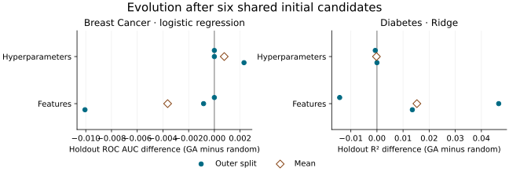
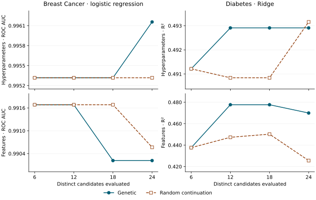
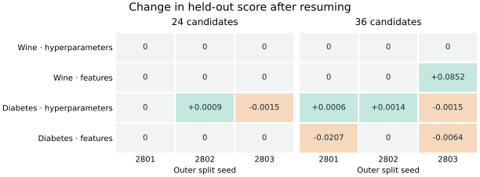

<script setup>
import holdoutResultsUrl from '../../../../benchmarks/results/performance-v2/holdout-by-budget.json?url'
import kernelResultsUrl from '../../../../benchmarks/results/performance-v2/default-kernel-coverage.json?url'
import resumeResultsUrl from '../../../../benchmarks/results/performance-v2/resume-equal-cost.json?url'
</script>

:::warning Development version
This is the **latest (dev)** documentation. It may contain unreleased features or breaking changes. For the stable release, use [the stable documentation](/stable/).
:::


# Genetic search benchmarks for scikit-learn

How quickly does genetic search find a useful model? The Bayesmark comparisons below report the best inner cross-validation score reached under a candidate budget. A separate paired experiment measures how well the selected hyperparameters and feature masks perform on held-out data.

## Does evolution improve on the initial population?

Each search started with the same six scored candidates. One continuation used the default evolutionary operators for two generations. The other sampled unseen candidates at random. Each pair evaluated 29 or 30 distinct candidates per method using identical three-fold splits. For feature selection, the random control sampled a mask size uniformly from one through half the columns, then sampled columns uniformly.

| Task and metric | Search | Initial winner | Evolution | Random continuation |
| --- | --- | ---: | ---: | ---: |
| Breast Cancer / logistic regression, ROC AUC | Hyperparameters | 0.9953 | 0.9963 | 0.9955 |
| Breast Cancer / logistic regression, ROC AUC | Features | 0.9917 | 0.9903 | 0.9939 |
| Diabetes / Ridge, R² | Hyperparameters | 0.4914 | 0.4927 | 0.4929 |
| Diabetes / Ridge, R² | Features | 0.4376 | 0.4801 | 0.4648 |



Each value is the mean score on three 25% outer holdouts. Higher is better within each row. On Diabetes, evolution selected masks with higher mean holdout R² even though random continuation scored higher in inner CV. The three outer partitions overlap. This experiment covers two datasets and measures quality per evaluation. Its reproduction script and all twelve pairs are in `benchmarks/results/performance-v2/shared-initialization.json` in the repository.

### How much did another six candidates buy?

With three CV folds, six additional distinct candidates cost 18 more fold fits. On Diabetes, the genetic feature selector improved mean held-out R² from 0.4376 at six candidates to 0.4777 at twelve. Random continuation reached 0.4473 at the same budget. On Breast Cancer, increasing the genetic feature search from six to eighteen candidates lowered mean held-out ROC AUC from 0.9917 to 0.9902.



Each point averages the same three outer partitions. Each panel has its own vertical scale. At each budget, inner CV chose the winner before the holdout was scored. In 11 of the 12 genetic runs the winner stayed the same between budgets 12 and 18. Four of those runs later found a higher inner CV score. The holdout score ultimately rose in two of the eleven runs, fell in two and tied in seven. A single flat interval gave little guidance on when to stop.

<a :href="holdoutResultsUrl" download="holdout-by-budget.json">Download the per-split candidates, CV scores and holdout scores (JSON)</a>.

## Should a small initial population try a different kernel in every slot?

In this SVM experiment, forcing a third distinct kernel changed mean held-out balanced accuracy by at most 0.18 percentage points per dataset. A repeated kernel can still be worth evaluating when another hyperparameter changes.

Each `GASearchCV` run started with three candidates, including the estimator default (`rbf`, `C=1`). The search sampled from four equally weighted kernels and a log-uniform range for `C`. In 24 of 64 runs, another candidate used `rbf` at a different `C`. For each such run, we replaced that kernel with each unused kernel in turn, keeping its `C` and the other two candidates fixed. Each alternative had the same nine fold fits. Three-fold CV selected its winner before we scored it on the outer holdout.

Choosing an unused kernel uniformly improved the expected holdout score in eight of those 24 runs, reduced it in two and tied in fourteen. The expectation averages the two possible replacements. The study used Iris, Wine, Breast Cancer and a 450-observation Digits subset, with two outer splits and eight search seeds per dataset. It covers the initial population only.

To check coverage in your own run, inspect `cv_results_["params"]`: two entries with the same kernel and different `C` values represent distinct model fits. See the [categorical sampling rules](../api/space#categorical) or <a :href="kernelResultsUrl" download="default-kernel-coverage.json">download all candidates, splits and scores (JSON)</a>.

## Does resuming a checkpoint change search quality at the same budget?

At 24 distinct candidates, resumed and uninterrupted searches tied on held-out score in 10 of 12 comparisons. At 36 candidates, feature selection on Wine improved on one split and tied on two. On Diabetes it scored lower on two splits and tied on one.



Each cell subtracts the uninterrupted winner's score from the resumed winner's score on the same 25% outer holdout. Positive values favor resuming. Wine used a decision tree and balanced accuracy. Diabetes used Ridge and R². The three outer splits within each dataset overlap.

Both methods started with the same 17 or 18 candidates and their CV scores. At budgets of 24 and 36, each method used 72 and 108 inner fold fits respectively to rank the candidates in its prefix. Only then was the winner refitted and scored on the holdout. These budgets compare solution quality per evaluation. They do not measure elapsed time.

<a :href="resumeResultsUrl" download="resume-equal-cost.json">Download per-split winners, scores and the reproduction script (JSON)</a>. To resume your own search, see [Resume from a checkpoint](../recipes/advanced/checkpointing).

## Why Bayesmark?

Frameworks like Optuna do not benchmark on ad-hoc problems. The Optuna team uses tools such as [kurobako](https://github.com/optuna/kurobako) and benchmark suites such as [Bayesmark](https://github.com/uber/bayesmark) (originally from the NeurIPS 2020 Black-Box Optimization Challenge). Bayesmark's recipe is deliberately simple and framework-agnostic:

- A handful of small, standard scikit-learn datasets.
- A handful of standard scikit-learn estimators, each with a **fixed search space**.
- Every optimizer receives a candidate budget. The harness records actual evaluation counts.
- Each task is repeated over several seeds, and the **best cross-validation score** is reported.

Because the datasets and search spaces are fixed and public, any optimizer — Optuna, random search, or a genetic algorithm — can be dropped into the same harness and compared fairly. That is exactly what the benchmark script in this repository does.

::: info Faithful reproduction
The per-model search spaces below are copied verbatim from Bayesmark's `API_CONFIG`. The only adaptation: Bayesmark searches some bounded parameters in *logit* space, a warp that none of the three optimizers expose directly, so those parameters are searched on their natural bounded range for every optimizer. This keeps the comparison even.
:::

## What We Compare

| Optimizer | Library | Strategy |
|-----------|---------|----------|
| `GASearchCV` | sklearn-genetic-opt | Evolutionary search (DEAP) with smart initialization |
| Optuna | optuna | Bayesian optimization with the TPE sampler |
| `RandomizedSearchCV` | scikit-learn | Random sampling — the standard strong baseline |

### Datasets

From Bayesmark's `DATA_LOADERS` (we drop `boston`, which modern scikit-learn removed):

| Dataset | Task | Loader |
|---------|------|--------|
| iris | classification | `load_iris` |
| wine | classification | `load_wine` |
| breast | classification | `load_breast_cancer` |
| digits | classification | `load_digits` |
| diabetes | regression | `load_diabetes` |

Classification is scored by **accuracy**; regression by **mean squared error** (optimized as `neg_mean_squared_error`).

### Models and Search Spaces

Copied from Bayesmark's `API_CONFIG`. `log` parameters use a log-uniform distribution; `linear`/`logit` parameters use a uniform distribution on the listed range.

| Model | Parameter | Type | Scale | Range |
|-------|-----------|------|-------|-------|
| **knn** | `n_neighbors` | int | linear | 1 – 25 |
| | `p` | int | linear | 1 – 4 |
| **svm** | `C` | real | log | 1.0 – 1e3 |
| | `gamma` | real | log | 1e-4 – 1e-3 |
| | `tol` | real | log | 1e-5 – 1e-1 |
| **dt** | `max_depth` | int | linear | 1 – 15 |
| | `min_samples_split` | real | logit | 0.01 – 0.99 |
| | `min_samples_leaf` | real | logit | 0.01 – 0.49 |
| | `min_weight_fraction_leaf` | real | logit | 0.01 – 0.49 |
| | `max_features` | real | logit | 0.01 – 0.99 |
| | `min_impurity_decrease` | real | linear | 0.0 – 0.5 |
| **rf** | *(same six as dt)* | | | |
| **ada** | `n_estimators` | int | linear | 10 – 100 |
| | `learning_rate` | real | log | 1e-4 – 1e1 |
| **lasso** / **linear** | `C` (clf) / `alpha` (reg) | real | log | 1e-2 – 1e2 |
| | `intercept_scaling` (clf) | real | log | 1e-2 – 1e2 |

Scaled models (`knn`, `svm`, `mlp`, `lasso`, `linear`) are wrapped in a `StandardScaler` pipeline.

## Equal Budget, Fair Comparison

The current Bayesmark runner gives each method the same ceiling. Randomized search requests one candidate per iteration, and Optuna requests one candidate per trial. The GA starts with up to eight candidates and proposes up to two offspring per population member per generation. It takes only whole generations within the budget, disables local refinement and caches repeated configurations.

For example, with `--budget 48`, a population of eight fits two full generations, for at most **40** candidate evaluations (8 + 16 + 16). With three folds, 40 evaluations require 120 fold fits. Randomized search can use all 48 evaluations, or 144 fold fits. Inspect `mean_evaluations`, `mean_seconds` and the number of successful seeds (`n_seeds`) in the Bayesmark JSON report.

The separate `benchmarks/benchmark_fit.py` harness also supports finalist validation. Its `actual_cross_validate_calls_mean` counts candidate evaluations across search and finalist validation. Its `cv_fold_fits_mean` counts the underlying fold fits. Wall time includes the final full-data refit. A candidate evaluated on one fold and promoted to three folds therefore contributes four fold fits in this workflow.

## Running It Yourself

From a repository checkout, install the benchmark extra to include Optuna in the comparison:

```bash
python -m pip install -e ".[benchmark]"
```

Then run the script from the repository root:

```bash
# Fast smoke run (a few datasets/models, small budget)
python benchmarks/benchmark_bayesmark.py --quick

# Full reproducible run with a JSON report
python benchmarks/benchmark_bayesmark.py \
    --datasets iris wine breast diabetes \
    --models knn svm dt rf ada \
    --optimizers gasearch optuna randomized \
    --budget 64 --seeds 3 \
    --output-json benchmarks/bayesmark.json

# Pick a single task to inspect closely
python benchmarks/benchmark_bayesmark.py --datasets wine --models svm --budget 80
```

If Optuna is not installed, the script prints a note and simply runs the remaining optimizers.

## Results

The table below reports the mean ± standard deviation of the best cross-validation
score across seeds. For classification the metric is accuracy (**higher is
better**); for regression it is MSE (**lower is better**). The **winner** column
marks the optimizer with the best mean on the optimized objective.

<!-- BENCHMARK_RESULTS_START -->
These historical results used a nominal budget of 48, three seeds and three-fold CV. The current runner uses the whole-generation cap described above. Use its JSON report for the realized counts of a new run.

| dataset | model | metric | gasearch | optuna | randomized | winner |
| --- | --- | --- | --- | --- | --- | --- |
| wine | knn | accuracy ↑ | **0.9832 ± 0.0046** | 0.9832 ± 0.0046 | 0.9813 ± 0.0027 | gasearch |
| wine | svm | accuracy ↑ | **0.9869 ± 0.0053** | 0.9851 ± 0.0026 | 0.9850 ± 0.0027 | gasearch |
| wine | dt | accuracy ↑ | 0.8520 ± 0.0117 | **0.8651 ± 0.0091** | 0.8463 ± 0.0312 | optuna |
| wine | rf | accuracy ↑ | 0.9645 ± 0.0095 | **0.9719 ± 0.0000** | 0.9532 ± 0.0096 | optuna |
| breast | knn | accuracy ↑ | 0.9684 ± 0.0014 | **0.9695 ± 0.0008** | 0.9678 ± 0.0008 | optuna |
| breast | svm | accuracy ↑ | **0.9789 ± 0.0000** | 0.9783 ± 0.0008 | 0.9783 ± 0.0008 | gasearch |
| breast | dt | accuracy ↑ | 0.9133 ± 0.0030 | **0.9151 ± 0.0017** | 0.9133 ± 0.0030 | optuna |
| breast | rf | accuracy ↑ | 0.9256 ± 0.0054 | **0.9285 ± 0.0072** | 0.9215 ± 0.0060 | optuna |
| diabetes | knn | MSE ↓ | **3223.40 ± 114.3** | 3229.59 ± 107.3 | 3223.47 ± 114.4 | gasearch |
| diabetes | svm | MSE ↓ | 3035.66 ± 28.6 | **3034.17 ± 30.1** | 3053.55 ± 33.9 | optuna |
| diabetes | dt | MSE ↓ | 3994.28 ± 183.6 | **3837.88 ± 106.5** | 3852.95 ± 159.9 | optuna |
| diabetes | rf | MSE ↓ | 3553.56 ± 219.1 | **3320.70 ± 52.5** | 3498.15 ± 188.9 | optuna |

`↑` higher is better, `↓` lower is better. **Bold** marks the best mean per row.

Across these twelve rows, the GA had higher mean inner CV scores than randomized search on ten tasks. Optuna had the best mean on each tree and forest task. Small score differences on the folds used for tuning warrant a separate holdout check.

<!-- BENCHMARK_RESULTS_END -->

### Does more budget close the gap?

These historical runs compare nominal budgets of 48 and 96 on four tasks.

| task | metric | gasearch 48 → 96 | optuna 48 → 96 | verdict change |
| --- | --- | --- | --- | --- |
| wine / dt | accuracy ↑ | 0.8520 → **0.8690** | 0.8651 → 0.8670 | optuna → **gasearch** wins |
| diabetes / rf | MSE ↓ | 3553.6 → 3295.8 | 3320.7 → 3259.6 | gap **233 → 36** |
| breast / rf | accuracy ↑ | 0.9256 → 0.9303 | 0.9285 → 0.9391 | still optuna |
| wine / rf | accuracy ↑ | 0.9645 → 0.9664 | 0.9719 → 0.9776 | still optuna |

The larger budget reversed the ordering on Wine/tree and narrowed the gap on Diabetes/forest. Optuna retained the higher mean accuracy on both random-forest classification tasks.

## Mixed and Conditional Spaces

Bayesmark's spaces are almost entirely numeric — the home turf of Bayesian
optimizers. Real hyperparameter tuning is often **mixed and conditional**:
categorical switches that turn whole regions of the space on or off. The
`--suite mixed` benchmark builds exactly that kind of space, where
sklearn-genetic-opt's native categorical handling and population-based crossover
have more to work with.

```bash
python benchmarks/benchmark_bayesmark.py --suite mixed --budget 96 --seeds 3
```

Two estimators, both with categorical and conditionally-relevant parameters:

| Model | Categorical / conditional parameters |
|-------|--------------------------------------|
| `svc_mixed` (SVC) | `kernel ∈ {linear, rbf, poly, sigmoid}` (makes `degree`/`coef0`/`gamma` relevant only for some kernels), `class_weight`, `shrinking` |
| `histgb_mixed` (HistGradientBoosting) | `max_depth ∈ {None, 3, 5, 7, 9}` (unbounded vs capped), `interaction_cst ∈ {None, "no_interactions"}`, plus numeric leaf/learning-rate parameters |

<!-- MIXED_RESULTS_START -->
Run with **budget = 64, 3 seeds, 3-fold CV** (`diabetes/svc_mixed` is skipped — SVC is a classifier here):

| dataset | model | metric | gasearch | optuna | randomized | winner |
| --- | --- | --- | --- | --- | --- | --- |
| wine | svc_mixed | accuracy ↑ | 0.9851 ± 0.0026 | **0.9868 ± 0.0053** | 0.9868 ± 0.0053 | optuna |
| wine | histgb_mixed | accuracy ↑ | 0.9831 ± 0.0080 | **0.9832 ± 0.0046** | 0.9794 ± 0.0054 | optuna |
| breast | svc_mixed | accuracy ↑ | **0.9801 ± 0.0022** | **0.9801 ± 0.0017** | 0.9783 ± 0.0008 | tie |
| breast | histgb_mixed | accuracy ↑ | 0.9713 ± 0.0054 | **0.9719 ± 0.0014** | 0.9707 ± 0.0051 | optuna |
| diabetes | histgb_mixed | MSE ↓ | 3248.9 ± 10.6 | **3212.7 ± 13.1** | 3231.2 ± 18.6 | optuna |

Optuna matched or exceeded the GA mean in all five rows. The CASH experiment below tests a different decision: choosing the estimator family together with its hyperparameters.

<!-- MIXED_RESULTS_END -->

## CASH: Algorithm Selection + Tuning

In a **CASH** (Combined Algorithm Selection and Hyperparameter optimization) problem the optimizer must
choose **which estimator family** to use *and* tune that family's
hyperparameters at the same time. The space is deeply conditional: `svm_gamma`
only matters when the SVM is selected, `rf_max_depth` only for the random
forest, and so on.

The benchmark (`benchmarks/benchmark_cash.py`) searches across **five families**
— RBF SVM, random forest, histogram gradient boosting, logistic regression, and
k-NN — a 15-dimensional conditional space:

```bash
python benchmarks/benchmark_cash.py --dataset synth --budget 100 --seeds 3
```

It is deliberately a **fair fight**:

- **Optuna** uses its native, define-by-run conditional API — it suggests the
  family first, then only that family's parameters. Conditional spaces are a
  headline Optuna strength, so it is not handicapped.
- **`GASearchCV`** and **`RandomizedSearchCV`** get the same problem through a
  flat `CASHClassifier` meta-estimator that exposes every family's parameters and
  routes to the selected one at `fit`. Both carry the flat-encoding tax of
  inactive genes.

The dataset has **real headroom** — a 1500×25 `make_classification` with a
non-linear, multi-cluster boundary that tops out around 0.86 (it does *not*
saturate near 1.0), so the estimator family genuinely matters and there is room
to separate.

<!-- CASH_RESULTS_START -->
The historical run below used 184 realized candidate evaluations per optimizer, three seeds and three-fold CV. The current CASH runner disables local refinement and gives each baseline the number of CV evaluations actually used by the GA on that seed.

| optimizer | mean accuracy ± std | best | mean evals | mean wall time |
| --- | --- | --- | --- | --- |
| **optuna** | **0.8636 ± 0.0050** | 0.8707 | 184 | 59 s |
| randomized | 0.8591 ± 0.0055 | 0.8667 | 184 | 27 s |
| gasearch | 0.8582 ± 0.0087 | 0.8693 | 184 | 205 s |

In this run, Optuna had the highest mean CV accuracy and randomized search had the shortest mean runtime. One difference between methods is how they encode the family choice. Optuna proposes parameters for the active family. The flat GA encoding also carries parameters for inactive families. The benchmark compares the complete methods and does not isolate the effect of that encoding.

<!-- CASH_RESULTS_END -->

## How to Interpret a Benchmark

- For compute efficiency, compare realized fold fits and elapsed time on the same hardware. Different candidates can have very different training costs.
- For solution quality, choose candidates using inner CV and evaluate winners on untouched outer data. Report the metric and the per-split differences.
- To evaluate a new search policy, reserve whole datasets before choosing defaults. Additional seeds on familiar tasks measure split variability while leaving the choice of tasks fixed.

## See Also

- [Comparing Search Methods](../examples/sklearn-comparison) — a single-task, copy-pasteable comparison with full code.
- [Advanced Optimizer Control](../guide/advanced-optimizer-control) — diversity control, local search and fitness sharing.
- [When to Use](../guide/when-to-use) — picking the right search method for your problem.
- [Bayesmark](https://github.com/uber/bayesmark) and [kurobako](https://github.com/optuna/kurobako) — the upstream benchmark tooling.
